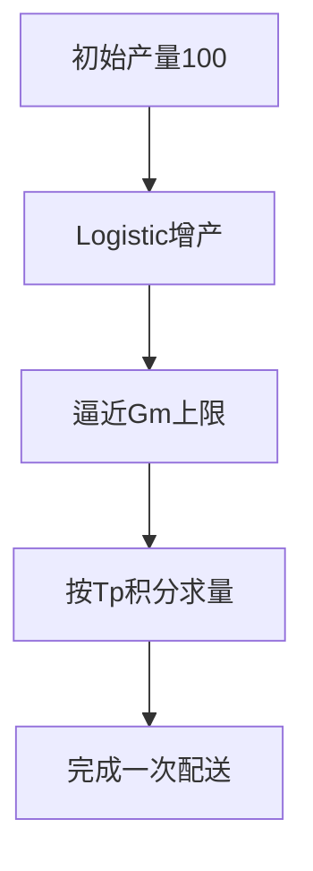

# 基于 Logistic 增长的药物生产模型

> [!IMPORTANT]
> 基于 Logistic 增长的药物生产模型，是用 ==Logistic 微分方程==描述药物（或疫苗）产量随时间变化的规律：初期产量小、中期急剧增加、后期趋于最大产能并保持稳定。

## 为什么需要它

在埃博拉等疫情的 SEIIR 干预模型中，药物和疫苗的供应不是瞬间无限的。如果假设每天都能拿出无穷多药，模型就脱离现实了。

想一想：工厂刚投产时产能多大？随着工人熟练、原料到位，产能如何变化？当设备满负荷运转后，还能无限增长吗？

显然不能。药物生产速率的导数会“先增加后减少至零”，这恰好是 Logistic 曲线的特征。因此课件用该模型刻画日产量 $G(t)$ 与疫苗日产量 $F(t)$ 的变化。

## 怎么做：建模与配送

**1. 建立生产方程**

$$
\frac{dG}{dt} = r t \left(1 - \frac{G}{G_m}\right), \quad G(t_0) = 100
$$

- $\frac{dG}{dt}$：药物日产量（生产速度）。
- $r$：生产速度的增长率。
- $G_m$：最大生产速度（产能上限）。

疫苗 $F$ 同理：$\frac{dF}{dt} = r_1 t (1 - \frac{F}{F_m})$。

**2. 计算单次配送量**

设配送周期为 $T_p$（如 $T_p=14$ 天），一个周期内只配送一次。由于运输需时间且药物每天都在产出，第 $n$ 次配送的药物总量为：

$$
P_{t_n} = \int_{t_n}^{t_n + T_p} G \, dt
$$

**3. 接入 SEIIR 传染病模型**

将产出的药物用于治疗患者，疫苗用于易感者 $S$：

$$
\frac{dS}{dt} = -\frac{\beta S I_{free}}{N} - F(t)
$$

$$
\frac{dR}{dt} = (1-f_1)\gamma I_{free} + (1-f_2)\gamma I_{isolated} + M(t) + F(t)
$$

## 与相近概念的区别

| 对比维度 | 指数增长模型 | Logistic 增长模型 |
| :--- | :--- | :--- |
| **产能上限** | 无上限，无限增长 | 有上限 $G_m$ |
| **增速变化** | 越来越快 | 先快后慢，最终趋于零 |
| **适用场景** | 资源无限时的理想假设 | 受限于设备、原料的现实生产 |

> [!NOTE]
> 课件中的搜救概率更新也用到了贝叶斯方法，但那是处理“未找到目标时降低后验概率”的空间搜索问题；而 Logistic 生产模型处理的是“时间维度上产能受限”的增长问题，两者应用场景完全不同。

## 常见的坑

> [!WARNING]
> 注意本题课件给出的方程含 $rt$ 项，即 $\frac{dG}{dt} = rt(1-\frac{G}{G_m})$，而非标准生物种群模型中的 $rG(1-\frac{G}{G_m})$。考试时必须严格按题目给定的公式列写，切勿凭肌肉记忆写错。

> [!CAUTION]
> 敏感性分析表明：若 $G_m < 4000$，药物产量根本无法满足控制疫情的需求。做优化题时，不仅要解出方程，还要结合实际意义判断参数取值是否合理。

## 算对了的例子：敏感性分析

以真题节选为例，研究增长率 $r$ 对疫情控制的影响（固定其他条件）：

| $r$ | 控制所需天数 | 死亡病例 |
| :--- | :--- | :--- |
| 50 | 250 | 629128 |
| 100 (基准) | 162 (-35.3%) | 124870 (-80.1%) |
| 200 (+100%) | 102 (-59.2%) | 272934 |

> [!TIP]
> 结论提炼：$r$ 越大，局势越早得到控制；$G_m$ 越大，死亡人数越少。优化物流配送的核心策略就是 ==最大化日产量上限并提高增长速度==。
