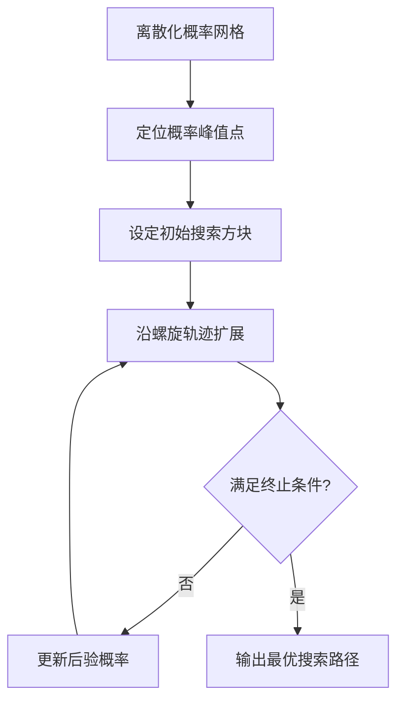

# 螺旋方形搜索模型（Spiral Square Search Model）

## 螺旋方形搜索模型是什么

在概率搜索理论中，当我们面对一个具有先验概率分布的离散网格时，如何规划搜索路径才能最大化发现目标的累积概率？简单的平行线扫描（Parallel Sweep）虽然易于计算，但在概率密度呈中心聚集或各向异性时，往往无法灵活适配高价值区域。

螺旋方形搜索模型（Spiral Square Search Model）正是为解决这一局限而生。它是一种==以高概率网格为中心、向外逐层扩展的正方形螺旋路径规划方法==。与固定形状的矩形搜索不同，它根据贝叶斯后验概率动态调整搜索边界，确保搜索资源优先覆盖“最可能”的区域，同时保持路径的连续性与飞行器的机动可行性。

## 为什么需要螺旋而非简单矩形

如果目标概率分布呈现明显的峰值，简单矩形搜索会遇到什么瓶颈？

-   **形状僵化**：矩形长宽比固定，难以贴合不规则的高概率等值线。
-   **边缘浪费**：为覆盖中心高峰，矩形不得不包含大量低概率的边缘区域。
-   **缺乏自适应性**：无法随贝叶斯更新实时改变搜索重心。

相比之下，螺旋方形模型通过“由内向外”的生长机制，天然契合概率密度的衰减趋势。它在保证覆盖率的同时，显著提升了单位航程内的==期望发现概率==。

## 模型构建与算法流程

如何将抽象的概率分布转化为具体的螺旋路径？核心步骤如下：

1.  **确定起点**：选取当前后验概率最大的网格单元作为螺旋中心。
2.  **定义步长**：设传感器有效扫宽为 $W$，则每一圈螺旋的边长增量为 $W$ 的整数倍，确保无缝覆盖。
3.  **路径生成**：按照“右→上→左→下”的顺序逐层外扩，每完成一圈即计算该圈覆盖区域的累积概率增益。
4.  **动态截断**：当新增一圈带来的边际概率收益低于阈值，或总航程耗尽时，停止扩展。

> [!IMPORTANT]
> 螺旋路径必须严格对齐网格边界，且转弯半径需大于飞行器最小转弯约束，否则理论模型将无法落地执行。

## 与相近搜索模式的对比

| 特性 | 简单方形搜索 | 优化矩形搜索 | 螺旋方形搜索 |
| :--- | :--- | :--- | :--- |
| 形状灵活性 | 低（固定正方形） | 中（可调长宽比） | ==高（自适应生长）== |
| 概率适配性 | 差 | 一般 | 优 |
| 计算复杂度 | 低 | 中 | 较高 |
| 适用场景 | 均匀分布 | 椭圆状分布 | 单峰/多峰聚集分布 |

## 常见误区与注意事项

> [!WARNING]
> 切勿将螺旋方形等同于几何上的阿基米德螺线！本模型中的“螺旋”是==离散的、基于网格步长的方形回旋==，其边长增量由传感器扫宽 $W$ 决定，而非连续曲线。

> [!CAUTION]
> 在进行贝叶斯更新时，若未正确归一化后验概率，螺旋扩展方向可能偏离真实高密度区，导致搜索效率骤降。务必在每次更新后验证 $\sum p_{ij} = 1$。

## 算例验证：从论文到实践

参考2015年MCM特等奖论文，假设某海域搜索中，经贝叶斯更新后概率峰值位于网格 $(x_0, y_0)$，传感器扫宽 $W=5\text{km}$。

-   **第1圈**：以 $(x_0, y_0)$ 为中心，构建 $1\times1$ 方格（边长 $W$），覆盖面积 $25\text{km}^2$。
-   **第2圈**：向外扩展至 $3\times3$ 方格（边长 $3W$），新增覆盖面积 $(9-1)W^2 = 200\text{km}^2$。
-   **第3圈**：扩展至 $5\times5$ 方格，新增面积 $(25-9)W^2 = 400\text{km}^2$。

若第2圈新增区域的平均后验概率密度为 $0.002/\text{km}^2$，则该圈带来的期望发现概率增量为 $200 \times 0.002 = 0.4$。若此值仍高于预设阈值 $0.05$，则继续向外扩展；否则，当前 $3\times3$ 区域即为该时段的最优螺旋搜索范围。这种==基于边际收益的动态截断==，正是螺旋方形模型优于固定模式的关键所在。
