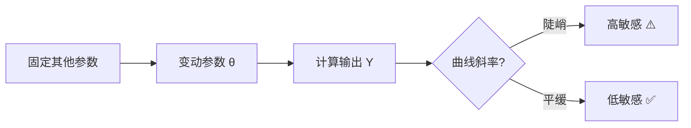

# 敏感性分析方法（Sensitivity Analysis，单参数与多参数变动）

## 敏感性分析：模型稳健性的试金石

在数学建模中，参数往往来自统计估计或经验假设，存在不确定性。**敏感性分析**旨在探究输入参数的微小变化对模型输出结果的影响程度。其核心目的是回答：**哪些参数是“关键少数”？模型的结论是否 robust（稳健）？**

> [!IMPORTANT]
> ==核心目标==：识别对结果影响最大的参数，验证模型在非理想数据下的可靠性。

## 单参数与多参数变动方法

### 1. 单参数敏感性分析 (One-at-a-Time, OAT)
保持其他参数不变，仅改变一个目标参数 $\theta$，观察输出 $Y$ 的变化。
- **做法**：选取基准值 $\theta_0$，在区间 $[\theta_0 - \Delta, \theta_0 + \Delta]$ 内取值，绘制 $Y-\theta$ 曲线。
- **判据**：若曲线斜率大（陡峭），则该参数为**高敏感参数**；若曲线平缓，则为**低敏感参数**。

### 2. 多参数敏感性分析
同时变动多个参数，考察交互效应。常用方法包括添加噪声或蒙特卡洛模拟。
- **做法**：如 MCM 2015 埃博拉论文中，向病死率 $\delta_H$ 添加 **50%~100% 的高斯噪声**，观察累计病例数 `CUM` 的波动范围。
- **意义**：模拟真实世界中多重不确定因素叠加的情景。

## 实例解析：埃博拉模型中的参数筛选

以 2015 年 MCM 特等奖论文为例，分析不同参数对根除埃博拉的影响：

| 参数 | 物理意义 | 敏感性表现 | 结论 |
| :--- | :--- | :--- | :--- |
| $\beta_i$ | 传播率 | 微小偏差导致结果落入“灰色区域” | ==高敏感==，需精确估算 (0.30-0.32) |
| $\tau$ | 防控引入时间 | $\tau$ 减小显著降低 `CUM` 并提前根除 | ==高敏感==，早期干预至关重要 |
| $1/\sigma$ | 潜伏期倒数 | 在 5~15 间大幅波动，趋势基本相似 | ==低敏感==，拟合时可设为常数 |

> [!TIP]
> **解题技巧**：若参数变化导致结果跨越“合理/不合理”边界（如红色区域 vs 灰色区域），则该参数极度敏感。

## 常见误区与注意事项

> [!WARNING]
> **切勿混淆**：敏感性分析 $\neq$ 误差分析。前者关注参数变动对趋势的影响，后者关注数值计算的精度。

1. **线性假设陷阱**：不要默认输入输出呈线性关系。如药物疗效 $\eta$ 与治愈率 $\gamma_H$ 的关系为 $\gamma_H = \rho_\eta \ln(\eta+1)$，是非线性的，需通过绘图直观展示。
2. **范围选择**：变动范围应具有物理意义。例如潜伏期参数 $\sigma$ 的测试范围应基于医学常识，而非任意数学区间。
3. **临界点识别**：关注二阶导数为零的点（如 $CUM''=0$），这往往是疫情从失控转向受控的**临界条件**。

通过敏感性分析，我们不仅能优化模型参数，更能向决策者指出：**“控制 $\tau$ 比优化 $\sigma$ 更紧迫”**，从而提升模型的实际应用价值。
