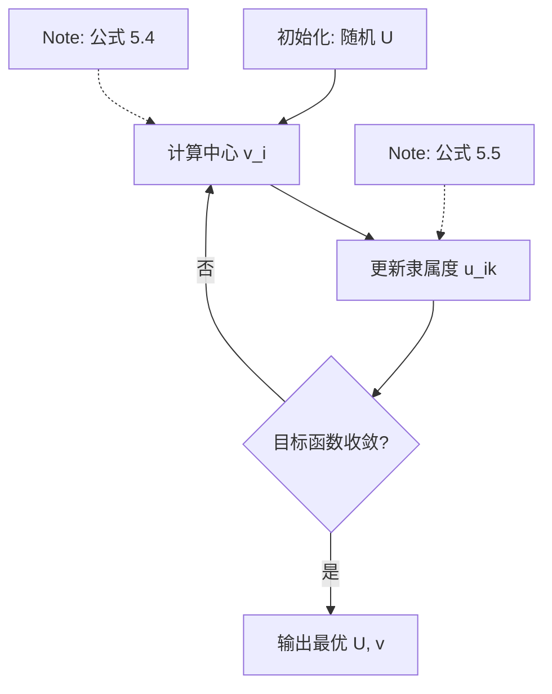

# 模糊 C-均值聚类算法（目标函数、约束条件与迭代步骤）

# 模糊 C-均值聚类算法（FCM）

## 它是什么与为什么需要

在物流配送选址中，若强行将某城市划归唯一仓库（硬聚类），忽略了地理邻近性与需求权重的过渡性。**模糊 C-均值（FCM）**允许样本以不同隶属度属于多个类。

> [!IMPORTANT]
> ==核心思想==：每个样本对各类的隶属度 $u_{ik} \in [0,1]$，且 $\sum_{i=1}^c u_{ik}=1$。隶属度越接近 1，相似性越高。

相比 K-Means，FCM 能处理“边界城市”同时受多个配送点辐射的情况，更符合药物配送中“多源补给”或“梯度辐射”的实际场景。

## 模型构建：目标与约束

南邮课件中引入了**加权距离**，考虑各城市药品需求量 $D_k$。

$$
\min J_m(U, v) = \sum_{k=1}^{N} \sum_{i=1}^{c} D_k (u_{ik})^m \| y_k - v_i \|^2
$$

**约束条件**：
1. 隶属度和为 1：$\sum_{i=1}^c u_{ik} = 1$。
2. 聚类数限制：$2 \leq c < N$。
3. 加权指数：$m > 1$（通常取 2），控制模糊程度。

> [!NOTE]
> $D_k$ 为权重项。需求大的城市对聚类中心位置影响更大，确保中心靠近高需求区。

## 迭代求解步骤

FCM 无解析解，需通过交替优化迭代求解。流程如下：

**关键迭代公式**：

1. **更新聚类中心** $v_i$（加权质心）：
   $$
   v_i = \frac{\sum_{k=1}^{N} D_k (u_{ik})^m y_k}{\sum_{k=1}^{N} D_k (u_{ik})^m}
   $$
2. **更新隶属度** $u_{ik}$：
   $$
   u_{ik} = \left( \sum_{j=1}^{c} \left( \frac{\|y_k - v_i\|}{\|y_k - v_j\|} \right)^{\frac{2}{m-1}} \right)^{-1}
   $$

> [!TIP]
> 记忆技巧：先算中心（加权平均），再算隶属（距离反比）。距离越近，隶属度越大。

## 常见坑与辨析

| 特性 | K-Means (硬聚类) | FCM (软聚类) |
| :--- | :--- | :--- |
| **隶属关系** | 非 0 即 1 | $[0,1]$ 连续值 |
| **目标函数** | 误差平方和 | 加权模糊误差 |
| **适用场景** | 类别界限清晰 | 类别重叠、需权重 |

> [!WARNING]
> **常见错误**：
> 1. 忽略 $D_k$：在本题背景下，必须使用**加权** FCM，否则无法体现药物需求差异。
> 2. $m=1$：此时退化为硬聚类，且分母可能为零，务必保证 $m>1$。

## 实例演示：西非药物配送

**背景**：针对几内亚、塞拉利昂、利比里亚三国城市进行配送点选址。

1. **输入**：各城市坐标 $y_k$ 及药品需求 $D_k$。
2. **执行**：设定 $c=6$（经测试最优聚类数），$m=2$。运行上述迭代直至 $J_m$ 变化小于阈值。
3. **结果**：得到 6 个聚类中心 $v_i$ 作为**配送总部**。
4. **功能**：每个总部负责向其高隶属度的周边城市运输药物。

> [!IMPORTANT]
> ==结论==：最终选出 **6 个** 配送点。它们不仅存储药物，还依据隶属度矩阵 $U$ 确定的辐射范围，向周围城市进行分级配送。
