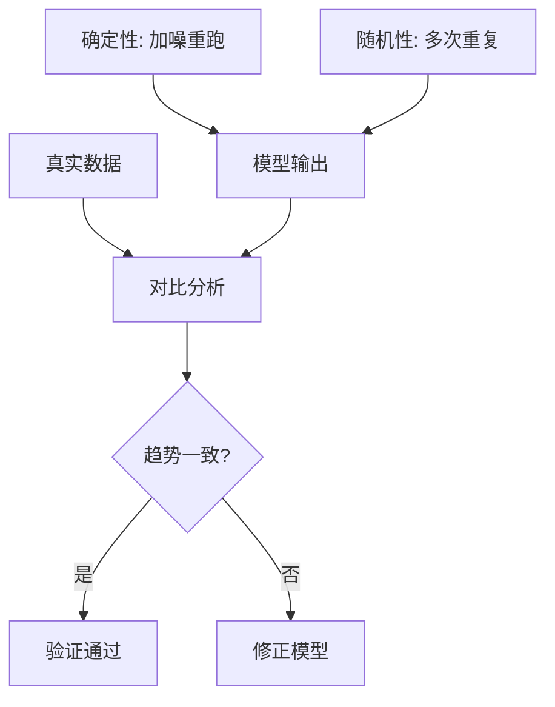

# 模型验证方法概述（随机模型与确定性模型验证）

## 模型验证方法概述

模型建好了，凭什么相信它？这是模型检验要回答的核心问题。验证的基本思路是：**把模型的输出和真实世界的数据放在一起比较，看差距有多大、规律是否一致**。根据模型是否包含随机因素，验证方法分为两大路线。

## 确定性模型：参数扰动看趋势

确定性模型不含随机项，同一组参数必得同一结果。验证它的常用手段是**参数扰动**——人为给关键参数加上噪声，观察输出曲线的变化幅度。

> [!IMPORTANT]
> 对确定性模型加噪声做验证，本质上是==把确定性模型"随机化"来测试其鲁棒性==。噪声幅度越大，输出偏离越小，说明模型对该参数越不敏感、越可靠。

以 2015 年 MCM 特等奖论文的埃博拉模型为例：团队为测试医院内病死率 $\delta_H$ 的敏感性，向 $\delta_H$ 添加**高斯噪声**，分别加入 50% 和 100% 两种强度，再重新运行仿真。若疫情曲线在噪声干扰下走势基本不变，则说明模型对 $\delta_H$ 的估计误差具有容忍度。

## 随机模型：多次重复看分布

随机模型（如基于个体 Agent 的仿真、蒙特卡洛模拟）每次运行结果都不同，单次输出没有代表性。验证思路是：

1. **多次独立重复**实验（如跑 $N=100$ 次）；
2. 统计输出的**均值、方差、置信区间**；
3. 将分布范围与真实数据对比，看实际观测值是否落在模型预测的合理区间内。

## 两类方法对比

| 维度 | 确定性模型验证 | 随机模型验证 |
|---|---|---|
| 核心手段 | 参数加噪（如高斯噪声） | 多次重复取统计量 |
| 比较对象 | 单条曲线 vs 实际数据 | 分布区间 vs 实际数据 |
| 关注指标 | 输出对参数的敏感程度 | 均值、方差、置信区间 |
| 典型场景 | SEIR 微分方程拟合疫情 | 基于个体的疫情传播仿真 |

> [!WARNING]
> 常见误区：对随机模型只跑一次就下结论，或对确定性模型只做单次拟合不做扰动测试。==验证的目的是检验模型的稳健性，而非追求与历史数据的"完美重合"==。埃博拉论文中团队也坦言，参数过多时不可能全部拟合，模型的价值在于**定性行为的可信度**，而非精确数值。

> [!TIP]
> 验证 + 敏感性分析通常捆绑进行：先验证模型能复现已知数据，再扰动参数看结论是否翻转，二者共同支撑模型的可信度。
