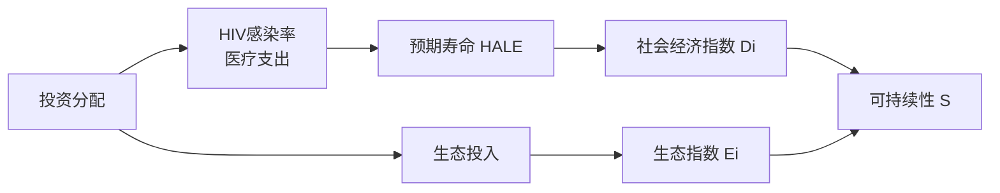

# 长期预测模型（如20年可持续发展计划预测）

## 长期预测模型：20 年可持续发展计划

长期预测与短期预测的本质区别在于：**短期看趋势外推，长期看结构演化**。预测 20 年后的赞比亚，不能简单把今年的 GDP 增长率连乘 20 次——政策干预、资源约束、人口结构都会改变系统本身的运行规则。因此长期预测的核心是：==先建立刻画系统内在动力学的机理模型，再让政策变量作为"输入"驱动系统演化==。

## 为什么需要机理模型

设想只拿赞比亚过去 10 年的 $D_i$ 数据做线性回归外推 20 年，会发生什么？艾滋病流行、医生短缺、基尼系数 0.6 这些结构性因素完全进不了模型，预测结果必然失真。

> [!IMPORTANT]
> 长期预测必须回答"如果采取某政策，系统会怎么变"，这要求模型包含**政策变量 → 中间指标 → 目标指数**的因果链，而非仅做数据拟合。

以赞比亚论文为例，其因果链为：

## 建模与求解流程

**第一步：构建个性化指标映射。** 论文用历史数据把 $D_i$、$E_i$ 表示为具体变量的函数。对指数/对数关系先做线性化，再最佳拟合，例如预期寿命与 HIV 感染率、医疗支出、教育水平的关系。

**第二步：设置政策情景。** 20 年计划被离散为两个 10 年阶段（受计算能力限制），每阶段确定投资总额与分配比例，并引入偏好参数 $\alpha$ 权衡经济与生态。

**第三步：优化求解。** 用粒子群优化（PSO）在投资分布的搜索空间中寻找最优解。设 128 个粒子，每个粒子代表一种投资分配方案，同时被"个体历史最优"和"群体全局最优"吸引，迭代收敛至最优分配。

**第四步：动态评估。** 将最优解代回模型，绘制 $D_i(t)$、$E_i(t)$、$S(t)$ 的 20 年轨迹，检验政策效果。

## 结果解读与政策含义

在 12 亿美元预算下，PSO 给出不同 $\alpha$ 对应的最优分配。模拟显示：

| 阶段 | $\alpha$ 取值 | $D_i$ 变化 | $E_i$ 变化 | 策略含义 |
|:---:|:---:|:---:|:---:|:---|
| 前 10 年 | 0.5 | 快速上升 | 下降 | 优先发展经济 |
| 后 10 年 | 1.5 | 趋于平稳 | 回升 | 转向生态治理 |

> [!TIP]
> 欠发达国家的可持续发展路径通常是"先发展、后治理"：前期接受 $E_i$ 适度下降换取 $D_i$ 快速提升，待 $S$ 进入高于初值的平台期后，再加大生态投入让 $E_i$ 恢复。

## 常见误区

> [!WARNING]
> 1. **把长期预测当外推**：忽略政策变量，只做时间序列延伸，无法回答"如果……会怎样"。
> 2. **一次性优化 20 年**：变量维度爆炸导致无法求解。赞比亚论文将 20 年拆为两个 10 年计划，是计算受限时的实用折中。
> 3. **只看终点不看路径**：20 年计划中 $D_i$ 与 $E_i$ 此消彼长，需检查整个时间轨迹是否出现不可接受的低谷（如 $E_i$ 崩溃）。

> [!CAUTION]
> 高亮结论：长期预测模型的可信度不取决于拟合优度 $R^2$，而取决于**因果链是否完整、政策变量是否显式进入模型、以及优化结果能否给出可执行的分阶段方案**。
