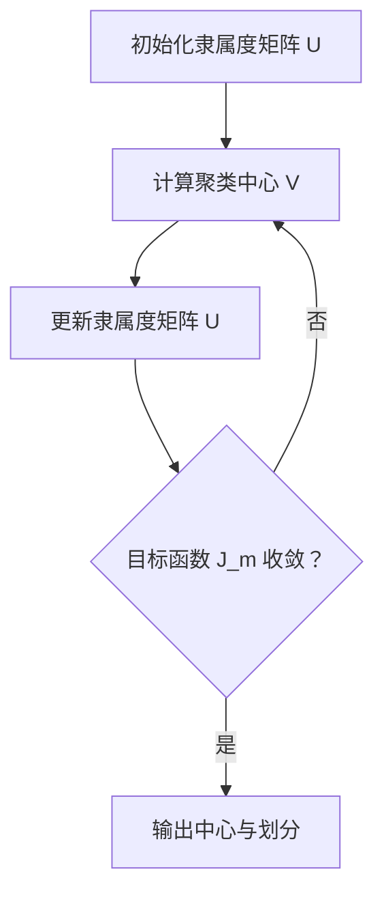

# 配送地点选址模型（公平原则与效率原则）
### 为什么选址不能只讲"效率"

在物流、应急物资配送（如埃博拉疫苗配送）中，选址要兼顾两个原则：

- **效率原则**：总运输距离/成本最小，即"就近供应"。
- **公平原则**：每个需求点的需求被"足够近"地满足，不能让边缘地区长期得不到服务。

如果只按效率原则，偏远小城市可能被"甩"给很远的中心；如果只按公平，又可能建太多中心、浪费资源。==选址模型的本质是在"效率"与"公平"之间做权衡==。

### 加权模糊 C-均值聚类（Weighted Fuzzy c-Means）

把每个城市看作样本 $y_k\in\mathbb R^n$（常用坐标 + 需求量），要把它划分到 $c$ 个"配送中心/总部"。与传统硬聚类不同，模糊 C-均值允许一个城市以隶属度 $u_{ik}\in[0,1]$ 同时"属于"多个中心，并满足

$$
\sum_{i=1}^{c} u_{ik}=1 \quad \text{for all } k.
$$

在目标函数中引入权重 $D_k$（如第 $k$ 个城市所需药量），得到加权模糊 C-均值的目标函数：

$$
J_m(U,V)=\sum_{i=1}^{c}\sum_{k=1}^{N} u_{ik}^{m} D_k \left\| y_k - v_i \right\|^2,
$$

其中 $v_i$ 为第 $i$ 个聚类中心（候选配送点），$m$ 为加权指数（常取 $m=2$）。

> [!IMPORTANT]
> ==$D_k$ 体现"公平"：需求越大的城市，对目标函数影响越大，算法越倾向于把它分到更近的中心。== 这就是"加权"的意义。

### 迭代求解流程

- 固定 $U$，更新中心：$v_i=\dfrac{\sum_k u_{ik}^m D_k y_k}{\sum_k u_{ik}^m D_k}$。
- 固定 $V$，更新隶属度：$u_{ik}=\dfrac{1}{\sum_{j=1}^{c}\left(\dfrac{\|y_k-v_i\|}{\|y_k-v_j\|}\right)^{\frac{2}{m-1}}}$。

### 聚类数 $c$ 怎么选

$J_m$ 随 $c$ 增大必然下降。观察曲线：当 $c$ 从 $1$ 增到某个临界值 $c^*$ 时 $J_m$ 急剧下降；再增加 $c$ 时下降趋缓，拐点（肘部）即为合适的 $c$。在埃博拉疫苗配送案例中，最终选择 $c=6$，即在几内亚、塞拉利昂、利比里亚设立 **6 个"总部"** 负责存储与分发。

### 与相近模型的区别

| 模型 | 划分方式 | 是否考虑需求量 | 适用场景 |
|---|---|---|---|
| 重心法 / P-中值 | 硬分配 | 可扩展 | 单中心/已知中心数 |
| K-means | 硬分配 | 否 | 一般聚类 |
| 模糊 C-均值 | 软分配（隶属度） | 否 | 边界模糊 |
| ==加权模糊 C-均值== | ==软分配== | ==是（$D_k$）== | ==应急物资配送选址== |

> [!WARNING]
> 常见坑：忘记约束 $\sum_i u_{ik}=1$；把 $D_k$ 当成"距离"而非"权重"；$m$ 取得过大导致隶属度趋于平均、失去区分度。

### 一个算对了的例子（埃博拉疫苗配送）

设某区域有 3 个城市，坐标与需求量如下，取 $c=2$，$m=2$：

| 城市 | 坐标 $y_k$ | 需求量 $D_k$ |
|---|---|---|
| A | $(0,0)$ | 10 |
| B | $(1,0)$ | 40 |
| C | $(0,2)$ | 50 |

初始隶属度取 $u_{ik}=1/2$，先更新中心：

$$
v_1=\frac{0.5\cdot10\cdot(0,0)+0.5\cdot40\cdot(1,0)+0.5\cdot50\cdot(0,2)}{0.5\cdot(10+40+50)}
=\frac{(40,100)}{100}=(0.4,1.0),
$$

同理 $v_2=(0.4,1.0)$（初始对称）。第二轮用距离更新 $u_{ik}$，例如城市 B 到两中心距离相等则 $u_{1B}=u_{2B}=0.5$；若某中心离 B 更近，则其隶属度上升。迭代若干次后，$v_1$ 会靠近 B，$v_2$ 靠近 C，A 按距离与需求被"公平"地分给较近的中心，同时整体目标函数 $J_m$ 下降。最终得到两个候选配送点及其服务范围，对应论文中的"6 个总部"划分思路。
