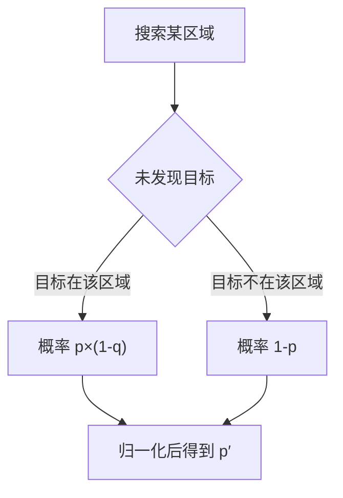

# POC（包含概率）更新算法确定搜索模式

## POC 更新算法如何确定搜索模式

在概率搜索理论中，初始概率分布只是起点。真正决定搜索资源如何分配的是==搜索后概率的更新方式==。POC（Probability of Containment，包含概率）更新算法的核心任务是：若某区域被搜索却未发现目标，该如何下调该区域的 POC，同时上调其他区域的 POC，并保证全区域概率总和仍为 $1$。

### 为什么要“更新”而不是“清零”

搜索过一片区域但没找到目标，并不意味着目标绝对不在那里——它可能因为遮挡、仪器灵敏度、搜索轨迹未覆盖等原因被遗漏。因此，被搜索区域的 POC 只能按比例调低，而不是直接置零。这就是引入探测概率 $q$ 的原因：

> $q$ = 在目标确实位于该区域的条件下，本次搜索能发现目标的概率。

于是，**目标在该区域且未被发现**的概率为 $p(1-q)$。目标不在该区域的概率为 $1-p$。利用贝叶斯公式，在“未发现目标”这一条件下，目标仍在该区域的后验概率为：

$$
p' = \frac{p(1-q)}{(1-p) + p(1-q)} \tag{9}
$$

这就是被搜索区域的 POC 更新公式。

### 如何同步上调未搜索区域

全区域所有 POC 之和必须始终为 $1$。被搜索区域概率下调后，其余区域必须整体按比例放大。设某未搜索区域先验 POC 为 $r$，后验为 $r'$，则：

$$
r' = \frac{r}{1 - pq} \tag{10}
$$

其中分母 $1-pq$ 是“未发现目标”这一事件的总概率。所有未搜索区域都除以这个小于 $1$ 的数，于是各区域 POC 等比例增加，总和仍为 $1$。

> [!IMPORTANT]
> 搜索后的 POC 更新遵循一个不变原则：==把所有区域的 POC 加起来，永远等于 1==。公式 (9) 只改被搜区域，公式 (10) 只改未搜区域，二者必须成对使用。

### 探测概率 $q$ 如何计算

为了实际计算 $q$，需要知道搜索能力的量化表达。记搜索宽度为 $W$（由传感器和能见度决定）、搜索路径总长为 $z$、区域面积为 $A$。在随机搜索假设下（目标在该区域均匀分布、航迹段均匀且独立、搜索不出区域边界），单个增量步长 $h$ 的探测概率为：

$$
g(h) = \frac{Wh}{A}
$$

沿路径累积，可得行驶长度 $z$ 后的总探测概率：

$$
b(z) = 1 - e^{-zW/A} \tag{14}
$$

这就是 $q$ 的实用表达式。搜索覆盖越密（$zW$ 越大），$q$ 越接近 $1$；区域越大，$q$ 越小。

### 搜索模式的选择逻辑

有了 POC 更新公式，搜索模式的选择就变成逐轮决策：在每一轮，找出**当前期望收益最大**的区域去搜，搜完更新 POC，再决定下一片区域。如果一个区域 POC 很高但 $q$ 也高，搜索后 $p'$ 大幅下降，说明信息增益大；如果一片区域 POC 很低，即使搜了变化也不大。最优策略倾向于优先搜索使整体 POC 分布“变化最大”的区域。

> [!WARNING]
> 常见错误是在多轮搜索中**沿用初始 POC 分布**分配搜索资源。正确做法是每轮搜索后都根据是否发现目标更新 POC，再重新决策。未发现目标本身也是信息。

### 一个算对了的例子

某区域初始 POC 为 $p=0.4$，本次搜索的探测概率 $q=0.5$，即目标在该区域但有 $50\%$ 概率漏掉。

先算被搜索区域的后验 POC：

$$
p' = \frac{0.4 \times (1-0.5)}{(1-0.4) + 0.4 \times (1-0.5)}
= \frac{0.2}{0.6 + 0.2} = 0.25
$$

该区域 POC 从 $0.4$ 降到 $0.25$，下降了 $15$ 个百分点——考虑到有一半概率漏掉，所以没有被清零。

假设另有一个未搜索区域，先验 $r=0.6$。总“未发现”概率为 $1 - pq = 1 - 0.4 \times 0.5 = 0.8$。于是：

$$
r' = \frac{0.6}{0.8} = 0.75
$$

更新后，两个区域 POC 之和 $p' + r' = 0.25 + 0.75 = 1$，归一化成立。

| 区域 | 先验 POC | 本轮搜索 | 后验 POC |
|------|----------|----------|----------|
| 被搜索区域 | $0.4$ | 未发现目标 | $0.25$ |
| 未搜索区域 | $0.6$ | 不搜 | $0.75$ |

这个例子说明：==未发现目标虽然令人失望，但它实时修正了概率分布，让下一次搜索更有可能对准目标真实所在区域==。POC 更新算法正是通过这种“逐轮修正—重新决策”的闭环，确定最优搜索模式。
