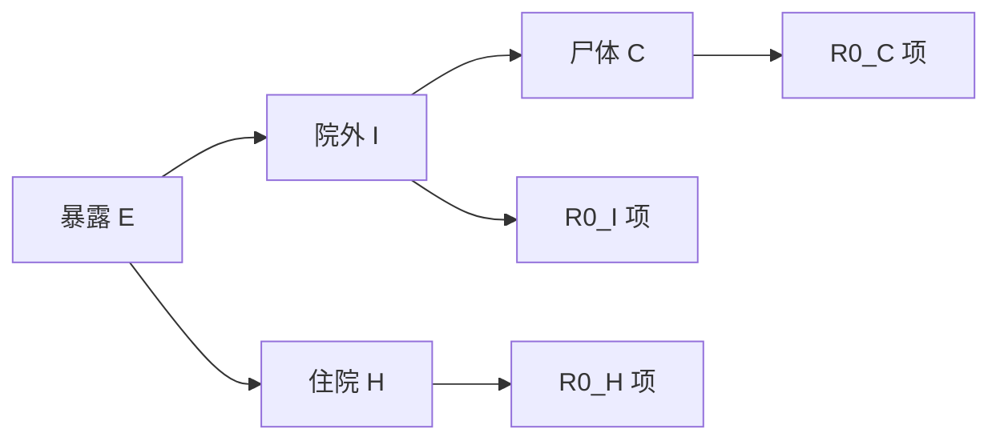

# 基本再生数 R0 的估计方法

## 它是什么

在完全易感、且没有控制干预的人群里，==一个典型感染者整个病程中引起的二代病例平均数，就是 $R_0$==。课件里写得更具体：埃博拉的 SEIHCR(CT) 模型把人分成易感 $S$、暴露 $E$、院外传染 $I$、住院 $H$、污染尸体 $C$、移除 $R$，还有接触者追踪相关量。$R_0$ 不是“随便一个 $\beta/\gamma$”，而是各传播途径贡献之和。

先问一句：如果感染者既能经院外 $\beta_I$、又能经医院 $\beta_H$、还能经尸体 $\beta_C$ 传人，总 $R_0$ 能只写一项吗？显然不能——因为它要走多条“生产二代病例”的路。

## 为什么需要

$R_0$ 用来判断疫情会不会扩散：$R_0>1$ 会流行，$R_0<1$ 会消退。做题时它把模型参数和实际数据连起来。课件里先用 $\beta_{I0}$ 等参数算病例数，再和报告数据比，验证 SEIR/SEIHCR 模型有效性。

## 怎么做：下一代矩阵法

van den Driessche 方法给出：

$$
R_0=\rho(FV^{-1})
$$

其中 $F$ 是新感染出现速率，$V$ 是转移出感染状态的速率，$\rho$ 是谱半径。对 SEIHCR(CT) 模型，化简后得到：

$$
R_0=\frac{\beta_I}{\alpha+(1-\delta_I)\gamma_I+\delta_I\nu_I}
+\frac{\beta_H}{(1-\delta_H)\gamma_H+\delta_H\nu_H}
+\frac{\beta_C}{\psi}
$$

- 第一项：院外传染个体贡献；
- 第二项：住院个体贡献；
- 第三项：未处理尸体经掩埋/处理速率 $1/\psi$ 贡献。

## 与相近概念的区别

| 概念 | 含义 | 课件记号 |
|---|---|---|
| 基础 $\beta/\gamma$ | 简单 SEIR 的 $R_0$ | 见式(4.1)前 |
| 多途径 $R_0$ | SEIHCR(CT) 三项相加 | 式(4.6) |
| 有效再生数 | 有干预后 $\beta_I(t)$ 衰减 | $\beta_{I0}e^{-k(1-\tau)}$ |

> [!WARNING]
> 别把 $R_0=\beta/\gamma$ 直接套到埃博拉题里；课件明说多仓室要用 $R_0=\rho(FV^{-1})$ 或式(4.6)三项和。

## 常见坑

- 把潜伏期 $1/\sigma$ 当传染期：$1/\sigma=5.3$ 天是潜伏，不是传染；传染期是 $1/\gamma$。
- 忘记分母里“移除”包含恢复 $\gamma$、死亡 $\nu$ 和隔离 $\alpha$。
- $\beta_C$ 分母写成别的，正确是 $1/\psi$（尸体处理平均时间）。
- $\gamma_H=\theta k$ 且 $\theta=3.2$，别丢。

## 一个算对了的例子

若某组估计 $\beta_I=0.16,\ \alpha=0.2,\ \delta_I=0.7,\ \gamma_I=1/5.61,\ \nu_I=1/5.61$（近似同速率），则

$$
\alpha+(1-\delta_I)\gamma_I+\delta_I\nu_I\approx0.2+0.3\times0.178+0.7\times0.178\approx0.378
$$

$$
R_{0,I}\approx0.16/0.378\approx0.42
$$

再加住院项与尸体项（如各约 $0.3$、$0.5$），总 $R_0\approx1.22>1$，说明无干预时疫情会增长；引入隔离使 $\beta_I(t)$ 指数衰减后，实际再生数才可能降到 1 以下。这样代入式(4.6)就是标准做法。
