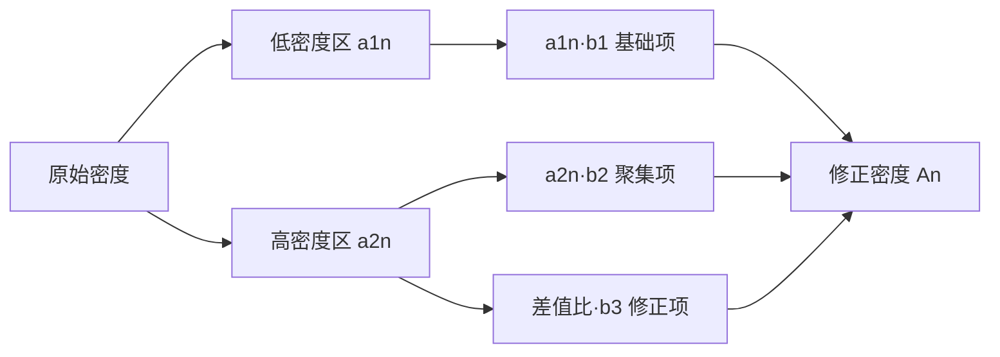

# 人口密度修正系数与新公式

## 人口密度修正系数与新公式

### 它是什么

在评价决策与多指标分析中，人口密度是评估资源配置、疾病传播风险、基础设施需求时常用的指标。但直接用原始人口密度（People/km²）存在一个问题：==密度相同的地区，人口分布结构可能完全不同==。比如同样是 1000 人/km²，一万人挤在十平方公里，和一万人分散在一百平方公里，其聚集效应差异极大。

新人口密度公式就是为修正这种偏差而提出的。它将区域人口拆分为**高密度聚集区**与**低密度散布区**两部分分别赋权，再用两者的差异量对权重结构进行二次修正。

设 $a_{1n}$ 为某区域内低密度区的人口密度（代表基础分布水平），$a_{2n}$ 为高密度聚集区的人口密度（代表核心聚集水平），$b_1, b_2, b_3$ 为权重系数，则修正后的人口密度 $A_n$ 为：

$$
A_n = a_{1n} \cdot b_1 + a_{2n} \cdot b_2 + \frac{(a_{2n} - a_{1n})}{a_{2n}} \cdot b_3
$$

约束条件：

$$
b_1 + b_2 + b_3 = 1
$$

### 为什么需要它

原始人口密度掩盖了空间分布的不均匀性。以疾病传播建模为例，Ebola 疫情在西非地区的传播速度不仅取决于区域内总人口除以总面积，更取决于==人口是否高度聚集==。聚集程度越高，接触率越高，传染率 $\beta$ 的有效值就越大。

直接使用原始密度会带来两个问题：

- **低估聚集风险**：大面积低密度区域“稀释”了核心聚集区的真实风险；
- **削弱指标区分度**：两个密度相近的地区，实际风险可能差异显著。

公式中第三项 $\dfrac{a_{2n} - a_{1n}}{a_{2n}} \cdot b_3$ 正是用来刻画这种**内部差异度**——差异越大，这项越大，修正力度越强。

> [!IMPORTANT]
> 关键是第三项：$\dfrac{a_{2n} - a_{1n}}{a_{2n}}$ 是**相对差异率**而非绝对差异。除以 $a_{2n}$ 的作用是==归一化==，使修正项不受密度本身量级的影响。两个密度分别为 500 和 1000 的地区，与 5000 和 10000 的地区，修正力度相同——这保证了公式在不同量级的地区间可比。

### 与普通加权平均的区别

| 对比维度 | 普通加权平均 | 新人口密度公式 |
| :--- | :--- | :--- |
| 形式 | $\bar{A} = a_1 b_1 + a_2 b_2$ | $A_n = a_1 b_1 + a_2 b_2 + \frac{a_2 - a_1}{a_2} b_3$ |
| 信息利用 | 只用了各部分数值 | 额外利用了**部分间的差异** |
| 当 $a_1 = a_2$ 时 | 退化为 $a_1(b_1+b_2)$ | 第三项为零，退化为 $a_1(b_1+b_2)$ |
| 敏感度 | 对密度线性敏感 | 对**内部不均匀性**额外敏感 |

普通加权平均只回答“平均密度是多少”，新公式还回答“密度分布是否均匀”，这是它在多指标评价中更有辨识度的原因。

### 常见易错点

> [!WARNING]
> 易错一：忘记权重归一化约束。必须满足 $b_1 + b_2 + b_3 = 1$，否则 $A_n$ 的量纲和含义都会出错。

> [!WARNING]
> 易错二：$a_{2n}$ 出现在分母，当高密度区密度趋近于 0（实际中不会，但理论上需注意）时公式无意义。实际使用中应检查数据，确保 $a_{2n} > 0$。

> [!CAUTION]
> 易错三：将 $a_{1n}$ 和 $a_{2n}$ 混淆为“两个不同地区”的密度。其实它们是==同一区域内两种人口分布状态==的密度，不是不同地区间的比较。

### 一个算对了的例子

以课件“表4：不同地区的数据”中两个地区为例，比较原始密度与修正密度的差异：

选取 **Kenema**（原始密度 $4697.336$）和 **Kono**（原始密度 $2618.687$）。

设该模型将各区域内部划分为低密度区与高密度区，数据如下（单位 People/km²）：

| 地区 | $a_{1n}$（低密度区） | $a_{2n}$（高密度区） | 原始总密度 |
| :--- | :--- | :--- | :--- |
| Kenema | 1200 | 9200 | 4697.336 |
| Kono | 1800 | 5100 | 2618.687 |

权重取 $b_1 = 0.3$，$b_2 = 0.5$，$b_3 = 0.2$（显然 $0.3+0.5+0.2 = 1$）。

**计算 Kenema：**

$$
A_n = 1200 \times 0.3 + 9200 \times 0.5 + \frac{9200 - 1200}{9200} \times 0.2
$$

$$
= 360 + 4600 + \frac{8000}{9200} \times 0.2
$$

$$
= 4960 + 0.8696 \times 0.2 = 4960 + 0.1739 = 4960.174
$$

**计算 Kono：**

$$
A_n = 1800 \times 0.3 + 5100 \times 0.5 + \frac{5100 - 1800}{5100} \times 0.2
$$

$$
= 540 + 2550 + \frac{3300}{5100} \times 0.2
$$

$$
= 3090 + 0.6471 \times 0.2 = 3090 + 0.1294 = 3090.129
$$

**结果解读：**

| 地区 | 原始密度 | 修正密度 $A_n$ | 原始排序 | 修正后排序 |
| :--- | :--- | :--- | :--- | :--- |
| Kenema | 4697.336 | 4960.174 | 1 | 1 |
| Kono | 2618.687 | 3090.129 | 2 | 2 |

两地区排序虽然未变，但注意修正后的差距从 $2078.649$ 拉大到了 $1870.045$——Kenema 并非只是因为总密度高而排名靠前，它还因为内部聚集差异更大（相对差异率 $0.8696 > 0.6471$）而在修正公式中获得了更高的分数。如果两个地区原始密度非常接近、但内部结构不同，这个修正就可能==改变排序结果==——这正是该公式的价值所在。

> [!TIP]
> 考试中计算此类题目时，建议**先验证权重和是否为 1，再逐步代入**。第三项的值通常很小（本例中不到 1），不要因为数值小而省略它——它的意义在于**调整排序而非大幅改变数值**。
