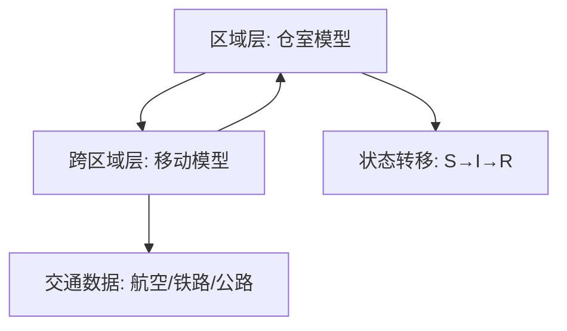

# 人类移动性模型（Human Mobility Model）与跨区域层建模

## 什么是人类移动性模型

人类移动性模型描述个体或人群在空间中的移动规律，是元胞自动机思想在宏观层面的延伸：把地理空间离散成**区域（region）**，把人口看成在区域间流动的"粒子"，用概率或流量刻画转移。

> [!IMPORTANT]
> 跨区域层建模的核心：==空间离散为区域，移动抽象为区域间的转移概率/流量==，疾病、信息、物资随之传播。

## 为什么需要它

以 2015 MCM 埃博拉题为例：疫情在几内亚、塞拉利昂、利比里亚三国间扩散，疫苗与治愈方法初始供应极其有限。若只建单一区域模型，无法回答：

- 病毒会沿哪条交通线扩散？
- 疫苗应优先投放到哪个区域，才能最小化生命损失与经济负担？

GLEAM 等全球流行病模拟器正是靠**多层架构**解决此问题：底层是人口与疫情状态（SIR 类仓室模型），上层是跨区域移动层，整合航空、铁路、公路、海运数据。

## 怎么做：两层耦合框架

**区域层**：每个区域内部用 SIR 等仓室模型刻画疫情发展，$ \frac{dI_i}{dt}=\beta_i S_i I_i/N_i-\gamma_i I_i $。

**跨区域层**：定义区域间移动矩阵 $ M=(m_{ij}) $，$ m_{ij} $ 表示单位时间从区域 $ i $ 迁往区域 $ j $ 的人数。感染者随移动"输出"到其他区域，实现疫情的空间耦合。

## 与相近概念的区别

| 模型 | 空间刻画 | 适用场景 | 典型算法 |
|------|----------|----------|----------|
| 元胞自动机 | 规则网格，邻域转移 | 局部扩散、火灾、交通流 | 局部规则迭代 |
| 人类移动性模型 | 不规则区域，任意转移 | 跨国疫情、人口迁徙 | 转移矩阵、贝叶斯更新 |
| 粒子群优化 | 无空间语义，搜索解空间 | 参数寻优 | 速度位置更新 |

> [!WARNING]
> 易错点：跨区域层的转移概率不是固定常数，应随疫情信息与搜索进展动态调整。2015 MCM 优秀论文用**贝叶斯推断**持续更新先验分布，使搜索模型随新数据 refinement。

## 算例：埃博拉疫苗分配

设三国 $ A,B,C $，人口 $ N_A=10^7, N_B=5\times10^6, N_C=3\times10^6 $，移动矩阵：

$$ M=\begin{bmatrix}0&200&100\\150&0&80\\60&40&0\end{bmatrix} \text{（人/日）} $$

若 $ A $ 国新增 100 名感染者，按移动比例输出：$ A\to B $ 输出 $ 100\times\frac{200}{300}\approx67 $ 人，$ A\to C $ 输出 $ 33 $ 人。疫苗初始量 5000 剂，按各区域**输入风险** $ R_j=\sum_i m_{ij}I_i/N_i $ 加权分配，而非按人口均分——这正是"最小化生命损失与全球影响"的运筹优化目标。

> [!TIP]
> 建模时先画区域邻接图，再填转移矩阵；数据不足时用重力模型 $ m_{ij}\propto P_iP_j/d_{ij}^2 $ 估计流量。
