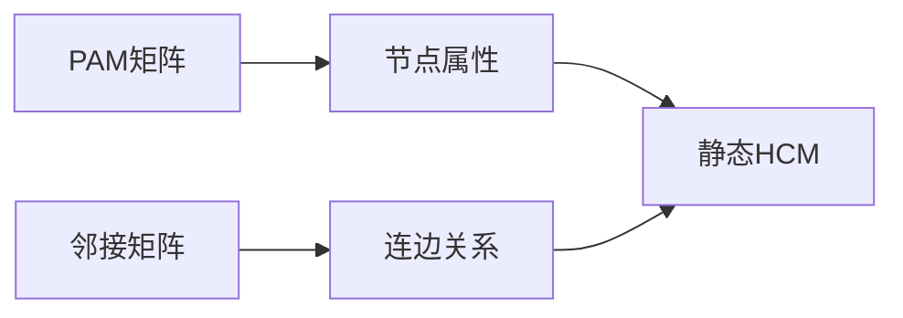

# 人力资本网络模型（Human Capital Network, HCM）

## 什么是人力资本网络模型

如果把员工看作节点、协作关系看作边，组织就不再是一张静态的“通讯录”，而是一个会呼吸的动态系统。人力资本网络模型（HCM）正是用==复杂网络理论==量化这种动态演化的工具。它解决了传统HR模型只关注个体属性、忽视“关系结构”对绩效影响的痛点。在2015年MCM/ICM特等奖论文中，该模型被用于预测370人组织的离职潮与招聘成本，证明了网络拓扑变化直接决定团队生产力。

> [!IMPORTANT]
> HCM的核心不是画图，而是建立==状态转移规则==。
> 必须将员工的入职、晋升、离职映射为网络节点的增删与连边的重连，才能进行有效仿真。

## 建模三步法：从静态到多层

构建HCM通常遵循“静态快照→动态演化→多层增强”的路径。面对一个具体组织时，我们该如何把抽象的人力资本变成可计算的矩阵？

### 静态网络与PAM矩阵

首先构建岗位网络。节点代表职位（而非具体的人），边代表隶属或协作关系。关键在于定义**岗位档案矩阵（PAM）**，记录每个节点的内在属性向量（如技能值、薪资等级）。此时邻接矩阵 $A_{ij}$ 仅反映结构连通性，而节点权重才承载人力资本存量。

### 动态演化驱动算法

组织是活的，模型必须引入时间维度。动态HCM通过三类算法规则驱动网络演化：

-   **离职算法**：低层员工直接删除节点；中层离职需触发填补机制，并考虑==情绪传染==导致周围节点流失率上升。
-   **晋升算法**：设定层级阈值，优先内部提拔，体现“晋升优于外招”原则。
-   **招聘算法**：按空缺比例的2/3制定计划，引入“在岗时间向量”模拟培训延迟效应。

> [!WARNING]
> 切忌假设离职是独立事件。
> 真实网络中存在==级联失效==风险，一人离职可能导致邻居节点工作负荷过载，进而引发二次离职，仿真时必须加入反馈回路。

### 多层网络扩展

单层HCM难以捕捉复杂人际互动。特等奖论文进一步构建了包含“友谊层”、“竞争层”和“人力资本层”的多层网络。相比单层模型，多层网络的平均路径长度等统计指标能更精准地反映团队内部的==连接紧密度==与隐性知识流动效率。

## 与相近概念的区别

| 对比维度 | 传统人力资源模型 | 人力资本网络模型 (HCM) |
| :--- | :--- | :--- |
| 分析单元 | 个体属性（学历、工龄） | 节点+连边（位置+关系） |
| 核心假设 | 人员独立、线性叠加 | 相互依赖、非线性涌现 |
| 动态机制 | 外部参数驱动 | 内生拓扑演化驱动 |
| 适用场景 | 薪酬核算、考勤统计 | 组织韧性评估、变革仿真 |

## 避坑指南与算例验证

> [!CAUTION]
> 不要混淆“岗位”与“人”。
> PAM矩阵描述的是==位置的固有属性==，人员流动只是在该位置上更换了载体。若将个人特质绑定到节点ID上，晋升或调岗时会导致逻辑错误。

以2015年ICM赛题为例，某队伍基于上述动态算法仿真得出：未来两年招聘与培训总成本为 $26.22\sigma + 140.15\sigma$；当流失率达到25%和35%时，工作效率将稳定低于80%。这一结论并非来自简单的回归拟合，而是通过网络迭代计算出的==稳态性能指标==。

> [!TIP]
> 验证模型合理性的金标准：
> 检查无外部招聘策略下，中层员工积极性是否如期下降。若模型未能复现这一“副作用”，说明晋升与情绪传导的参数耦合存在缺陷。
