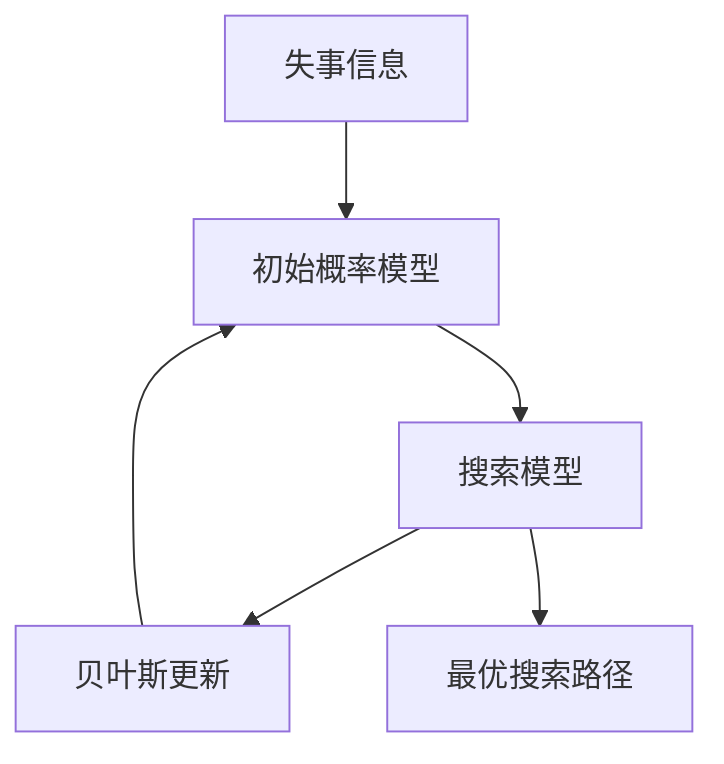

# 任务分解与目标明确
拿到一个数学建模题目，最怕的不是“不会做”，而是“不知道该做什么”。题目往往是一段几百字的背景描述，里面混杂着真实约束、隐含假设和评价标准。如果直接扑上去建模型，很容易做到一半发现方向偏了——比如你花了三天优化药品产量，评委却更关心配送路径是否覆盖了疫区。

所以第一步不是建模，而是**把大问题拆成若干个边界清晰的小问题**，并让每个小问题都有明确的产出。

### 它是什么

任务分解（Task Decomposition）是指：将一个建模问题按照**逻辑维度**或**工作阶段**切分为若干个子任务，每个子任务能够独立建模、独立求解，最后再合起来回答原题。目标明确（Clear Objective）则要求每个子任务的产出是可描述的——是一个数值、一张图、一个策略，还是对某个问题的“是/否”判断。

以课内真题“Delivery System”为例，原题要求设计埃博拉药物与疫苗的配送系统。这个“系统”至少包含三层未知：**从哪发货**、**送到哪**、**送多少**。参赛队将其拆为两个子任务：

- 决定接收药物的地点；
- 计算各地点所需的药物数量。

先解决“地点”，再解决“数量”，逻辑上单向依赖，不会互相打架。这就是一次合理的分解。

### 为什么需要它

数学建模竞赛的时间是固定的，但题目的复杂度没有上限。不分解的后果是：模型内部耦合严重，一处改动波及全身，论文写到一半还在纠结“要不要考虑机场容量”。分解之后，每个子任务都有清晰的评价方式，团队也可以并行分工。

更重要的是，分解会让模型的**可解释性**更强。论文中每个部分对应一个子问题，评委一眼就能看出你“解决了什么”，而不是读完整篇还在猜“所以你们的模型到底输出什么”。

### 怎么做

一个常用的分解思路是**按输入—过程—输出来切**。先问自己三个问题：

- 这个模型的**最终输出**是什么？（例如：每架飞机的搜索路径）
- 得到这个输出，需要哪些**中间结果**？（例如：搜索区域的概率分布）
- 每个中间结果又依赖哪些**输入数据或假设**？（例如：飞机类型、坠毁轨迹、海洋漂流模型）

以“飞机失事搜索”真题为例，最终目标是优化搜索路径。但直接优化路径是不可能的，因为不知道飞机最可能在哪。于是自然地分解为：

这是一个典型的“概率—搜索—更新”循环结构。初始概率模型告诉你“去哪搜”，搜索模型告诉你“怎么搜”，贝叶斯更新在搜索失败后修正“该去哪”。三个模块职责不同，但接口清晰。

另一种分解维度是**按对象属性切**。比如传染病防控中，一个国家的城市可以按“开放 / 封闭”状态分为两类。定义开放系数：

$$
F_n = \frac{c_{\text{open}}}{c_{\text{all}}}
$$

其中 $c_{\text{open}}$ 为开放城市数，$c_{\text{all}}$ 为城市总数。这个指标本身不是最终答案，但它是“人员流动影响”子任务的核心变量，可以嵌入更大的传播模型中。

### 与相近概念的区别

| 概念 | 关注点 | 典型问法 |
|:---|:---|:---|
| 任务分解 | 把“做什么”拆成模块 | 这个问题包含哪几个子问题？ |
| 模型假设 | 明确“什么条件下做” | 忽略了哪些因素？边界在哪？ |
| 模型评价 | 检验“做得好不好” | 误差多大？灵敏度如何？ |

三者经常被混淆。任务分解回答的是**结构问题**，模型假设回答的是**边界问题**，模型评价回答的是**质量守门问题**。分解不干净就急着写假设，容易把不同粒度的内容混在一起——比如把“忽略机场容量”这条假设塞进“配送点选择”的段落里，但其实它影响的是运输成本，属于另一个子任务。

### 常见的坑

> [!WARNING]
> 分解出的子任务之间**存在循环依赖**。

例如，某队想“先确定各疫区需求，再根据需求确定生产量，再根据生产量调整封锁政策”，而封锁政策又反过来影响疫区需求。三个模块互相等待，论文里就会出现“暂设需求为常数”后又不断推翻的痕迹。

> [!CAUTION]
> 把“假设”伪装成“子任务”。

“假设所有医疗中心设在省会城市”不是子任务，它不产生新的分析对象，只是简化问题。真正的子任务应当在假设生效后仍然有独立的建模动作——比如“根据省会分布计算配送半径”。

> [!TIP]
> 分解完成后，写一句话总结每个子任务的**输入、输出、方法**。如果某句话写不出来，说明这个子任务还没有想清楚。

### 一个算对了的例子

回到埃博拉配送题。正确的分解是：

- **子任务一：接收点选择。** 输入：行政区划、疫情分布；输出：接收药物的城市集合；方法：以省会为候选集，结合感染人数筛选。
- **子任务二：需求量计算。** 输入：接收点人口、感染率、治疗周期；输出：各点药物剂数；方法：基于每日使用速率反推总量。

假设 $5 \times 10^7$ 剂药物可供一年使用，每位患者需 1 份剂量（10 剂）。若某接收城市有 $N$ 名患者，则该城市需求为：

$$
D = 10N
$$

若该城市每天平均消耗 $d$ 剂，配送间隔为 $T$ 天，则单次配送量为：

$$
Q = d \times T
$$

这个计算过程不复杂，但关键在于：**它只属于“需求量计算”这个子任务**，不会牵扯到底哪个城市开放、哪个城市封闭。边界清晰，论文读起来就流畅，评委也能快速定位你的贡献。

分解得好的标志不是“分得多细”，而是每个子任务都能独立回答一个问题，且合起来恰好回答原题。
