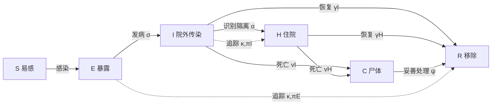

# SEIHCR(CT) 改进模型（引入医院H、尸体C、接触者追踪CT）

## 是什么：在 SEIR 骨架上补三类现实通道

埃博拉不是只按“易感—潜伏—传染—移除”扩散。题目材料反复强调三件事：**尸体污染、医院治疗、接触者追踪（CT）**。所以建模时不能只改参数，而要改仓室结构：在 SEIR 基础上增加 $H(t)$（住院个体）、$C(t)$（受污染尸体），并用 $\kappa,\pi_E,\pi_I$ 表示追踪带来的额外隔离压力。

> [!IMPORTANT]
> ==SEIHCR(CT) 的核心，不是“多几个字母”，而是把防控动作写进状态转移。==

## 为什么需要：三条传染途径要分开量化

符号表给出三组传播率：$(\beta_I,\beta_H,\beta_C)$。这说明新感染不应只由 $I$ 产生，而应写成类似
$$
S\!\downarrow:\quad S(\beta_I I+\beta_H H+\beta_C C)/N
$$
的结构。若漏掉 $\beta_C C$，就解释不了材料中“葬礼接触尸体也会传播”；若漏掉 $H$，就无法比较“住院护理改善感染控制”的效果。

| 相近模型 | 状态 | 关键不足 |
|---|---|---|
| SI / SIS | 无潜伏期 | 不能描述埃博拉暴露期 |
| SIR | 有移除 | 无 $E$，无住院、尸体 |
| SEIR | 有 $E$ | 仍把传播只压在 $I$ 上 |
| SEIHCR(CT) | 加 $H,C$ 与追踪 | 更贴合医疗干预场景 |

## 怎么做：先画流，再写方程，最后讨论参数灵敏度

做题顺序建议固定为：

1. **画仓室流**：先标出 $S,E,I,H,C,R$ 与 $CUM$；
2. **写转移项**：如 $E\to I$ 用 $\sigma E$，$I\to H$ 用 $\alpha I$，尸体处理用 $\psi C$；
3. **加入 CT 修正**：$\kappa$ 是每个被识别传染者平均追踪的接触者数，$(\pi_E,\pi_I)$ 表示追踪后未造成新病例即被隔离的概率；
4. **做政策比较**：提高 $\alpha,\psi,\kappa,\pi_E,\pi_I$ 通常压低传播；改变 $\delta_I,\delta_H$ 会改变 $I/H\to C$ 的分流。

> [!TIP]
> 口诀：==“三率分管三路，追踪削在源头”==——$\beta_I,\beta_H,\beta_C$ 分开；CT 提前截断 $E,I$。

## 常见坑

> [!WARNING]
> 最易错是把 $C$ 当成普通 $R$。尸体未处理前仍可通过 $\beta_C$ 传播，只有经 $1/\psi$ 后才真正退出传播链。

> [!CAUTION]
> 不要把 $\gamma_I,\gamma_H$ 与 $v_I,v_H$ 混为一个“病程结束率”。恢复进 $R$，死亡先进入 $C$，方向不同，公共卫生含义也不同。

## 算对的例子：简答“除疾病传播外还考虑哪些关键因素”

题目要求列举至少三项。按材料应答：**药物需求与配送**（数量、配送系统、地点、生产速度）；**高传染性尸体传播**；**医院治疗降低传播**；**接触者追踪**；以及更安全尸体处理与早期隔离。写成模型语言，就是引入 $H,C$ 两仓室，并用 $\alpha,\psi,\kappa,\pi_E,\pi_I$ 调控传播链。这样既回答“现实因素”，也能回扣 SEIHCR(CT) 的结构改进。
