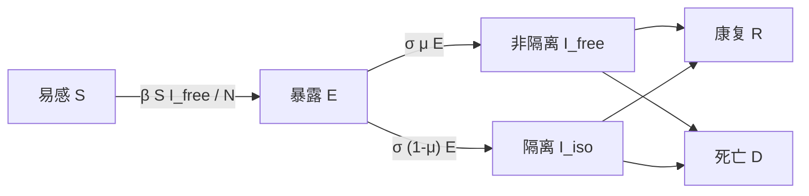

# SEIIR 模型（考虑不同感染阶段）

---
title: SEIIR 模型（考虑不同感染阶段）
requires: [传染病动力学模型/SEIR 模型]
---

## 为什么需要 SEIIR

当感染人数达到一定规模，政府会在 WHO 建议下采取 ==隔离== 措施，这是普通 SEIR 没法刻画的。SEIIR 在 SEIR 基础上把感染者 $I$ 拆成 ==隔离感染者 $I_{\text{isolated}}$== 与 ==非隔离感染者 $I_{\text{free}}$== 两条通道，从而能分别设定死亡率 $f_2<f_1$、并引入隔离带来的传播阻断效应。

## 核心方程

总人口恒等式：$N=S+E+I_{\text{free}}+I_{\text{isolated}}+R$。==只有 $I_{\text{free}}$ 参与传播==，因此感染力项固定为 $\beta S I_{\text{free}}/N$。

$$
\frac{dS}{dt}=-\frac{\beta S I_{\text{free}}}{N},\quad
\frac{dE}{dt}=\frac{\beta S I_{\text{free}}}{N}-\sigma E
$$

$$
\frac{dI_{\text{free}}}{dt}=\sigma\mu E-\gamma I_{\text{free}},\qquad
\frac{dI_{\text{isolated}}}{dt}=\sigma(1-\mu)E-\gamma I_{\text{isolated}}
$$

$$
\frac{dR}{dt}=(1-f_1)\gamma I_{\text{free}}+(1-f_2)\gamma I_{\text{isolated}},\quad
\frac{dD}{dt}=f_1\gamma I_{\text{free}}+f_2\gamma I_{\text{isolated}}
$$

| 符号 | 含义 | 备注 |
| :-- | :-- | :-- |
| $1/\sigma$ | 平均潜伏期 | 由 $E$ 转出速率 |
| $1/\gamma$ | 平均传染期 | 决定 $I$ 滞留时间 |
| $\mu$ | 新增非隔离感染者比例 | 由 $\mu=e^{-f_2}$ 给出 |
| $f_1,f_2$ | 非隔离/隔离死亡率 | $f_1>f_2$ |

> [!IMPORTANT]
> ==$\mu$ 反映隔离意愿==：隔离致死率 $f_2$ 越低，$\mu$ 越小，更多人愿意被隔离；反之则 $\mu$ 增大、隔离效果下降。课件设定 $(1-\mu)>\mu$，即多数新发感染者被隔离。

## 与 SEIR、SIR 的区别

| 模型 | 是否有潜伏期 | 是否区分隔离 | 典型场景 |
| :-- | :-- | :-- | :-- |
| SIR | 否 | 否 | 短期麻疹等 |
| SEIR | 是 | 否 | 自然传播期埃博拉 |
| SEIIR | 是 | ==是== | 有隔离/药物干预期 |

## 加入药物后

若有新药 $G(t)$ 可治愈非晚期患者，只需在隔离方程中减去 $M(t)$、康复方程中加上 $M(t)$（$M(t)\le G(t)$ 为实际治愈人数），其余不变：

$$
\frac{dI_{\text{isolated}}}{dt}=\sigma(1-\mu)E-\gamma I_{\text{isolated}}-M(t),\quad
\frac{dR}{dt}=(1-f_1)\gamma I_{\text{free}}+(1-f_2)\gamma I_{\text{isolated}}+M(t)
$$

> [!TIP]
> 建模时按阶段拆：==自然传播用 SEIR==，==隔离/药物期用 SEIIR==，并以相接处的病例数作为新模型初值，保持连续。

## 算例：阶段初值与求解

取第 100 天（自然传播末）数据作为 SEIIR 初值：
$S_0=12\,219\,576,\ E_0=2209,\ I_{\text{free}}(0)=822,\ I_{\text{isolated}}(0)=822,\ R_0=971,\ D_0=2912$。
取 WHO 范围内的病死率 $f_1=0.8,\ f_2=0.6$，其余系数沿用拟合 SEIR 得到的 $\beta,\sigma,\gamma$，用 Matlab `ode45`（课件记作 ode 工具箱）数值求解，即可得到隔离与非隔离两支病例曲线，预测几内亚、塞拉利昂、利比里亚后续趋势。

> [!WARNING]
> 常见坑：① ==$\beta S I_{\text{free}}/N$ 中的 $N$ 不含 $D$==（题目给 $N=S+E+I_f+I_i+R$），否则感染力被低估；② 药物项 $M(t)$ 不能直接照搬供应量 $G(t)$，需有库存与分配约束；③ 切换模型时初值必须满足新模型的守恒式。

> [!NOTE]
> 埃博拉实际病死率在 0.6–0.8，故 $f_1=0.8$ 用于非隔离、$f_2=0.6$ 用于隔离是合理上、下界取值；若拟合曲线偏离真实死亡数，优先检查 $\mu=e^{-f_2}$ 的设定是否过强。
