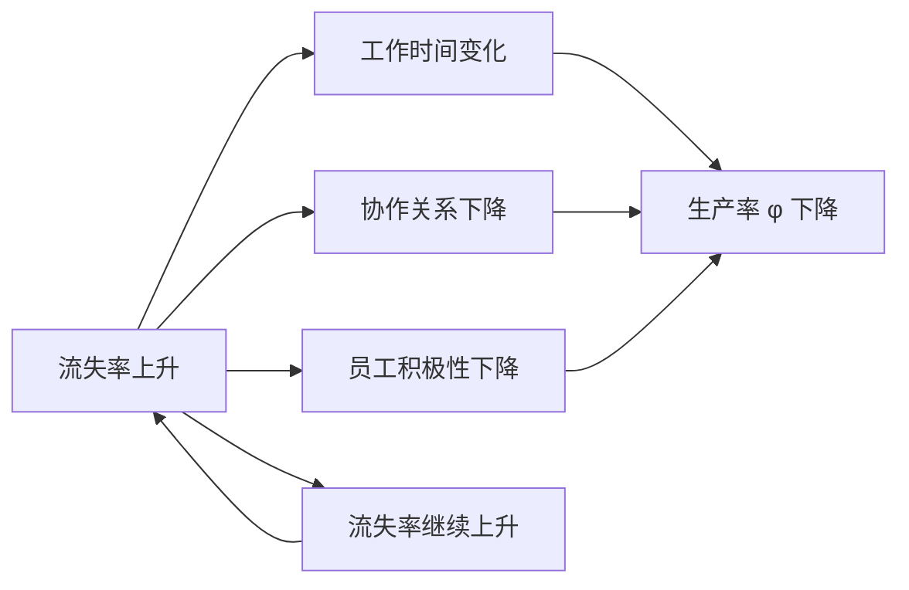

# 生产率与成本模型（Productivity and Costs of HCM）

**生产率与成本模型（Productivity and Costs of HCM）**

在分析搜索救援网络或企业人力网络（HCM）这类复杂系统时，我们常常要衡量系统的整体运行效率，也就是**生产率**，并评估各种扰动（如设备故障、员工流失）带来的**成本**。本知识点给出一个基于向量运算的静态生产率模型，并说明如何通过仿真观测成本变化。

## 生产率的向量化度量

系统的生产率是各组成部分（员工）生产率的总和。设岗位档案矩阵（Post Archives Matrix）中记录了三组数据，组织总生产率 $\varphi$ 定义为

$$
\varphi = \vec{a}\,(\vec{b} + \mu\,\vec{c})
$$

其中：

| 符号 | 含义 | 形状 |
| --- | --- | --- |
| $\vec{a}$ | 员工效率行向量 | $1\times n$ |
| $\vec{b}$ | 员工基本生产率列向量 | $n\times 1$ |
| $\vec{c}$ | 员工工作时间列向量 | $n\times 1$ |
| $\mu$ | 单位时间生产率提升系数 | 标量 |

==每一个员工的贡献为 $a_i(b_i+\mu c_i)$，总生产率是其和==，即 $\varphi=\sum_i a_i(b_i+\mu c_i)$。

## 为什么需要这个模型

一个扰动事件（如人员流失 churn）会通过多条路径影响 $\varphi$：

==直接影响：岗位调整使 $\vec{c}$（工作时间/经验）改变，经验损失直接拉低 $\varphi$。==  
间接影响：协作下降、积极性降低使 $\vec{a}$（效率）下降，且可能触发新的流失，形成正反馈。

## 成本仿真与指标

为量化"高流失率的成本"，引入三个观测指标：

| 指标 | 含义 | 期望走势（流失率升高时） |
| --- | --- | --- |
| 工作率（working rate） | 在岗人员占比 | 下降 |
| 公司绩效 $\varphi$ | 生产率总和 | 下降并趋于稳定 |
| 平均积极性 | 效率参数 $\in[0,1]$ | 下降 |

以两个情景对比（100 个月仿真）：

| 流失率 | 最终工作率 | 最终 $\varphi$ | 最终积极性 |
| --- | --- | --- | --- |
| 25% | ≈75% | ≈179$\sigma$ | 0.87 |
| 35% | ≈67% | ≈153$\sigma$ | 0.81 |

> [!IMPORTANT]
> 流失率越高，==绩效下降越快、稳态越低==；间接效应（积极性、协作）会放大直接损失，形成"越流失越差、越差越流失"的循环。

## 与搜索模型中"概率"的对照

在网络模型章节中，类似的"输出度量"思路也出现在失联飞机搜索模型：用先验分布 + 贝叶斯推断 + 搜索模式优化，最大化累计发现概率 $P(N)$。两者的共同点是：==为复杂系统建立一个可计算的标量/分布输出，再用迭代/仿真优化它==。

> [!TIP]
> 记忆口诀：$\varphi=\vec a(\vec b+\mu\vec c)$——"效率 × (基本 + 时间×成长)"。做题时先辨认三个向量的形状（行×列），再展开为求和式验证。

> [!WARNING]
> 常见坑：$\vec a$ 必须是行向量、$\vec b,\vec c$ 是列向量，否则乘法无意义；$\mu$ 是标量系数，不是向量，别漏乘到 $\vec c$ 上。

## 一个算对了的例子

某部门有 3 名员工，$\vec a=(0.9,\,1.0,\,0.8)$，$\vec b=(10,\,12,\,8)^\top$，$\vec c=(5,\,3,\,6)^\top$，$\mu=0.5$。则

$$
\varphi = (0.9,\,1.0,\,0.8)
\begin{pmatrix}10+0.5\times5\\ 12+0.5\times3\\ 8+0.5\times6\end{pmatrix}
= (0.9,\,1.0,\,0.8)\begin{pmatrix}12.5\\ 13.5\\ 11\end{pmatrix}
$$

$$
\varphi = 0.9\times12.5 + 1.0\times13.5 + 0.8\times11 = 11.25+13.5+8.8 = \boxed{33.55}
$$

再对照仿真结果：若流失率从 25% 升到 35%，$\varphi$ 从 $179\sigma$ 降到 $153\sigma$，降幅约 14.5%，可见间接效应不容忽视。
