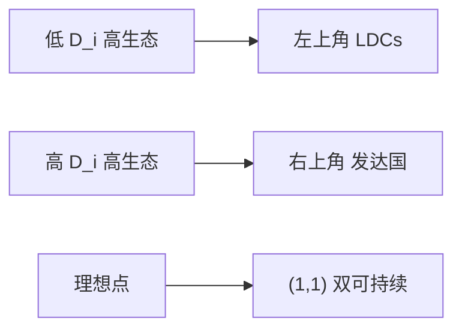

# 生态足迹（Ecological Footprint）与社会可持续性指数 SSI

## 它是什么

在《数学建模》第4章“评价决策与多指标分析方法”里，课件用两个指数来量化一个国家的可持续性：==**社会经济指数** $D_i$（也叫 SSI 中的人类福祉侧）与 **生态影响指数** $E_i$==。把各国画在二维平面上，横轴是 $D_i$，纵轴是 $E_i$。这里 $E_i$ 就对应课件说的 **生态足迹（Ecological Footprint）** 思路：人类对生态系统的占用与破坏越大，$E_i$ 越高；$D_i$ 越高表示生活质量、工业与经济发展越好。

先想一个问题：如果一个国家 $D_i$ 很高但 $E_i$ 也很高，它算可持续吗？

## 为什么需要它

因为环境保护与工业发展之间存在 **权衡（Trade-off）**。课件给出的现状是：

- 联合国48个最不发达国家（LDCs）聚集在图表 **左上角**：环境破坏低，但人类福祉低（$D_i$ 低）；
- 较发达国家生活质量好，但 **对生态系统影响更大**（$E_i$ 高）；
- 于是国家发展似乎沿着 $D_i$ 与 $E_i$ 的 **负相关趋势** 走：经济越发展，生态越受损。

> [!IMPORTANT]
> 理想完美可持续点位于 $(1,1)$：即经济、环境都可持续。课件用 Zambia 的 20 年计划说明，要在扩大经济的同时保持环境保全。

## 怎么做：从指标到平面图

把每个国家 $i$ 的两个指标归一化后画点：

 Zambia 的建模里，先用微分方程表示财富—人口动态，再用二维元胞自动机看援助投在哪；然后用粒子群优化画“投资 vs 可持续性”曲线。核心是把多指标压成 $(D_i,E_i)$ 两点来决策。

## 相近概念区别

| 概念 | 含义 | 在本题中角色 |
|---|---|---|
| 生态足迹 $E_i$ | 对生态系统的影响/破坏 | 纵轴，越小越好 |
| $D_i$ / HDI 类福祉 | 社会经济生活质量 | 横轴，越大越好 |
| SSI | 综合可持续社会指数 | 由二者合成看是否近 $(1,1)$ |

> [!WARNING]
> 别把 $D_i$ 与 $E_i$ 的正负号搞反：课件是 **$D_i$ 越大越发达、$E_i$ 越大越破坏生态**，二者历史数据呈负相关。

## 一个算对了的例子（来自选择题）

题面：优化国家可持续性困难，因为环保与工业有权衡。四个选项里正确的是：

- 低度发达国家在左上角 ==核心结论==：**环境破坏低但人类福祉低**；
- 发达国家在右下/右上生活质量好但 **生态系统影响更大**；
- 假设趋势是 $D_i$ 与 $E_i$ 负相关；
- 理想配置是点 $(1,1)$。

> [!TIP]
> 记平面图：左上穷但干净，右下富但脏，右上最危险，$(1,1)$ 才是建模要靠近的可持续角。

> [!NOTE]
> SSI 的参考文献是 van de Kerk & Manuel (2008)，做题出现“Sustainable Society Index”就是指这套 $(D_i,E_i)$ 双轴评价框架。
