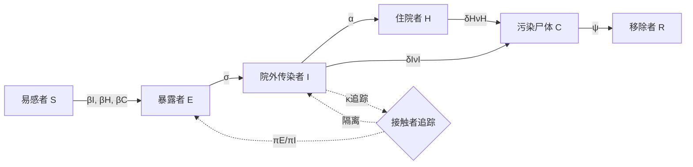

# 考虑尸体、医院和接触者追踪的原因阐述

> [!IMPORTANT]
> 在埃博拉传染病动力学建模中，传统 SEIR 模型无法刻画该病毒的特殊传播机制。必须引入==尸体、医院和接触者追踪==三个关键因素，将其扩展为 SEIHCR(CT) 模型。

## 为什么需要这三个因素？

思考一下：如果只用 SEIR 模型预测埃博拉疫情，会漏掉什么？

- **尸体**：西非传统葬礼需清洗遗体，而死者体液病毒载量极高。若不单独设仓室，会严重低估传播率。
- **医院**：患者入院后，隔离条件改变了传播途径（院内感染 $\beta_H$ 通常低于院外 $\beta_I$），且病死率和康复率均发生变化。
- **接触者追踪（CT）**：根据定义，需在发病前 21 天内找出所有直接接触者并监测。这能在潜伏期提前阻断传播链，是遏制疫情的==核心干预手段==。

## 怎么做：SEIHCR(CT) 模型构建

在微分方程组 (4.3) 中，这三个因素分别对应特定的项与参数：

1. **总传播率**：$\lambda = \beta_I \frac{I}{N} + \beta_H \frac{H}{N} + \beta_C \frac{C}{N}$。其中 $\beta_C$ 专门衡量尸体处理不当导致的传播率。
2. **医院干预**：院外感染者以速率 $\alpha$ 被识别并转移至住院仓室 $H(t)$，在院内以 $\gamma_H$ 康复或以 $\nu_H$ 死亡。
3. **接触者追踪**：体现在 $\dot{E}(t)$ 和 $\dot{I}(t)$ 的负向修正项中，例如 $-\kappa(\alpha I + \psi C)\pi_E \omega_E (E/N)$。这里 $\kappa$ 是每个被隔离者平均追踪的接触者数，$\pi_E$ 是被追踪暴露者被成功隔离且不引起新病例的概率。

> [!TIP]
> 记忆口诀：**“三率两移一追踪”**。三率指 $\beta_I, \beta_H, \beta_C$；两移指院外到院内（$\alpha$）、尸体到安全处理（$\psi$）；一追踪即含 $\kappa$ 和 $\pi$ 的 CT 项。

## 与相近概念的区别

| 对比维度 | 传统 SEIR 模型 | SEIHCR(CT) 模型 |
| :--- | :--- | :--- |
| **传染源** | 仅考虑活体感染者 $I$ | 增加住院者 $H$ 和污染尸体 $C$ |
| **传播率** | 单一常数 $\beta$ | 区分院外 $\beta_I$、院内 $\beta_H$、尸体 $\beta_C$ |
| **干预手段** | 无显式表达 | 通过 $\alpha$（隔离速率）和 $\kappa, \pi$（追踪参数）量化 |
| **基本再生数** | 仅依赖自然病程 | 受医疗资源与殡葬规范显著影响 |

## 常见坑与注意事项

> [!WARNING]
> 很多同学在写方程时，忘记将 $\beta_C S(t) C(t)/N$ 加入 $\dot{S}(t)$ 的流出项和 $\dot{E}(t)$ 的流入项。尸体 $C(t)$ 也是传染源，必须参与力感染（force of infection）的计算！

> [!CAUTION]
> 接触者追踪的修正项带有负号，表示它是在**减少**暴露者和感染者的数量，不要写成正号导致人数异常增加。

## 算对了的例子（真题简答）

**题干**：团队在构建模型时，除了疾病传播外，重点考虑了哪些关键因素？（列举至少三项）

**参考解答**：
1. **特殊传播途径**：高传染性尸体带来的潜在威胁（对应 $C$ 仓室与 $\beta_C$）。
2. **医疗干预效果**：患者在医院接受治疗可改善感染控制并降低传播率（对应 $H$ 仓室与 $\alpha$）。
3. **接触追踪**：作为强有力干预手段，早期发现患者以减少暴露机会（对应追踪参数 $\kappa, \pi_E$）。

> [!NOTE]
> 结论表明：更安全的尸体处理（增大 $\psi$）、加强接触追踪（增大 $\kappa$）及早期隔离（增大 $\alpha$），能有效压低累计病例数 $CUM(t)$ 的增长率，最终实现根除。
