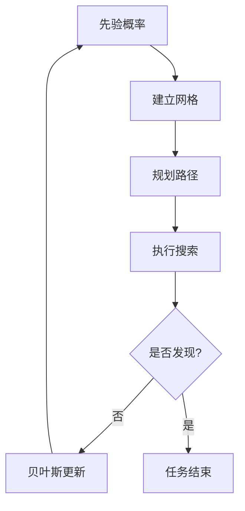

# 海洋搜索理论历史与核心概念

海洋搜索理论解决的核心问题是：一架飞机失联后，如何在茫茫大海上用有限的搜救资源（如 C-130 搜索机）最快找到它？

如果你只知道“最后一次联系点”，你会怎么搜？盲目扩大范围显然浪费燃油。我们需要一种方法，把“目标可能在哪”和“搜了没找到说明什么”结合起来动态调整策略——这就是概率搜索理论与贝叶斯方法的经典应用。

## 历史背景与核心概念

现代搜索理论起源于二战时期的反潜作战，由 B.O. Koopman 等人奠基。其核心思想是将连续的海域离散化，并利用贝叶斯公式在每次搜索后更新目标位置的概率分布。

> [!IMPORTANT]
> 核心循环：==先验建模 → 路径优化 → 搜索执行 → 贝叶斯后验更新==。未找到目标时，被搜索区域的概率下降，未搜索区域概率上升。

## 怎么做：从连续到离散的网格化

实际计算中，无法对连续海域直接积分。课件中的做法是以失联点为原点，将搜索区域划分为面积为 $W^2$ 的正方形网格（为简化计算，通常令 $W := 1$，即每格一平方英里）。搜索边界 $r_{max}$ 由失踪飞机的最大滑翔或坠落距离决定。

连续的概率密度函数 $p(x,y)$ 被映射到网格上，面积分近似为离散求和：

$$
\iint_A p(x, y) \mathrm{d}A \approx \sum_{i=a}^{b} \sum_{j=c}^{d} p_{ij}
$$

确定最优搜索位置的算法如下：
1. 扣除往返航程（如跑道在失联点以南 400 英里），算出剩余可用搜索航程。
2. 将可用航程转化为特定搜索模式（方形、螺旋形等）的最大覆盖尺寸。
3. 遍历每个网格点作为搜索中心，计算该路径覆盖网格的总成功概率，取最大值对应的中心点。

## 相近概念对比

| 维度 | 传统确定性搜索 | 概率贝叶斯搜索 |
| :--- | :--- | :--- |
| **目标假设** | 目标在某固定范围内 | 目标服从空间概率分布 |
| **未找到时** | 仅扩大范围或重复扫掠 | ==用贝叶斯定理更新后验概率== |
| **资源分配** | 均匀覆盖 | 集中在高概率区域 |

## 常见坑与注意事项

> [!WARNING]
> 网格外切圆问题：实际搜索区是半径为 $r_{max}$ 的内切圆，但为了矩阵运算方便，必须保留正方形网格，圆外的网格点初始概率应设为 0。

> [!CAUTION]
> 混淆“探测概率”与“存在概率”：$p_{ij}$ 是目标在第 $(i,j)$ 格的**存在概率**。单次搜索的成功概率还需乘以传感器的**探测概率**（Lateral search range 内的发现率）。

## 算例演示

假设简化模型：失联点周围有 $2 \times 2$ 共 4 个网格，初始先验概率均匀分布，即 $p_{11}=p_{12}=p_{21}=p_{22}=0.25$。C-130 搜索机受航程限制，只能完整搜索其中 1 个网格（设探测概率为 1）。

若选择搜索第 $(1,1)$ 格且**未发现目标**，如何用贝叶斯定理更新概率？

设事件 $S$ 为“未在第 $(1,1)$ 格发现目标”。
- 若目标在 $(1,1)$ 格，未被发现的概率 $P(S|\text{在}_{11}) = 1 - 1 = 0$。
- 若目标在其他格，未被发现的概率 $P(S|\text{不在}_{11}) = 1$。

全概率公式求 $P(S)$：
$$
P(S) = 0 \times 0.25 + 1 \times 0.25 + 1 \times 0.25 + 1 \times 0.25 = 0.75
$$

更新后验概率：
$$
p'_{11} = P(\text{在}_{11}|S) = \frac{0 \times 0.25}{0.75} = 0
$$
$$
p'_{12} = P(\text{在}_{12}|S) = \frac{1 \times 0.25}{0.75} = \frac{1}{3} \approx 0.333
$$

> [!TIP]
> 结论：搜索过的格子概率降为 0，未搜索的格子概率按比例放大。下一架次的最优搜索中心必然转移到 $p'_{ij}$ 最大的网格。这就是 MATLAB 仿真中迭代寻优的数学本质。
