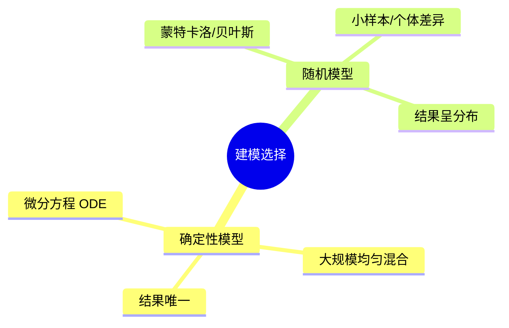

# 随机模型与确定性模型的对比（Stochastic vs Deterministic Model）

## 什么是随机与确定性模型

在传染病动力学（如埃博拉建模）中，**确定性模型**假设人群是连续流体，用微分方程描述平均趋势；而**随机模型**将个体视为离散单元，状态转移由概率决定。

> [!IMPORTANT]
> 核心区别：确定性模型给出==唯一确定的轨迹==，随机模型给出==状态的概率分布==。

## 为什么需要随机模型？

当研究尺度下沉到“个体”或“小区域”时，确定性模型的连续性假设失效。例如在多层状态模型中，个体从“潜伏”转为“感染”并非必然，而是基于接触概率 $P_{interact}$ 的随机事件。

$$
P _ { i n t e r a c t } = \frac { \text { 区域内特定类型个体数 } } { \text { 区域总人数 } }
$$

若忽略这种随机性，无法模拟“超级传播者”或小规模爆发中的偶然灭绝现象。

## 怎么做：基于状态的随机模拟

1.  **初始化**：根据 WHO 数据设定初始易感、潜伏、感染者分布。
2.  **状态转移**：每个时间步，对每个个体进行“掷骰子”。
    *   先判断是否移动（基于区域移动概率）。
    *   再判断是否感染（基于 $P_{interact}$ 和传染性参数）。
3.  **多层嵌套**：个体层随机 $\rightarrow$ 城市层网络交互 $\rightarrow$ 国家层宏观统计。

> [!TIP]
> 解题技巧：遇到“小样本”、“个体差异大”或“需评估风险概率”时，优先考虑随机模型。

## 常见误区与对比

| 维度 | 确定性模型 (Deterministic) | 随机模型 (Stochastic) |
| :--- | :--- | :--- |
| **数学工具** | 微分方程组 (ODE/PDE) | 概率分布、马尔可夫链、蒙特卡洛 |
| **输出结果** | 一条平滑曲线 | 多次模拟的置信区间/分布 |
| **适用场景** | 大规模人口、长期趋势预测 | 早期爆发、小规模社区、个体追踪 |
| **计算成本** | 低 | 高（需大量重复模拟） |

> [!WARNING]
> 易错坑：不要混淆“参数不确定性”与“过程随机性”。贝叶斯推断调整的是参数分布，而状态机模拟的是过程本身的随机跳变。

## 算例：埃博拉个体感染概率

假设某区域有 1000 人，其中早期症状感染者 10 人。某易感者今日在该区域活动。

1.  计算接触概率：
    $$ P_{interact} = \frac{10}{1000} = 0.01 $$
2.  假设每次接触导致感染的条件概率为 0.2。
3.  该易感者今日被感染的总概率为 $0.01 \times 0.2 = 0.002$。
4.  在模拟中生成 $[0,1]$ 均匀随机数 $r$。若 $r < 0.002$，则状态由 S 转为 E（潜伏），否则保持 S。

==核心结论==：随机模型通过微观个体的概率累积，还原宏观疫情的非线性特征，更适合精细化防控策略评估。
