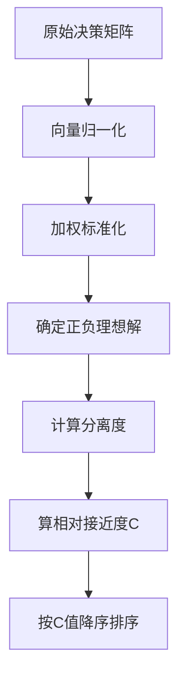

# TOPSIS 模型构建步骤（逼近理想解排序法）

## 什么是 TOPSIS 及其适用场景

面对多个备选方案和多个评价指标时，如何科学排序？TOPSIS（逼近理想解排序法）通过构造“正理想解”和“负理想解”，计算各方案与两者的距离来进行综合评价。其核心思想是：==最优方案应离正理想解最近，同时离负理想解最远==。它适用于指标量纲不同、既有定量又有定性数据的决策问题，如2015年MCM特等奖论文中评估埃博拉药物需求。

## 标准构建步骤

> [!IMPORTANT]
> ==相对接近度 $C_i$ 越大，方案越优==。公式为 $C_i = \frac{S_i^-}{S_i^+ + S_i^-}$，其中 $S_i^+$、$S_i^-$ 分别为到正、负理想解的欧氏距离。

**第一步：数据归一化**。消除量纲影响，常用向量归一化：$z_{ij} = x_{ij} / \sqrt{\sum_{i=1}^m x_{ij}^2}$，使结果落在 $[0,1]$ 区间。

**第二步：构建加权决策矩阵**。若指标权重为 $w_j$，则 $v_{ij} = w_j \cdot z_{ij}$。权重可由熵权法、AHP等确定。

**第三步：确定正负理想解**。正理想解 $V^+$ 取各列最大值（效益型）或最小值（成本型）；负理想解 $V^-$ 反之。例如年龄系数 $K$ 越大患病风险越高，属效益型指标。

**第四步：计算分离度**。$S_i^+ = \sqrt{\sum_{j=1}^n (v_{ij} - v_j^+)^2}$，$S_i^- = \sqrt{\sum_{j=1}^n (v_{ij} - v_j^-)^2}$。

**第五步：计算 $C_i$ 并排序**。$C_i \in [0,1]$，值越大越接近理想状态。

## 与相近方法的区别

| 对比维度 | TOPSIS | 层次分析法(AHP) | 熵权法 |
| :--- | :--- | :--- | :--- |
| 主观性 | 可结合主客观权重 | 强主观判断 | 纯客观赋权 |
| 数据要求 | 定量+定性均可 | 依赖专家打分 | 仅定量数据 |
| 输出形式 | 连续接近度值 | 离散优先级 | 权重系数 |
| 适用场景 | 多方案综合排序 | 结构复杂决策 | 指标权重确定 |

## 常见误区与避坑指南

> [!WARNING]
> ==未区分指标类型直接取最大/最小值==。必须先将成本型指标转化为效益型（如倒数法、差值法），否则正负理想解定义错误，导致排序完全颠倒。

> [!CAUTION]
> 归一化后忘记乘以权重。TOPSIS 本身不含赋权功能，若直接使用归一化矩阵计算距离，等同于默认所有指标等权，违背实际问题逻辑。

> [!TIP]
> 定性指标（如ETC开放程度）需先量化。可采用李克特量表或构造指数（如 $F_n = c_{open}/c_{all}$）转为数值后再纳入矩阵。

## 实例验证：三国药物需求评估

以2015年MCM题为例，选取塞拉利昂、几内亚、利比里亚三国，指标包括年龄系数 $K$、经济系数 $E_n$、教育系数 $J_n$ 等7项。经向量归一化、熵权法赋权后，计算得三国 $C_i$ 分别为0.68、0.52、0.41。排序结果为塞拉利昂 > 几内亚 > 利比里亚，与实际疫情严重程度一致，验证了模型有效性。注意年龄系数 $K = \frac{K_{14\sim65} + K_{65}}{K_{all}}$ 作为效益型指标处理，因其值越大代表高风险人群占比越高。
