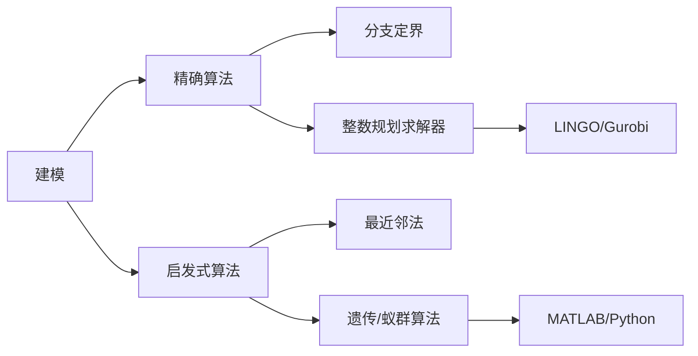

# TSP 模型（旅行商问题）规划配送路线

## TSP 模型：规划配送路线

旅行商问题（Traveling Salesman Problem, TSP）要解决的核心问题是：一个配送员从仓库出发，必须访问所有需求点各一次，最后回到仓库，**怎样安排访问顺序，才能让总路程最短？** 这是物流配送路线优化中最经典的问题。

> [!IMPORTANT]
> TSP 的本质是寻找一条 ==经过所有节点恰好一次并返回起点的最短哈密顿回路==。

为什么需要它？在“第5章 优化与物流配送模型”中，若只靠直觉排路线，点一多就无法保证最优。TSP 用数学模型把路线规划变成可求解的优化问题。

## 与相近问题的区别

| 问题 | 是否返回起点 | 是否恰好访问一次 | 典型目标 |
| :--- | :---: | :---: | :--- |
| TSP | 是 | 是 | 最短总路程 |
| 最短路径 | 否 | 否（可经过多次） | 两点间最短距离 |
| 最小生成树 | 否 | 否 | 连通所有点且总权最小 |
| VRP 车辆路径 | 可选 | 是（分多车） | 多车总成本最小 |

> [!NOTE]
> TSP 是 VRP（车辆路径问题）的基础版本：VRP = 多个 TSP + 容量/时间约束。

## 数学模型（0-1 整数规划）

设节点集合 $N=\{1,2,\dots,n\}$，$d_{ij}$ 为 $i$ 到 $j$ 的距离，决策变量 $x_{ij}\in\{0,1\}$ 表示是否走 $i\to j$：

$$
\min \sum_{i=1}^{n}\sum_{j=1}^{n} d_{ij}x_{ij}
$$

约束：每个点 ==进入一次、出去一次==，即

$$
\sum_{j}x_{ij}=1,\quad \sum_{j}x_{ji}=1 \quad \forall i
$$

此外必须 ==消除子回路（subtour）==，否则会得到“绕小圈不连通”的非法解。

> [!WARNING]
> 最常见的坑：==忘记消除子回路==。只加入出度约束时，模型可能输出若干互不相连的小圈，不是合法的单一回路。

## 求解思路与求解工具

- 小规模（$n\le 20$）：用 LINGO/Gurobi 直接求 ==精确最优解==。
- 大规模：用 ==启发式/元启发式算法==（如遗传算法、蚁群算法）求近似最优。

## 一个算对了的例子

收费站流量问题中，将收费广场抽象为网络图后，需要在多条路径中选择流量最大、事故率最低的路线。例如对路径 $1\to4\to7\to12\to17\to20$，流量为 1375 辆/小时，事故率 0.96%。在求解时用 LINGO 得到各变量的缩减成本，发现若让 $t_{13},t_{61}$ 各增 1，目标函数显著变差——==缩减成本为负==说明该决策不划算，应避免进入长路径。这与 TSP 的思想一致：==通过量化每条边的选择代价，选出让总代价最小的回路==。

> [!TIP]
> 解题套路：① 建距离矩阵 → ② 设 0-1 变量 → ③ 写目标函数与出入度约束 → ④ 加子回路消除约束 → ⑤ 用 LINGO 求解并灵敏度分析。
