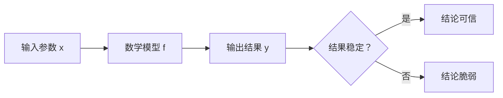

# 稳定性分析（Stability Analysis）

稳定性分析（Stability Analysis）是数学建模中 ==检验模型结论是否可靠== 的关键环节。它回答一个问题：==当输入参数或外部条件发生扰动时，模型的输出结果是否会剧烈波动，甚至得出相反的结论？== 如果答案是"会"，那我们基于模型做出的决策就不可信。

## 为什么需要稳定性分析

一个模型在"标准参数"下算出的最优方案，可能在参数稍微变动时就退化为最差方案。例如在收费站排队模型中，若车道合并形状的排名在自动收费站比例从 30% 变到 35% 时完全颠倒，那"对称合并优于单向倾斜"这一结论就==没有决策价值==。



## 怎么做稳定性分析

常见的做法有三步：

**第一步：参数扰动**。对模型中的关键参数（如 AHP 中的判断矩阵元素、排队模型中的到达率 $\lambda$）施加小范围变化（如 $\pm 5\% \sim \pm 20\%$）。

**第二步：重新求解**。在扰动后的参数下重新计算模型，观察核心指标（如权重排序、平均速度 $\bar v_j$、均衡指标 $1/\sigma_t^2$）的变化。

**第三步：判断结论是否翻转**。==若关键排序或趋势在扰动下不变，则结论稳定；若发生变化，则需给出适用条件或改进模型==。

> [!TIP]
> 稳定性分析与敏感性分析是"一体两面"：敏感性分析看**输出随输入的变化率**，稳定性分析看**定性结论是否会翻转**。论文中常合并为一节写"灵敏度/稳定性分析"。

## 与相近概念的区别

| 概念 | 关注点 | 典型问法 |
| --- | --- | --- |
| 稳定性分析 | 结论是否翻转 | 参数变化后排名变了吗？ |
| 敏感性分析 | 输出对输入的敏感程度 | $\partial y/\partial x$ 大不大？ |
| 一致性检验 | 判断矩阵的逻辑自洽 | $CR < 0.1$ 吗？ |
| 误差分析 | 计算/测量误差传播 | 误差范围多大？ |

## 一个算对了的例子

以 AHP 环境因素判断矩阵为例，气候变化与生态系统改变的成对比较矩阵给出权重 $w_1=0.1030$、$w_2=0.0513$，一致性比率 $CR = 0.0674 < 0.1$，说明判断矩阵自洽。

现在做稳定性分析：把"气候变化 vs 生态系统改变"的比较值从 $2$ 改为 $1.5$，重新求权重。若 $w_1$ 仍 > $w_2$，则"==气候变化影响更大=="这一定性结论稳定；若权重比例 $w_1/w_2$ 从 $2$ 变为约 $1.8$，波动仅约 $10\%$，则不仅排序稳定，==定量结果也较稳健==。

> [!WARNING]
> 常见坑：只对单一参数做扰动，忽略**参数间的联动**（如收费站占比与面积、车道排列的耦合）。论文中至少应选取 2～3 个关键参数做组合扰动。

> [!NOTE]
> 稳定性分析 ≠ Lyapunov 稳定性。前者是建模论文的**结果检验**环节，后者是动态系统理论中关于**状态收敛**的严格定义，两者不可混用。

## 实战写作模板

在论文"稳定性/灵敏度分析"小节中，可按以下结构组织：

1. 说明扰动对象与幅度（如"对判断矩阵元素 $\pm 0.5$"）；
2. 展示扰动后关键指标的表格或曲线；
3. 给出结论：==结论是否翻转==，以及适用范围。

```mermaid
timeline
    title 稳定性分析流程
    选关键参数 : 扰动 ±5%~20%
    重新求解模型 : 记录指标变化
    对比结论 : 判断是否翻转
    写出适用范围 : 论文落笔
