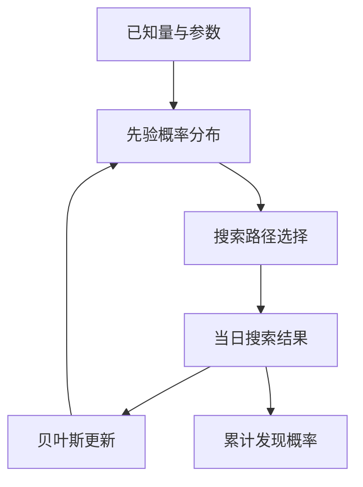

# 问题重述与分析（Problem Restatement and Analysis）

## 问题重述与分析

### 它是什么

问题重述与分析是数学建模论文正文的起点。它的任务不是把原题抄一遍，而是用建模者自己的语言，==把题目要解决的现实问题转化为一个可以量化、可以求解的数学问题==。

从上面埃博拉题的例子可以看到，题目给的是背景和数据，“问题重述与分析”要回答的是：这些数据和约束背后，我们到底要算什么、优化什么、输出什么。

### 为什么需要

竞赛评审在论文开头最想确认三件事：

1. 你有没有读懂题；
2. 你有没有把复杂现实简化成可建模对象；
3. 你的后续模型是否“长”在这个分析上。

如果问题重述只是逐字复述题目，评审无法判断你的建模思路从何而来；如果直接跳入公式，又缺少了“为什么要这样做”的交代。问题重述与分析就是两者之间的桥梁。

---

### 怎么做

**第一步：剥离背景，提取任务**

先问自己一个问题：题目最后要的“交付物”是什么？

- 是预测一个数值？
- 是优化一个方案？
- 是给出一个分配策略？
- 是评价一个系统的好坏？

以失踪飞机搜索为例，题目要的交付物不是“找到飞机”，而是一个==搜索策略==：在哪搜、按什么路径搜、每天搜完后如何更新判断。

**第二步：识别可用的已知量**

把题目中所有可以用符号表示的量列成表格，并区分两类：

| 类型 | 含义 | 飞机搜索题中的例子 |
| --- | --- | --- |
| 固定参数 | 已知或可查的常数 | 巡航高度 $h$、升阻比 $L/D$ |
| 决策变量 | 模型要优化的量 | 搜索中心位置、搜索路径类型、搜索面积 |
| 状态变量 | 随搜索过程变化的量 | 各网格点含飞机的后验概率 |

飞机搜索论文中的 Nomenclature 表就是这一步的产物。它的存在让评审一眼看到“建模语言已经建立”。

**第三步：明确假设及其来源**

每一个“简化”都要给出理由。例如：

> [!IMPORTANT]
> 假设飞机失去信号时立即失去动力，随后进入无动力滑翔。
> 依据：原文指出，模型“assumes that at the moment of lost signal, the plane experiences a failure and is no longer powered”。这使问题从“飞行轨迹未知”简化为“滑翔轨迹可计算”。

这一步的关键词是==可计算性==。如果你的假设让模型更贴近现实但无法求解，那它在这个阶段的价值有限。

**第四步：画出问题结构**

用一张流程图交代“输入—过程—输出”，比三段文字更有效：

这张图等价于一句话：**初始分布 → 搜索 → 未找到 → 更新分布 → 再搜索**。评审看到这样的图，就知道你的模型是一个闭环迭代过程。

---

### 和相近概念的区别

| 概念 | 回答的问题 | 输出 |
| --- | --- | --- |
| 问题重述 | 题目要求我们做什么？ | 清晰的任务边界 |
| 问题分析 | 我们打算用什么框架做？ | 建模思路与假设 |
| 模型假设 | 我们忽略了哪些现实因素，为什么可以忽略？ | 简化的合法化说明 |
| 符号说明 | 变量叫什么、单位是什么？ | Nomenclature 表 |

新手常见的错误是把这四个混在一段里写，评审无法区分“题目说的”和“我假设的”。

---

### 常见的坑

> [!WARNING]
> 不要在问题重述里写“我们建立了一个模型”。重述阶段还没有模型，只有“问题的数学化表述”。

> [!CAUTION]
> 不要把“分析”写成“解决方案预告”。分析回答的是“关键难题是什么、用什么思路应对”，而不是“第一步算先验概率，第二步做贝叶斯更新”。

> [!NOTE]
> 问题分析中提到的每个关键困难，后续必须有对应的模型环节去解决。飞机搜索题里提到了“如何衡量搜索路径的有效性”，后文就真的定义了基于“总发现概率”的度量方式。前后呼应才完整。

---

### 一个完整的小例子

以埃博拉药物配送题为例，问题重述与分析可以这样写：

**任务对象**：西非三国（几内亚、利比里亚、塞拉利昂）的埃博拉疫情。

**目标**：给定有限的药物供应和各国不同的疫情严重程度，==确定药物在三国的分配数量==。

**已知量**：
- 各国当前感染人数 $I_n$；
- 各国人口年龄结构，由此计算年龄系数 $K$；
- 药物总量约束。

**关键简化**：假设每个未进入晚期患者在整个疗程中需要的药物量为固定的一份，从而把“分配数量”问题离散化。

**核心困难**：各国疫情严重程度不能只用感染人数衡量，还要考虑年龄结构带来的传播风险差异。为此引入年龄系数 $K$ 作为修正，再结合当前感染人数形成综合需求指标。

这几行字写完后，读者自然知道：接下来的模型是“如何定义一个综合需求评分，并据此分配药物”。这就是问题重述与分析应达到的效果——==让论文的每一页都能在开头找到自己的出处==。
