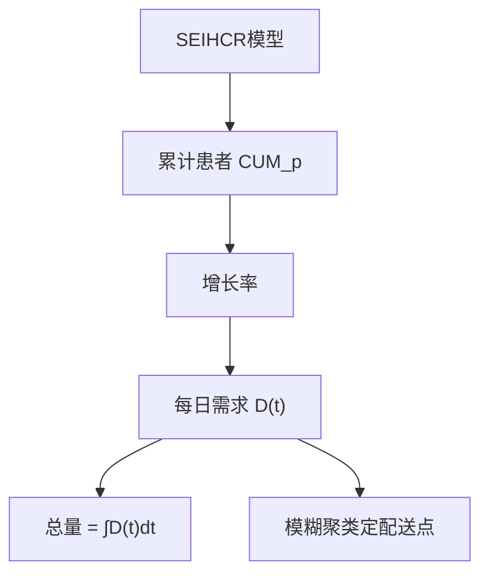

# 物资配送与制造速度模型（药物每日需求与总量计算）

## 它是什么

在传染病药物干预问题中，"制造速度"与"每日需求"是两个必须同时回答的问题：

- **每日需求 $D$**：由 SEIHCR 模型输出的累计患者数 $CUM_p$ 及其增长率决定，即每日新增患者所需的药物单位剂量；
- **制造速度**：疫苗/药物的生产速率，决定了能否跟上 $D$ 的增长；
- **配送系统**：利用模糊 $c$-均值聚类，将城市按需求 $D_k$ 聚类，确定配送中心（总部）位置 $v_i$ 与隶属度 $u_{ik}$。

> [!IMPORTANT]
> ==核心链条==：SEIHCR 模型 $\rightarrow$ 累计患者 $CUM_p$ $\rightarrow$ 每日需求 $D$ $\rightarrow$ 模糊聚类确定配送点 $\rightarrow$ 比较不同制造速度与疗效的干预效果。

## 为什么需要

仅控制传播（隔离、追踪接触者）不够，若药物供不上，患者死亡率仍高。因此必须回答三个问题：

1. 一共需要多少药？（总量 = 每日需求 $D$ 的积分/累加）
2. 药放在哪里？（聚类中心 $v_i$）
3. 生产多快才够？（制造速度 vs. 每日需求 $D$ 的匹配）

## 怎么做

### 计算每日需求与总量

以塞拉利昂首都弗里敦为例：

1. 用 SEIHCR (CT) 模型模拟，得累计患者数 $CUM_p(t)$；
2. 求增长率，代入公式得每日所需药物单位剂量 $D(t)$；
3. **总量** = $D(t)$ 曲线下的阴影面积（即对时间积分）。

### 模糊 $c$-均值聚类定配送点

目标函数：

$$
\min J_m(U,v)=\sum_{k=1}^{N}\sum_{i=1}^{c}D_k(u_{ik})^m\left\|y_k-v_i\right\|^2
$$

约束：$c<c_{\max}$，$y_{ki\min}<y_{ki}<y_{ki\max}$。

- $D_k$：城市 $k$ 所需药品数量（作为权重）；
- $v_i$：第 $i$ 个聚类中心（即配送总部位置）；
- $u_{ik}$：城市 $k$ 对总部 $i$ 的隶属度。

迭代公式：

$$
\hat{v}_i=\frac{\sum_{k=1}^{N}D_k(\hat{u}_{ik})^m y_k}{\sum_{k=1}^{N}D_k(\hat{u}_{ik})^m},\qquad
\hat{u}_{ik}=\left(\sum_{j=1}^{c}\left(\frac{d_{ik}}{d_{jk}}\right)^{2/(m-1)}\right)^{-1}
$$

**选 $c$ 的方法（肘部法则）**：观察 $J_m$ 随 $c$ 变化的曲线，拐点处即为最优聚类数。本案例中 $c=6$，即在几内亚、塞拉利昂、利比里亚设 6 个配送总部。

## 与相近概念的区别

| 概念 | 解决的问题 | 关键点 |
|------|-----------|--------|
| SEIHCR 模型 | 预测传播 | 分室、接触追踪 |
| 药物需求计算 | 算总量与每日量 | $D(t)$ 由 $CUM_p$ 导出 |
| 模糊聚类配送 | 定配送中心 | $D_k$ 作权重，肘部法则选 $c$ |
| 制造速度 | 生产能否跟上 | 与 $D(t)$ 比较，评估干预程度 |

## 常见的坑

> [!WARNING]
> 1. ==混淆 $CUM_p$ 与每日新增==：$CUM_p$ 是累计值，$D$ 是其导数/差分，二者不可直接混用。
> 2. **$c$ 不是越小越好**：$c$ 太少则配送任务过重；太多则管理成本上升。看 $J_m$ 曲线拐点。
> 3. **$m$ 的选取**：加权指数 $m=2$ 是常用默认值，但需说明理由。

## 算例（弗里敦）

用 SEIHCR (CT) 模型模拟弗里敦（患者最多，代表性强）：

- 左图：累计患者数随时间变化；
- 右图：灰线为每日单位剂量需求 $D(t)$，阴影面积为总需求量；
- 与 WHO 实际数据对比，误差在可接受范围内，验证模型可行。

结论：SEIHCR (HC) 模型既能预测累计患者，又能计算药物总量，为制造与配送决策提供依据。
