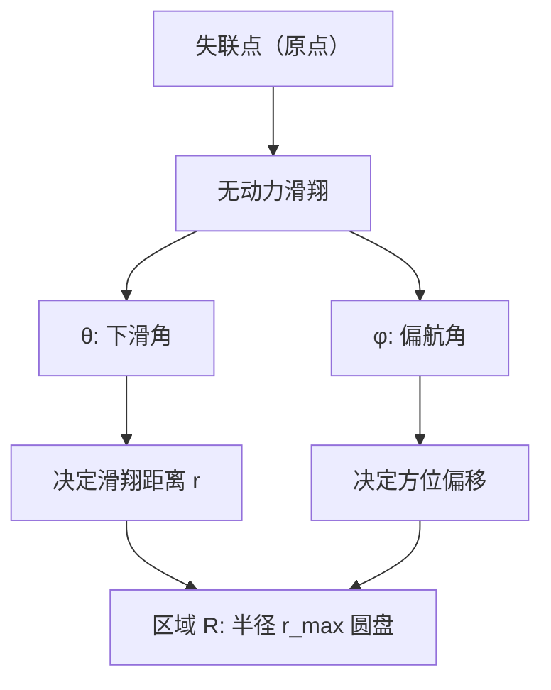

# 先验概率分布模型（随机下降与初始概率密度函数 PDF）

## 先验概率分布模型：随机下降与初始 PDF

> [!IMPORTANT]
> 先验概率分布（prior probability density function）是在**开展任何搜索之前**，仅根据失联瞬间的已知信息（位置、航向、高度、升阻比）建立的飞机可能位置的概率模型。它是整个贝叶斯搜索框架的"初始信念"，后续的搜索与概率更新都以此为起点。

## 为什么需要它

搜索开始前，我们对飞机位置的认知完全来自失联那一刻的数据。如果能把这些信息转化为空间上的概率密度函数 $f(x,y)$，就能回答两个关键问题：

1. **飞机最可能在哪里？**——决定搜索资源的初始投放区域；
2. **每个区域被覆盖的价值有多大？**——为后续搜索路径优化提供量化依据。

没有先验分布，搜索就退化为"均匀撒网"，效率极低。

## 怎么做：几何建模

**第一步：确定可达区域 $R$。**

设失联点为原点，北为 $y$ 正方向，东为 $x$ 正方向。飞机失去动力后做无动力滑翔，其最小下滑角由升阻比决定：

$$
\theta_{\min} = \tan^{-1}\!\left(\frac{1}{L/D}\right)
$$

由几何关系，最大滑翔航程为：

$$
r_{\max} = h \cdot \frac{L/D}{1} = h \cdot (L/D)
$$

以波音 747-400 为例：$L/D = 17$，巡航高度 $h = 35000\ \text{ft}$，得 $\theta_{\min} \approx 3.37^\circ$，$r_{\max} \approx 113$ 英里。区域 $R$ 就是以失联点为圆心、$r_{\max}$ 为半径的圆盘。

**第二步：为几何参数分配概率分布。**

下滑角 $\theta$ 和偏航角 $\phi$ 被视为**相互独立的随机变量**，各自有独立的概率函数：

- **$\phi$（偏航角）**：飞机可能向任意方向偏离初始航向，通常建模为均匀分布或正态分布；
- **$\theta$（下滑角）**：采用**双峰正态分布**（bimodal normal distribution），因为：
  - 接近 $\theta_{\min}$：飞行员有意以最优角度滑翔，最大化航程；
  - 接近 $90^\circ$：灾难性故障（爆炸、失速）导致近乎垂直坠落。

$$
f(\theta) = p_{\text{crash}} \cdot f(\theta_{\text{crash}}) + p_{\text{glide}} \cdot f(\theta_{\text{glide}})
$$

其中 $p_{\text{glide}} = 1 - p_{\text{crash}}$，两项分别对应两种互斥情形。

> [!TIP]
> 记忆要点：$\theta$ 管"飞多远"，$\phi$ 管"往哪飞"，两者独立 → 联合密度 = 边缘密度之积。

## 坐标变换：从 $(\theta,\phi)$ 到 $(x,y)$

搜索需要在地理坐标 $(x,y)$ 中进行，因此要将 $(\theta,\phi)$ 空间的密度变换到 $(x,y)$ 空间。利用极坐标关系：

$$
x = r(\theta)\cos\phi, \qquad y = r(\theta)\sin\phi
$$

由概率密度的变量替换公式：

$$
f_{X,Y}(x,y) = f_{\Theta,\Phi}(\theta,\phi) \cdot \left|\frac{\partial(\theta,\phi)}{\partial(x,y)}\right|
$$

这一步的核心是**雅可比行列式**的计算，它保证了概率在坐标变换下的守恒性。

## 与后验分布的区别

| | 先验分布（Prior） | 后验分布（Posterior） |
|---|---|---|
| **建立时机** | 搜索开始前 | 每次搜索后 |
| **信息来源** | 失联瞬间的物理参数 | 搜索数据 + 贝叶斯更新 |
| **作用** | 确定初始搜索区域 | 动态调整后续搜索重点 |
| **数学工具** | 几何建模 + 变量变换 | 贝叶斯定理 |

> [!WARNING]
> 常见错误：把 $\theta$ 建模为单峰正态分布。实际上，"最优滑翔"和"灾难坠毁"是两种截然不同的物理情形，必须用双峰分布分别刻画，权重由 $p_{\text{crash}}$ 与 $p_{\text{glide}}$ 决定。

## 算例：747-400 的初始 PDF

已知：$L/D = 17$，$h = 35000\ \text{ft}$，$p_{\text{crash}} = 0.3$。

**计算 $\theta_{\min}$：**

$$
\theta_{\min} = \tan^{-1}\!\left(\frac{1}{17}\right) \approx 3.37^\circ
$$

**计算 $r_{\max}$：**

$$
r_{\max} = h \cdot (L/D) = 35000 \times 17\ \text{ft} \approx 113\ \text{英里}
$$

**构建 $\theta$ 的双峰密度：**

设 $f(\theta_{\text{glide}}) \sim N(3.37^\circ, \sigma_1^2)$，$f(\theta_{\text{crash}}) \sim N(90^\circ, \sigma_2^2)$，则：

$$
f(\theta) = 0.3 \cdot f(\theta_{\text{crash}}) + 0.7 \cdot f(\theta_{\text{glide}})
$$

结合 $\phi \sim U(0, 2\pi)$（均匀偏航），通过坐标变换即得区域 $R$ 上的初始联合密度 $f_{X,Y}(x,y)$。搜索资源应优先投向密度最高的区域——通常是以失联点为中心、沿初始航向延伸的扇形地带。
