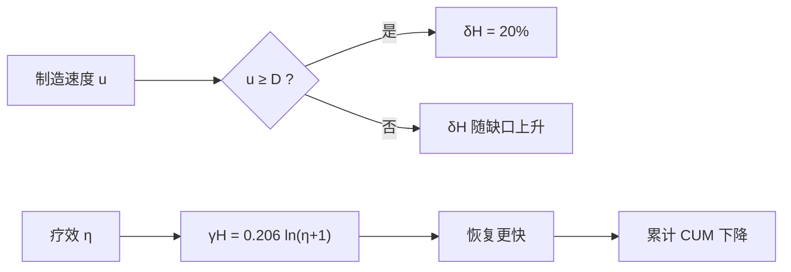

# 药物干预模型（开发疫苗提高治愈率、降低死亡率）

## 它是什么

在埃博拉 SEIHCR (CT) 模型里，药物干预模型刻画两件事：一是**药品供给速度**如何影响医院内病死率 $\delta_H$，二是**药物疗效**如何影响住院恢复速率 $\gamma_H$。模型把干预分成三层医疗水平：basic（无药）、vaccine available（疫苗、不依赖医院）和 cure available（医院有药，可提前治愈住院者）。

> [!IMPORTANT]
> 核心结论：**制造速度不足会按缺口比例抬高病死率；疗效越好则恢复越快、累计感染越少。**

## 为什么需要

埃博拉疫情里，单纯限制人口流动作用很小。Valdez 等人指出，真正有效的是**迅速且早期的干预**：提高医院化率，并降低医院与葬礼中的传播率。所以我们必须在动力学模型里显式写出“药量—病死率”和“疗效—恢复时间”的反馈。

## 怎么做

先看病死率的分段控制。设每日所需药品量 $D$，制造速度 $u$：

$$
\delta_ {H} = \left\{ \begin{array}{l l} \rho_ {u} \cdot \frac {D - u}{D} + \delta_ {H 0}, & u < D, \\ \delta_ {H 0}, & u \geq D, \end{array} \right.
$$

其中 $\rho_u=0.7$，最低病死率 $\delta_{H0}=20\%$。再看疗效，记疗效水平为 $\eta$：

$$
\gamma_ {H} = \rho_ {\eta} \ln (\eta + 1),\qquad \rho_\eta=0.206
$$

$1/\gamma_H$ 是症状出现到住院康复的平均时间，因此 $\gamma_H$ 越大表示药越有效、治愈越快。

## 和相近概念的区别

| 干预手段 | 作用位置 | 模型表示 |
|---|---|---|
| 疫苗 | 易感/潜伏者，不需医院 | 新增接种路径 |
| 药物治愈 | 住院感染者 | 提高出院概率、缩短病程 |
| 医院化率提升 | 接触—住院转移 | 改变仓室流入率 |

注意 cure 只作用于 hospitalized individuals；模型未区分晚期住院者，是一个简化假设。

## 常见的坑

> [!WARNING]
> 分段函数只在 $u<D$ 时用缺口比例叠加，别把 $u\ge D$ 也代入。

> [!TIP]
> 记忆：==先判 $u$ 与 $D$ 大小，再算 $\delta_H$==。

## 算对了的例子

已知日均需求 $D=106.2$，若 $u=50<106.2$：

$$
\delta_H = 0.7\cdot\frac{106.2-50}{106.2}+0.20
=0.7\cdot\frac{56.2}{106.2}+0.20
\approx0.3704+0.20=57.04\%
$$

约为 $57.0\%$，说明供给不足会让病死率从 $20\%$ 猛增到近三倍。而提高 $\eta$ 会增大 $\gamma_H$，使累计病例 CUM 中等程度下降。
