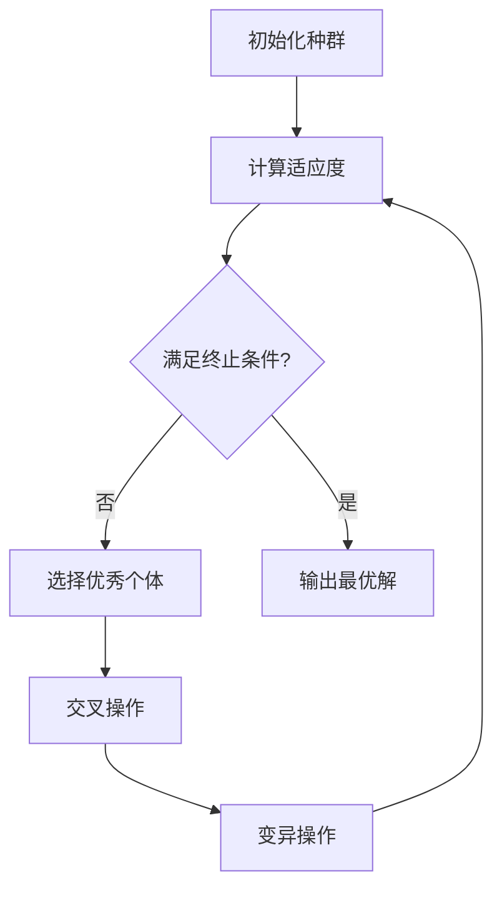

# 遗传算法优化人力资本管理（染色体表示与适应度函数）

## 遗传算法在人力资本优化中的应用

在复杂系统仿真中，传统梯度下降法（如 Nelder-Mead）易陷入==局部最优==且难以处理有界约束。遗传算法（GA）通过模拟生物进化，能在解空间中高效搜索==全局最优解==，特别适用于 NP-hard 的人力资源配置或选址问题。

> [!IMPORTANT]
> GA 的核心优势在于==全局搜索能力==与==边界约束处理==，代价是计算速度较慢。

### 染色体表示与适应度函数

**1. 染色体编码（怎么做）**
将决策变量映射为基因序列。在塞拉利昂医疗中心选址案例中，若需从 13 个区中选 $q$ 个建中心，染色体可表示为长度为 $q$ 的整数数组，每个基因代表一个选中的区首府 ID。
*   **示例**：`[Kailahun, Makeni, Bo]` 对应基因串 `[1, 4, 9]`。

**2. 适应度函数（怎么评）**
适应度函数 $F(x)$ 直接决定个体被选择的概率。需将优化目标转化为最大化问题。
*   **投资可持续性模型**：
    $$
    S(\text{investments}) = \frac{D_i + \alpha * E_i}{1 + \alpha}
    $$
    其中 $D_i$ 为发展指标，$E_i$ 为环境责任，$\alpha$ 为权重系数。GA 的目标是最大化 $S$。
*   **选址模型**：通常取目标函数（如总距离最小）的倒数或负值作为适应度，即 $F = 1 / (\sum h_i d_i)$。

### 与相近算法对比

| 特性 | Nelder-Mead / Powell | 遗传算法 (GA) |
| :--- | :--- | :--- |
| **搜索机制** | 局部迭代，依赖初始点 | 群体进化，随机搜索 |
| **最优解类型** | 易陷==局部最优== | 倾向==全局最优== |
| **约束处理** | 难处理有界优化 | 天然支持边界限制 |
| **计算效率** | 快 | ==慢==（需多次迭代） |

> [!WARNING]
> GA 收敛速度慢，不适合实时性要求极高的场景。课件中指出，因数据收集需求，最终可能放弃 GA 而改用其他方法。

### 常见坑与实例解析

**坑点**：
1.  **参数敏感**：交叉率 $P_c$ 和变异率 $P_m$ 设置不当会导致早熟收敛或随机游走。
2.  **编码冲突**：在选址问题中，交叉可能产生重复基因（同一区选两次），需引入修复机制。

**算例验证**：
在塞拉利昂案例中，设 $\lambda=92.1$ km，需求系数 $h_i$ 已知。
*   **输入**：13 个候选点，距离矩阵见表 2。
*   **GA 求解**：经 Matlab 迭代，得出最优解为 7 个中心：`Kailahun, Makeni, Kambia, Kabala, Bo, Moyamba, Freetown`。
*   **结果**：该分布满足了最大距离约束，且加权总距离最小，验证了 GA 在处理离散组合优化上的有效性。

> [!TIP]
> 记忆口诀：**编码定结构，适应度定优劣，交叉变异寻全局，慢工出细活。**
