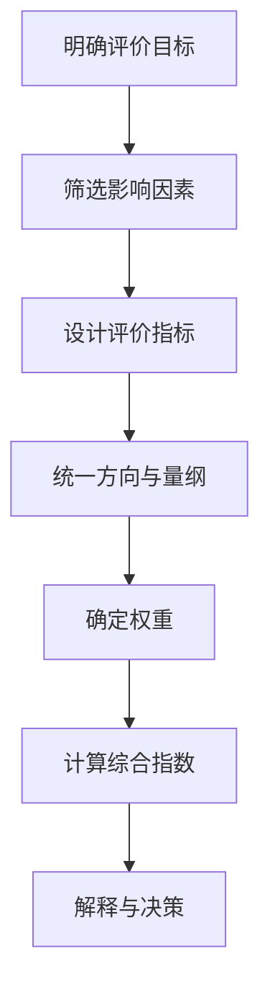

# 影响因素评估指标体系构建（温度、湿度、经济、教育等）

## 指标体系是什么

影响因素评估指标体系，是把“温度、湿度、经济、教育”等复杂因素转化为==可比较、可排序、可用于决策==的一组指标。

它要回答两个问题：

1. **看什么**：选择哪些影响因素和评价目标；
2. **怎么合成**：将多个指标合成为综合评价结果。

例如，在可持续发展模型中，可以先以预期寿命、污染水平等构成目标指标，再分析 HIV 感染率、教育、医疗支出、财富等因素对目标的映射关系。

> [!IMPORTANT]
> 指标体系不是简单罗列数据，而是“目标—因素—指标—权重—结果”的完整结构。

## 为什么需要构建指标体系

现实因素往往方向不同、单位不同。例如：

- 温度越高，空调能耗可能越大；
- 湿度影响体感舒适度和设备运行；
- 经济发展可能改善医疗条件，也可能增加污染；
- 教育水平通常有利于健康和收入增长。

如果直接比较原始数值，不同量纲会掩盖真实关系。因此必须先统一指标方向和量纲，再根据研究问题进行合成。

## 怎么做

### 明确目标和层次

先说明评价对象与目标。例如评价城市宜居性，可以把“环境舒适、经济活力、教育保障”设为一级指标，再细化为年均温度、相对湿度、居民收入、经费投入等二级指标。

### 选取指标并确定方向

根据数据的==代表性、可获取性和可解释性==筛选指标，同时区分正向指标与负向指标。

| 类型 | 含义 | 示例 |
|---|---|---|
| 正向指标 | 越大越好 | 教育水平、居民收入 |
| 负向指标 | 越小越好 | 污染浓度、高温时长 |
| 适度型指标 | 接近某个区间最好 | 人体舒适温度 |

对于适度型指标，不能简单使用“越大越好”或“越小越好”的处理方式。

### 统一量纲

常用方法包括极差归一化和 Z-score 标准化。极差归一化公式为：

$$
x'_{ij}=\frac{x_{ij}-\min x_j}{\max x_j-\min x_j}
$$

其中，$x_{ij}$ 表示第 $i$ 个对象在第 $j$ 个指标上的原始值，$x'_{ij}$ 为归一化结果。

正向量化为：

$$
z_{ij}=\frac{x'_{ij}-\min x'_j}{\max x'_j-\min x'_j}
$$

负向量化为：

$$
z_{ij}=\frac{\max x'_j-x'_{ij}}{\max x'_j-\min x'_j}
$$

若最大值等于最小值，说明该指标没有区分能力，不能直接除以零。

### 确定权重并合成

权重反映各指标的重要性，可采用等权法、主观赋权、熵权法或组合赋权。常见综合评价模型为：

$$
S_i=\sum_{j=1}^{m}w_jz_{ij},\qquad \sum_{j=1}^{m}w_j=1
$$

课件中的污染指数采用了相同思想：

$$
Pollution_i=\sum_p A_{ip}W_p
$$

其中 $A_{ip}$ 是人均污染物 $p$ 的排放量，$W_p$ 是其 GWP 权重。该方法本质上就是“指标归一化后加权求和”。

> [!TIP]
> 权重不是装饰：若采用等权，就应解释为何各指标影响相当；若采用主观权重，则要说明依据并接受敏感性检验。

## 与相关概念的区别

| 概念 | 主要作用 | 典型输出 |
|---|---|---|
| 指标体系 | 规定“评价什么” | 指标集合及层次结构 |
| 指标标准化 | 消除量纲影响 | $z_{ij}$ |
| 综合评价 | 将多指标合成为结果 | 综合得分、排名 |
| 因素分析 | 解释“为何变化” | 回归关系、影响方向 |
| 敏感性分析 | 检查结论是否稳健 | 权重变化后的结果 |
| 预测模型 | 推演“未来会怎样” | 预测值、情景结果 |

指标体系可以成为因素分析、预测模型和优化模型的输入，但二者不能混为一谈。

## 常见坑

> [!WARNING]
> 1. 指标重复：教育年限和识字率同时高权重，可能造成信息重复。  
> 2. 方向错误：把污染、死亡率等负向指标直接归一化后按正向解释。  
> 3. 权重武断：只给出一个结果，不检验权重变化。  
> 4. 数据不可比：全国数据与城市数据、总量与人均量混用。  
> 5. 相关当因果：财富与健康同时上升，不代表财富必然导致健康改善。

## 一个算对的例子

某地评价居住舒适度，选取温度适宜度 $T$ 和湿度适宜度 $H$，两者均为正向指标，归一化后分别为 $0.8$、$0.6$。若权重均为 $0.5$，则：

$$
S=0.5\times0.8+0.5\times0.6=0.70
$$

因此，该地综合舒适度为 $0.70$。

进一步加入经济指标 $G$，其归一化值为 $0.9$，并赋予权重 $0.4$，则需同步调整原权重：

$$
S=0.3T+0.3H+0.4G
$$

$$
=0.3\times0.8+0.3\times0.6+0.4\times0.9=0.72
$$

> [!CAUTION]
> 新增指标后必须重新归一化权重，保证权重总和仍为 $1$；不能保留原权重再额外加上新权重。
