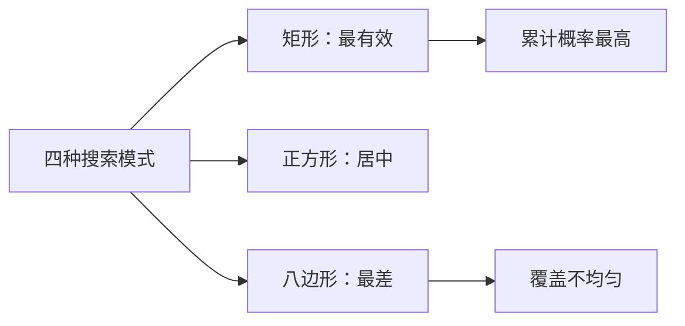

# 有效性参数（Effectiveness Parameter）与搜索模式对比

## 有效性参数与搜索模式对比

在搜索模型（如 MH370 搜索、山区搜救）中，研究者常需要回答一个核心问题：**换一种搜索方式或资源投入，到底能让找到目标的概率提升多少？** 若每次变化都要重新建立模型，成本极高。有效性参数（Effectiveness Parameter）提供了一个统一的“旋钮”，把不同搜索条件折合为一个可调系数。

### 为什么要引入有效性参数

在基础搜索模型中，常假设搜索区域被均匀覆盖，搜索者扫过每单位面积的发现概率相同。但现实中：

- 目标越大越明显（波音 747 比塞斯纳小飞机更容易被发现）；
- 搜索飞机越先进，发现能力越强（带红外、声呐的 C-130 比单人目视搜索更强）；
- 天气、海况、传感器精度都会影响单次扫描的“质量”。

有效性参数 $\lambda$ 的引入，就是把上述因素打包成一个乘性因子。定义两个子参数：

$$
\alpha = \text{目标易发现程度},\qquad \beta = \text{搜索平台有效性}
$$

两者都以 1 为基准：$\alpha>1$ 表示目标比一般飞机更容易找，$\beta>1$ 表示搜索飞机比普通平台更强。于是

$$
\lambda = \alpha \cdot \beta
$$

> [!IMPORTANT]
> $\lambda$ 是对“搜索质量”的量化。$\lambda=1$ 就是最基础模型；$\lambda>1$ 表示单次扫描更有效，$\lambda<1$ 表示更差。

### 它如何嵌入模型

设搜索区域面积为 $A$，搜索速度为 $W$（单位时间覆盖宽度），在时间增量 $h$ 内覆盖面积为 $Wh$。若搜索完全有效，覆盖面积内发现概率就是 $Wh/A$；但实际发现能力受 $\lambda$ 调制，于是单步发现概率修正为

$$
g(h) = \frac{\lambda W h}{A}
$$

将其代入“未发现条件下的条件概率更新”微分方程，得到与基础模型同构的解，只是指数上多了 $\lambda$：

$$
q(z) = 1 - \exp\left(-\frac{\lambda z W}{A}\right)
$$

其中 $z$ 为累计搜索时间。$q(z)$ 就是累计成功概率（cumulative success probability）。

> [!TIP]
> 记忆技巧：$\lambda$ 出现在指数里，`λ ↑ → 指数项更负 → q(z) 更快接近 1`，但增速递减。

### 常见误区与边界

- **误以为 λ 翻倍，累计概率也翻倍。** 实际不会。由于 $q$ 是饱和函数，$\lambda$ 翻倍只让 $1-q$ 按指数更快衰减。这体现边际收益递减：从 $\lambda=1$ 到 $\lambda=2$ 的提升远大于从 $\lambda=10$ 到 $\lambda=11$。
- **混淆“覆盖面积增加”与“有效性增加”。** 增加搜索时间或速度 $W$ 与提高 $\lambda$ 在公式中都进入指数，但从成本角度看：增加时间/速度要更多燃料、人力；提高 $\lambda$ 可能要换传感器或增加观察员。两者不总能互换。
- **α 和 β 不可直接测量。** 它们需要根据历史数据或专家判断标定，通常取 0.5～2 之间的合理值，不能随意取极端。

### 搜索模式对比：矩形 vs. 八边形 vs. 正方形

即使 $\lambda$ 固定，不同搜索路径的覆盖率增长方式也不同。以模拟题中高失速可能性场景为例，四种模式的对比如下：

| 搜索模式 | 累计成功概率相对表现 |
| --- | --- |
| 矩形搜索（Rectangular） | ==最有效==，覆盖率最均匀 |
| 正方形搜索（Square） | 居中，略逊于矩形 |
| 八边形扇区搜索（Octagonal Sector） | ==最差==，边缘重复覆盖严重 |

> [!WARNING]
> 模式对比必须控制变量：同等 $\lambda$、同等搜索时间。若不同模式还配了不同的 $\lambda$，对比结果就不公平。

### 一个算对的小例子

设 $A=500$ 平方海里，$W=10$ 海里/小时，$\lambda=1.5$，求搜索 $z=100$ 小时后的累计成功概率。

$$
q = 1 - \exp\left(-\frac{1.5 \times 100 \times 10}{500}\right)
   = 1 - e^{-3}
   \approx 1 - 0.0498
   = 0.9502
$$

即约 $95\%$。若 $\lambda=1$，则 $q = 1 - e^{-2} \approx 86.5\%$。可见 λ 从 1 到 1.5 提升了约 8.5 个百分点，但并未“按比例”增加。

### 与相近概念的区别

- **λ 不是覆盖率**。覆盖率是 $Wz/A$ 或类似量，表示扫过面积占比；λ 是“扫过之后能否发现”的折扣因子。
- **λ 也不是先验概率 $p_{crash}$**。高失速可能性改变的是初始分布 $p_{crash}$ 的权重，而 $\lambda$ 改变的是搜索过程发现能力。两者分别对应“目标可能在哪”和“搜索者看得多准”。

> [!NOTE]
> 在贝叶斯更新框架中，先验分布影响的是起始位置；λ 影响的是似然（检测概率）。两个环节都要调，模型才稳健。
