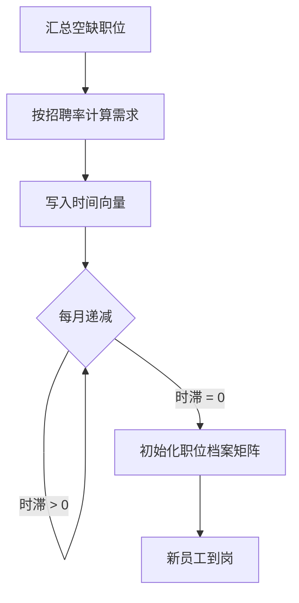

# 招聘与结算事件（Recruitment & Settlement Event）算法

## 招聘与结算事件算法

### 它是什么

在复杂系统仿真（尤其是人力资源网络模型）中，招聘与结算事件（Recruitment & Settlement Event）算法是==处理职位空缺与外部补员的离散事件驱动机制==。当离职（churn）与晋升（promotion）算法执行完毕后，若仍存在无法由内部员工填补的空缺职位，系统便触发招聘流程，按层级分别计算招聘数量、模拟招聘时滞，并在时滞结束后将新员工"登记入库"。

### 为什么需要

企业内部晋升往往优先于外部招聘：晋升成本低、时滞短，且能激励员工。但当某层级（尤其是中高层）出现空缺且无人满足晋升条件时，必须依赖外部招聘。招聘存在天然的**时滞效应**——不同层级员工的招聘周期不同，这直接影响公司的人力资本结构与绩效表现。因此需要一套算法来刻画"发招聘通知 $\rightarrow$ 等待 $\rightarrow$ 新员工到岗"的完整过程。

### 怎么做

招聘算法的核心假设有三：
- 公司能在给定时间中位数内招到合适员工；
- 新招员工为该层级中生产率最低者；
- 招聘人数与当前空缺职位数成正比（招聘率给定）。

算法流程如下（以低级员工为例，中高层不允许空缺，直接在离职算法中触发招聘）：

具体步骤：
1. **统计空缺**：执行完 churn 与 promotion 后，汇总各层级空缺数 $V_j$（$j$ 为层级）。
2. **计算需求并计时**：按招聘率 $r_j$ 计算需招聘人数 $N_j = r_j \cdot V_j$，将其写入时间向量 $T_j$。每月对有招聘计划的层级 $T_j \leftarrow T_j - 1$，并记录当月需到岗人数。
3. **登记入库**：当 $T_j$ 减至 $0$ 时，在职位档案矩阵（Post Archives Matrix）中初始化该员工信息，标志招聘完成。

> [!IMPORTANT]
> 招聘时滞是离散事件仿真的关键：时间向量 $T_j$ 模拟了从发通知到到岗的延迟，==不能即时补员==，否则高估公司短期人力。

### 与相近概念的区别

| 概念 | 触发条件 | 时滞 | 对象 |
|------|----------|------|------|
| 晋升（Promotion） | 内部有满足经验者 | 短或无 | 内部低级 $\to$ 高级 |
| 招聘（Recruitment） | 无内部晋升者 | 层级相关中位数 | 外部新员工 |
| 离职（Churn） | 随机或效率触发 | 即时 | 现有员工流出 |

### 常见的坑

> [!WARNING]
> 1. **忽略层级差异**：中高层与低级员工的招聘时滞不同，需分别设置时间向量。
> 2. **即时到岗误区**：若 $T_j$ 未减至 $0$ 就入库，会抹平招聘延迟，导致仿真结果过于乐观。
> 3. **政策调整不同步**：如题目要求"两年内不外部招聘中级员工"，需同步修改 churn（中级效率降至 $2\%$）、promotion（强制留任）与 recruitment（仅招低级，且招聘人数为空缺 $2/3$ 时低级招聘量增加）三处算法。

### 算对了的例子

设低级员工空缺 $V_L = 30$，招聘率 $r_L = \frac{2}{3}$，招聘时滞中位数 $T_L = 3$ 个月。则需求人数 $N_L = \frac{2}{3} \times 30 = 20$ 人。将 $20$ 写入时间向量第 $1$ 个月，每月递减：第 $1$ 月末 $T_L=2$，第 $2$ 月末 $T_L=1$，第 $3$ 月末 $T_L=0$，此时在职位档案矩阵中初始化 $20$ 名新低级员工，其生产率取该层级最低值。若同时中级空缺 $V_M=10$ 但政策禁止外部招聘，则中级 $N_M=0$，仅靠内部晋升填补，若晋升不足则空缺持续，直接影响公司绩效。

> [!TIP]
> 记忆口诀：**先算空缺，再定时滞，逐月递减，零时入库**。
