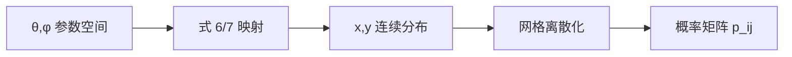

# 坐标变换（经纬度坐标转换与搜索区域离散化网格）

坐标变换是把概率模型从“物理参数空间”搬到“地理空间”的桥梁。概率搜索理论里，飞机的可能坠点由滑翔角 $\theta$ 与航向改变 $\phi$ 描述，概率密度写成 $p(\theta,\phi)$；但搜救人员只能在地图上撒网，因此必须把它映射为笛卡尔 $p(x,y)$，再离散成可计算的矩阵。

## 为什么需要坐标变换

直接搜 $(\theta,\phi)$ 空间没有意义：搜救资源（船只、飞机、雷达）是按地理位置排布的。两个空间的对照如下：

| 维度 | $(\theta,\phi)$ 空间 | $(x,y)$ 空间 |
| --- | --- | --- |
| 含义 | 滑翔角 / 航向改变 | 北 $y$ / 东 $x$ 偏移 |
| 单位 | 弧度 | 英里 / 网格 |
| 使用者 | 气动建模者 | 搜救人员 |
| 用途 | 写先验密度 | 贝叶斯更新、分配资源 |

## 变换公式与几何含义

==核心映射==由式 (6)(7) 给出，其中 $\rho$ 为转弯半径：

$$
x = \sqrt{2\rho^2(1-\cos\phi)}\cos\!\Big(\frac{\pi-\phi}{2}\Big) + \big(h\cot\theta - |\rho\phi|\big)\sin\phi
$$
$$
y = \sqrt{2\rho^2(1-\cos\phi)}\sin\!\Big(\frac{\pi-\phi}{2}\Big) + \big(h\cot\theta - |\rho\phi|\big)\cos\phi
$$

第一项是转弯段位移，第二项是直线滑翔段位移。考试常做简化：==转弯瞬时完成、无高度损失，即 $\rho=0$==，则

$$
x = h\cot\theta\,\sin\phi,\qquad y = h\cot\theta\,\cos\phi.
$$

最大航程 $r_{\max}=h\cot\theta_{\min}$，$\theta_{\min}=\tan^{-1}\frac{1}{L/D}$。于是搜索区域 $R$ 是以最后已知位置为圆心、半径 $r_{\max}$ 的圆盘。

## 搜索区域离散化网格

连续的 $p(x,y)$ 要求二重积分，计算机和搜索矩阵都难处理。做法是：以最后已知位置为原点，取边长 $2r_{\max}$ 的正方形，划成边长 $W=1$ 英里的小方格，每格面积 1 平方英里。于是

$$
\iint_A p(x,y)\,\mathrm dA \approx \sum_{i=a}^{b}\sum_{j=c}^{d} p_{ij}\tag{18}
$$

[!TIP]
记住三步：==**坐标原点选最后已知位置，网格边长取 $W=1$，先填满正方形矩阵再画内切圆确定实际搜索区**==。矩阵必须是方阵，内切圆才是真实可搜范围。

## 常见的坑

[!WARNING]
- **不要把 $(\theta,\phi)$ 当地理坐标**：$\theta$ 是垂直面内滑翔角，$\phi$ 是水平面内航向偏转，两者互相垂直。
- **$\rho=0$ 简化不等于 $\theta$ 任意**：$\theta$ 仍受 $\theta\ge\theta_{\min}$ 约束，否则滑翔距离会超过气动极限。
- **网格必须方阵**：即使真实区域是圆，也不能改成圆矩阵，否则下标求和和后续贝叶斯更新会出错。

## 一个算对了的例子（波音 747-400）

已知 $L/D=17$，$h=35000$ ft $= 6.63$ mi，$\theta_{\min}=\tan^{-1}(1/17)\approx3.37^\circ$。

1. $r_{\max}=h\cot\theta_{\min}=35000\times17$ ft $=595{,}000$ ft $\approx112.7$ mi，即约 113 英里。
2. 取 $\rho=0$ 简化。任取一格 $(x,y)=(50,20)$ mi，则 $\phi=\arctan(x/y)\approx68.2^\circ$，$r=\sqrt{50^2+20^2}\approx53.9$ mi，$\cot\theta=r/h\approx8.13\Rightarrow\theta\approx7.0^\circ>\theta_{\min}$，合法。
3. 将式 (5) 的 $p(\theta,\phi)$ 经 $(x,y)$ 反变换代入，得该格 $p_{ij}$；对全部格求和应为 1（式 18）。

[!NOTE]
为什么用方阵不用圆阵？因为贝叶斯更新的矩阵运算、探测概率求和都要求规则下标；圆只是"有效搜索区"，不改变矩阵形状。
