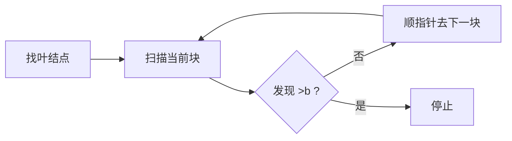
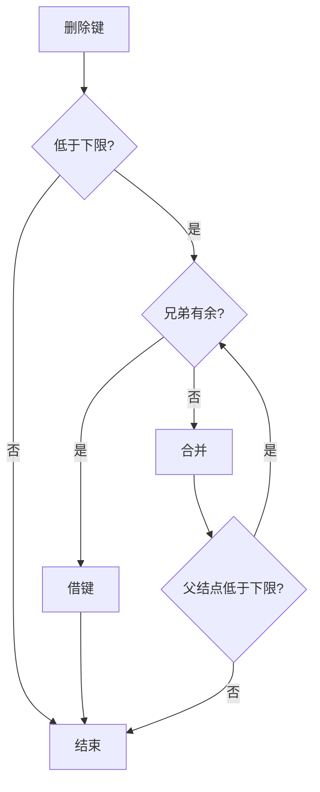

# B树/B+树的查找、范围查询、插入（分裂与新建根）与删除（先借后合并原则）

> [!IMPORTANT]
> B树/B+树能==自动保持与数据文件大小相适应的索引层次==，使每个块的充满程度在**半满**和**全满**之间，不需要溢出块。

## 为什么需要B树

堆文件按先来后到存储，无序；顺序文件插入代价极高（需全部重排序）。传统的稠密/稀疏索引在频繁增删时会产生碎片化或大量溢出块。B树是一棵平衡树，从树根到任一树叶的路径都一样长，通过动态分裂与合并解决上述问题。

## 结构特征

关键参数 $n$ 决定每个存储块的布局：最多 $n$ 个键值和 $n+1$ 个指针。

| 结点类型 | 指针要求 | 键值数量 | 说明 |
| :--- | :--- | :--- | :--- |
| 根结点 | $\ge 2$ 个 | - | 不管 $n$ 多大，至少两个指针 |
| 内部结点 | $\ge \lceil(n+1)/2\rceil$ 个 | $j-1$ 个 | $j$ 个指针分 $j$ 个区间 |
| 叶结点 | $\ge \lfloor(n+1)/2\rfloor$ 个指向记录 | - | 最后一个指针指向右邻叶块 |

若有 $j$ 个指针，则键值为 $K_1, ..., K_{j-1}$。第一个指针指向 $< K_1$ 的部分，第二个指向 $\ge K_1$ 且 $< K_2$ 的部分，依此类推。

## 查找与范围查询

**点查找**：从根开始，根据键值区间选择对应指针向下，直到叶结点。

**范围查询**（在叶结点上查找 $[a,b]$）：
1. 先查找到可能出现 $a$ 的叶结点。
2. 在该结点向右扫描，若未遇到 $>b$ 的键，则顺着叶结点间的指针进入下一个叶块继续检查，直到找到 $>b$ 的键停止。

## 插入：分裂与新建根

> [!TIP]
> 核心口诀：有空直接插，没空就分裂，父满向上推，根满建新根。

1. **寻找位置**：设法在叶结点找到空闲空间，有空间直接插入。
2. **叶结点分裂**：若无空间，将叶结点分裂为两个，使每个结点有一半或刚好超过一半的键（左侧多，右侧少）。
3. **向上传递**：下层分裂相当于在父结点插入新键-指针对。父结点有空则插，无空则继续分裂。
4. **新建根**：若根结点也无空间，分裂根结点并在上层创建新根（这是B树长高的唯一方式）。

## 删除：先借后合并原则

> [!WARNING]
> 删除前若结点处于最小充满度，删除后违反约束，必须调整！

1. **先借**：尝试向左兄弟或右兄弟借一个键。若兄弟有多余键，将其移入当前结点，并修改父结点中的分隔键。
2. **后合并**：若左右兄弟都只有最少键（无法借），则将当前结点与某兄弟合并，同时删除父结点中的一个键和指针。若父结点因此低于下限，继续向上“先借后合并”。

## B树与B+树的辨析

| 特性 | B树 | B+树 |
| :--- | :--- | :--- |
| 数据存储 | 所有结点均可存数据 | 仅叶结点存数据/指针 |
| 范围查询 | 需中序遍历整棵树 | 仅需沿叶结点链表顺序扫描 |
| 内部结点容量 | 较小（含数据指针） | 较大（只存键和子树指针） |

> [!NOTE]
> I/O开销：读操作为层数加一次；增删操作为层数加二次。因 $n$ 通常很大（$\ge 100$），三层即可支撑极大数据库，重组开销基本可忽略。
