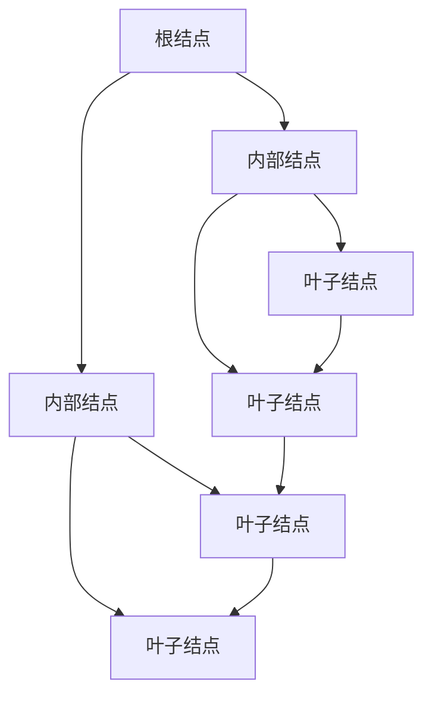

# B树/B+树的结构特征（内部结点、叶子结点、秩为n的B树特征、键和指针数目规则）

## 为什么需要 B 树

索引是为了加速查找，但如果索引本身完全放进内存或只建单层结构，在数据文件不断增大时，层次和查找代价就难以控制。B 树的价值就在于：它==自动保持与数据文件大小相适应的索引层次==，并且始终是一棵平衡树，树根到任一叶子的路径都一样长。这样无论插删多少次，查找代价都稳定。

## B 树的结构特征

B 树通常有根、内部结点、叶子结点三层，但可以有任意多层。它有一个关键参数 $n$，规定每个存储块==最多有 $n$ 个键值和 $n+1$ 个指针==。所有键值在结点内从左到右升序排列。

### 内部结点

内部结点的 $n+1$ 个指针都指向下一层块。若非根内部结点有 $j$ 个指针，就有 $j-1$ 个键值 $K_1,\dots,K_{j-1}$，第 1 个指针指向小于 $K_1$ 的部分，第 2 个指向 $[K_1,K_2)$，依此类推，第 $j$ 个指向大于等于 $K_{j-1}$ 的部分。除根外，内部结点至少要使用 $\lceil (n+1)/2 \rceil$ 个指针。

### 叶子结点

叶子结点除最后一个指针外，其余指针都指向数据文件中的记录；最后一个指针指向下一个叶子结点，便于范围查询顺序扫描。叶子结点至少要有 $\lfloor (n+1)/2 \rfloor$ 个指向数据的指针。

### 根结点

根结点是特例：不管 $n$ 多大，==至少有两个指针被使用==，允许出现“一个键值两个指针”的较小状态。

## 秩为 $n$ 的 B 树规则

| 结点类型 | 最大指针数 | 最大键值数 | 最少指针数 | 最少键值数 |
|---|---:|---:|---:|---:|
| 内部结点（非根） | $n+1$ | $n$ | $\lceil (n+1)/2 \rceil$ | $\lceil (n+1)/2 \rceil-1$ |
| 叶子结点（非根） | $n+1$ | $n$ | $\lfloor (n+1)/2 \rfloor$ | $\lfloor (n+1)/2 \rfloor$ |
| 根结点 | $n+1$ | $n$ | 2 | 1 |

> [!IMPORTANT]
> 记法最关键：==“秩为 $n$”表示每块最多 $n$ 键、$n+1$ 指针==，半满规则再分内部结点取上整、叶子结点取下整。

## 一个算对的例子

若 $n=3$：

- 非根内部结点：最多 3 键 4 指针，至少 $\lceil 4/2\rceil=2$ 指针、$1$ 键。
- 非根叶子结点：最多 3 键 4 指针，至少 $\lfloor 4/2\rfloor=2$ 个数据指针，最后 1 个指针指向下一个叶子。

## 常见坑

> [!WARNING]
> 不要把叶子结点的“下一个叶子指针”计入指向数据记录的指针数；内部结点和叶子结点的最小指针数公式不同，一个上取整，一个下取整。

> [!TIP]
> 做题先写三句话：最多 $n$ 键 $n+1$ 指针；内部至少 $\lceil (n+1)/2 \rceil$；叶子至少 $\lfloor (n+1)/2 \rfloor$。再套根结点“至少 2 指针”的特例。
