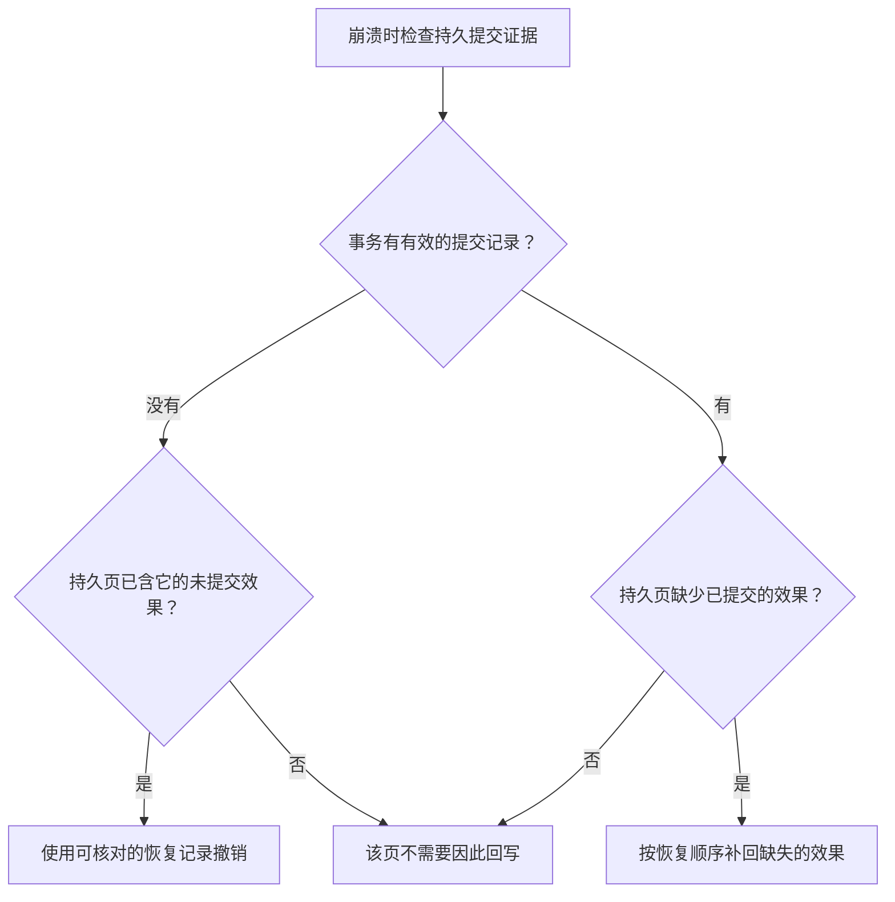

# DBMS提供的能力及系统成分（Megatron2000原型概述）

## DBMS 提供的能力

先想一个问题：如果不用 DBMS，让每个应用程序自己用文件去存数据、管数据，会发生什么？

同一个“学生成绩”数据，教务系统存了一份，学工系统又存了一份，两边格式还不一样；程序一改，文件格式就崩了；两个程序同时改同一份文件，数据可能互相覆盖。DBMS 存在的意义，就是把这些问题从应用程序里“拿过来”，由系统统一解决。

DBMS 提供四类核心能力：

| 能力 | 解决什么问题 | 关键机制 |
|------|------------|----------|
| **持久存储** | 数据不能随程序结束而消失 | 数据独立于程序存储，管理效率更高 |
| **编程接口** | 用户不必关心数据物理存放细节 | 用 SQL 语句声明“要什么”而非“怎么取” |
| **查询优化** | 同样的 SQL，执行效率可以差几个数量级 | 自动选择是否使用索引、如何连接 |
| **事务管理** | 并发修改与故障恢复 | 遵循 ACID 准则 |

## 事务边界与部件职责

==事务是一次提交或回滚所覆盖的工作单位，不等于一条 SQL。== 自动提交模式下，一条语句通常占一个隐式事务；显式事务则可以把「扣减甲库」「增加乙库」合在同一次提交。若两条分别自动提交，失败可能只留下扣减；此时每条语句都完成了各自的事务，整体库存仍不满足业务约束。

| 需要保护什么 | 首先看哪一层 |
|---|---|
| 原子性：提交全部效果，或撤销、排除未完成的效果 | 事务边界与恢复机制 |
| 一致性：正确事务保持约束和业务不变量 | 约束、事务逻辑与合适的隔离级别 |
| 隔离性：并发事务能看见什么、怎样交错 | 调度、锁或版本等并发控制 |
| 持久性：已确认的提交经承诺故障后仍有效 | 恢复与存储的持久化保证 |

> [!WARNING]
> 并发控制和恢复必须配合，但不宜把 ACID 记成两两分给两个部件。日志可以让一个已经提交的错误金额持久化，它不能替应用判断哪个金额才合法。参见 PostgreSQL 的[事务说明](https://www.postgresql.org/docs/current/tutorial-transactions.html)。

---

## DBMS 接受的两类命令

DBMS 的命令可按意图分类，而不是对使用者作硬性分工：有权限的应用也能执行 DDL，维护者也可以查询数据。

| 命令来源 | 使用者 | 语言 | 作用对象 |
|---------|--------|------|---------|
| 建立数据库模式的命令 | DBA | DDL（数据定义语言） | 表结构、索引、视图 |
| 查询与修改数据的命令 | 普通用户 / 应用程序 | DML（数据操纵语言） | 表中的记录 |

典型 DDL：`CREATE TABLE`、`CREATE INDEX`；典型 DML：`SELECT`、`UPDATE`、`INSERT`、`DELETE`。

---

## 物理地址与逻辑地址

数据存在磁盘上，怎么“找到”一条记录？有两套地址体系：

**物理地址**在所采用的存储模型里直接定位数据，不必暴露现代设备的实际磁盘几何：

- 块地址：`主机 + 设备 ID + 柱面号 + 扇区号 + 块号`
- 记录地址：在块地址的基础上再加上 `块内偏移量`

**逻辑地址**则是面向用户的稳定标识，通常是 `表名 + 记录 ID` 形式的定长字节串。

> [!WARNING]
> 物理地址会随着数据被移动（如块重新分配、数据重组）而失效；逻辑地址保持稳定，但每次访问都需要通过某种映射转换为物理地址。两者不能混为一谈。

---

## 恢复要比较提交证据和磁盘上的页

允许未提交的脏页先写出时，覆盖旧页之前须先有可用于撤销的持久记录。允许提交后才写出脏页时，确认提交前须有可用于重做的持久记录和提交证据。两条分别解决「旧值被覆盖」和「新值没来得及写」，不是任何系统都必须采用的同一写盘策略。

**补充算例。** 单个事务把 A 从 100 改为 200。崩溃时若没有持久提交且磁盘仍是 100，不必给该页写一次 100；若磁盘已是 200 才需要撤销。若提交有效而磁盘仍是 100，则应补到 200；磁盘已含正确结果时可跳过。本例只用一个事务，实际恢复还要处理并发更新、日志与数据页顺序，以及恢复时再次故障。这些边界在课程的日志与事务恢复一节进一步展开。
