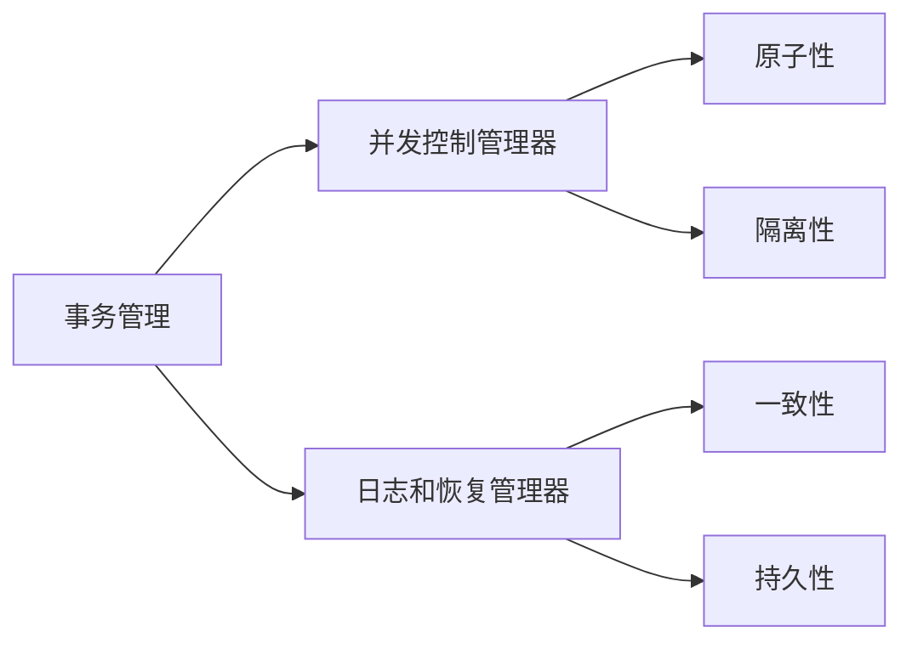
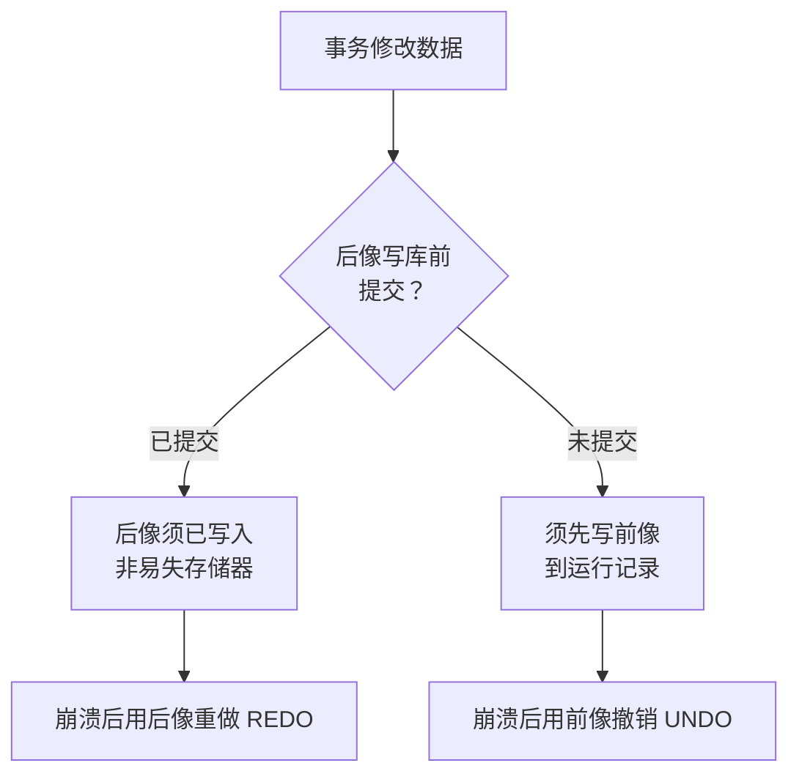

# DBMS提供的能力及系统成分（Megatron2000原型概述）

## DBMS 提供的能力

先想一个问题：如果不用 DBMS，让每个应用程序自己用文件去存数据、管数据，会发生什么？

同一个“学生成绩”数据，教务系统存了一份，学工系统又存了一份，两边格式还不一样；程序一改，文件格式就崩了；两个程序同时改同一份文件，数据可能互相覆盖。DBMS 存在的意义，就是把这些问题从应用程序里“拿过来”，由系统统一解决。

DBMS 提供四类核心能力：

| 能力 | 解决什么问题 | 关键机制 |
|------|------------|----------|
| **持久存储** | 数据不能随程序结束而消失 | 数据独立于程序存储，管理效率更高 |
| **编程接口** | 用户不必关心数据物理存放细节 | 用 SQL 语句声明“要什么”而非“怎么取” |
| **查询优化** | 同样的 SQL，执行效率可以差几个数量级 | 自动选择是否使用索引、如何连接 |
| **事务管理** | 并发修改与故障恢复 | 遵循 ACID 准则 |

其中事务管理又拆成两个部件：

- ==并发控制管理器（调度器）==：保证 **原子性（Atomicity）** 与 **隔离性（Isolation）**。
- ==日志和恢复管理器==：保证 **一致性（Consistency）** 与 **持久性（Durability）**。

ACID 四个性质与两个部件的对应关系是高频考点，容易张冠李戴。记忆方法：调度器管的是“多个事务同时跑时别互相干扰”，所以是 A 和 I；日志管理器管的是“崩溃了能不能恢复”，所以是 C 和 D。

> [!IMPORTANT]
> 每一个 SELECT 或 UPDATE 动作本身就是一个事务。事务的“原子性”指的是：事务内的操作要么全部成功，要么全部不留下痕迹。

---

## DBMS 接受的两类命令

DBMS 的命令入口分为两类，对应两类使用者：

| 命令来源 | 使用者 | 语言 | 作用对象 |
|---------|--------|------|---------|
| 建立数据库模式的命令 | DBA | DDL（数据定义语言） | 表结构、索引、视图 |
| 查询与修改数据的命令 | 普通用户 / 应用程序 | DML（数据操纵语言） | 表中的记录 |

典型 DDL：`CREATE TABLE`、`CREATE INDEX`；典型 DML：`SELECT`、`UPDATE`、`INSERT`、`DELETE`。

---

## 物理地址与逻辑地址

数据存在磁盘上，怎么“找到”一条记录？有两套地址体系：

**物理地址**直接指明数据在硬件上的位置：

- 块地址：`主机 + 设备 ID + 柱面号 + 扇区号 + 块号`
- 记录地址：在块地址的基础上再加上 `块内偏移量`

**逻辑地址**则是面向用户的稳定标识，通常是 `表名 + 记录 ID` 形式的定长字节串。

> [!WARNING]
> 物理地址会随着数据被移动（如块重新分配、数据重组）而失效；逻辑地址保持稳定，但每次访问都需要通过某种映射转换为物理地址。两者不能混为一谈。

---

## 事务恢复的两个关键规则

事务在提交前随时可能失败，系统必须能“撤销”它做过的修改。这就引出**先记后写规则**：

> 如果后像（新值）要在事务提交前写入数据库，则必须先把前像（旧值）写入运行记录。

为什么要这样？因为事务提交前失败时，需要根据前像把数据改回原样。先“留底”，再动数据，否则一旦崩溃就找不到旧值了。

另一个规则是**提交规则**：

> 后像必须在事务提交前写入非易失存储器——可以写入数据库，也可以只写入运行记录。

注意，==提交规则并不要求后像一定在提交前落盘到数据库文件里==，写入运行记录也满足条件。提交之后系统再慢慢把后像刷入数据库，期间若发生故障，可依据运行记录中的后像**重做（redo）**。

把两条规则合起来看：

> [!TIP]
> 记两条规则：**“提交前，后像要落非易失；改库前，前像要留底。”** 第一条保证提交后能重做，第二条保证失败时能撤销。

---

## 一个算对了的例子

设事务 T 要把记录 A 的值从 `100` 改成 `200`。按规则执行顺序：

1. **先写前像**：把 `A = 100` 写入运行记录（日志落盘）。
2. **再写后像**：把 `A = 200` 写入数据库缓冲。
3. **提交**：确保后像 `A = 200` 已写入非易失存储器（可能是运行记录，也可能是数据库文件），事务提交。

若在第 2 步之后、提交之前系统崩溃：运行记录里有前像 `100`，恢复时执行 **UNDO**，把 A 改回 `100`，事务等于没发生过。若提交已完成后数据库写盘中断：运行记录里有后像 `200`，恢复时执行 **REDO**，把 A 补写成 `200`，保证持久性。

这两种情况正好对应了 ACID 中 A（原子性：未提交就全部撤销）和 D（持久性：已提交就必定生效）的要求。
