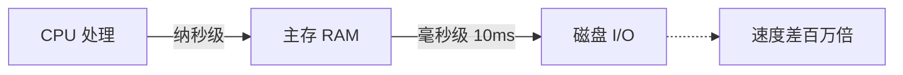

# I/O计算模型与RAM计算模型

## 为什么数据库算法不能照搬内存算法？

在《数据结构》中我们追求时间复杂度 $O(n)$ 或 $O(\log n)$，但在 DBMS 实现中，这个标准为何突然“失效”了？核心原因在于 ==I/O 与 CPU 的速度鸿沟==。RAM 计算模型假设所有数据访问代价均等，而 I/O 计算模型承认磁盘访问是性能瓶颈。读一个 4~64KB 的块约需 $10ms$，CPU 在此期间可执行上百万条指令；而块载入主存后，即便线性搜索也仅需数千条指令（耗时 $<1\%$）。因此，DBMS 算法优化的首要目标不是减少 CPU 比较次数，而是 ==最小化磁盘 I/O 次数==。

> [!IMPORTANT]
> I/O 计算模型的核心准则：==磁盘访问次数是衡量 DBMS 算法优劣的第一指标==，内存中的计算开销在 I/O 面前通常可忽略不计。

## 索引结构如何适配 I/O 模型？

既然 I/O 昂贵，索引设计就必须围绕“少读块”展开。稠密索引与稀疏索引是两种典型策略，其本质区别在于对 I/O 代价的权衡：

| 特性 | 稠密索引 | 稀疏索引 |
| :--- | :--- | :--- |
| 索引项粒度 | 每个记录对应一项 | 每个数据块对应一项 |
| 索引大小 | 大（例：40MB） | 小（例：4MB，可入主存） |
| 存在性查询 | 无需访问数据文件 | 必须读取数据块验证 |
| I/O 优化点 | 减少数据块扫描 | 索引本身常驻内存 |

> [!TIP]
> 记忆口诀：==稠密查存在，稀疏省空间==。若索引能全部放入主存，稀疏索引只需 1 次 I/O 读数据块，远优于稠密索引的多次磁盘查找。

## 散列表在磁盘上有何不同？

内存散列用链表解决冲突，但磁盘散列的桶必须由 ==存储块== 构成。当桶满时通过溢出块链扩展，且需保证给定桶号 $i$ 能直接定位首个块地址。面对数据增长，动态散列有两种策略：

- **可扩展散列**：桶数组翻倍，仅用哈希值前 $i$ 位寻址。优点是桶数组在内存时效率极高；缺点是翻倍瞬间 I/O 激增，且可能提前分裂浪费空间。
- **线性散列**：每次桶数 $B+1$，增长更平滑，避免了一次性重组的巨大 I/O 开销。

> [!WARNING]
> 切勿将内存散列的“链表法”直接套用于磁盘！磁盘散列必须以 ==块为单位== 组织溢出链，否则指针追逐会导致大量随机 I/O，彻底违背 I/O 计算模型初衷。

## 实战计算：索引 I/O 对比

以课件经典例题验证：关系 $R$ 有 $10^6$ 元组，块大小 4096B，每块存 10 元组，键 30B + 指针 8B，每块可存 100 个索引项。

- **无索引顺序查找**：需扫描 $100,000$ 块，I/O = $100,000$ 次。
- **无索引二分查找**：$\log_2 100000 \approx 17$ 次 I/O（前提：数据有序且支持随机访问）。
- **稠密索引**：索引占 $10,000$ 块，二分查找 $\log_2 10000 \approx 14$ 次 I/O + 1 次数据块 = $15$ 次。
- **稀疏索引**：仅 $1,000$ 索引块（≈4MB），==可完全载入主存==，故只需 1 次数据块 I/O。

> [!CAUTION]
> 计算 I/O 时务必区分 ==索引是否在内存==。若题目未说明索引驻留主存，默认按磁盘二分查找计算；若明确“索引在主存”，则索引访问 I/O 为 0，仅计数据块读取次数。这是考试中最常见的失分点。
