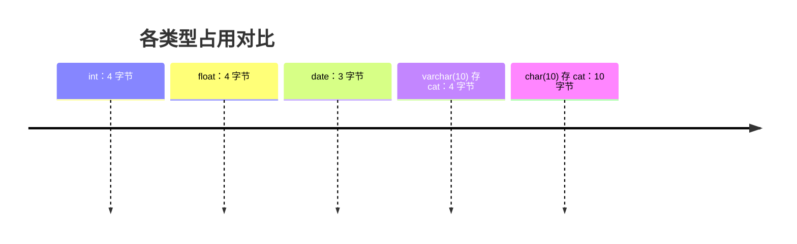

# 基本SQL数据类型及长度与内存对齐

## 基本 SQL 数据类型及长度

数据库必须把逻辑上的“属性值”落到磁盘的字节序列里。不同数据类型的长度差异直接影响一条记录的物理大小，也影响建表时 `varchar(n)` 里 n 该怎么取。先看最常见的一对：`char(n)` 与 `varchar(n)`。

**`char(n)` 定长字符串**：无论实际存了几个字符都占用 n 个字符的空间。如果字符集是单字节的（如 Latin-1），就是 n 字节。存 `'cat'` 到 `char(10)`，占 10 字节，后面 7 个字节填充空格或直接浪费掉。

**`varchar(n)` 变长字符串**：只保存实际内容的长度，额外用 1 或 2 字节记录“内容有多长”。于是 `varchar(10)` 存 `'cat'` 只需 3 + 1 = 4 字节（长度前缀法）或 3 + 1 = 4 字节（终止符法）。

> [!IMPORTANT]
> ==`varchar(255)` 的长度前缀是 1 字节，`varchar(65535)` 的长度前缀是 2 字节==。判断依据：n ≤ 255 用 1 字节，256 ≤ n ≤ 65535 用 2 字节。`varchar(10)` 属于前者，总占用 = 实际字符数 + 1。

### 两种实现方式

- **方法 1：长度 + 内容**。用一个 8 位二进制整数记长度，后面紧跟内容。存 `'cat'` 时，第一个字节是 `00000011`（即数字 3 的二进制），随后是 `c`、`a`、`t` 三个字符的编码。
- **方法 2：空值作终止符**。内容后面补一个特殊终止符号（类似 C 语言字符串的 `\0`），读取时扫描到终止符为止。

| 特性 | 方法 1（长度前缀） | 方法 2（终止符） |
|---|---|---|
| 求长度 | O(1) 读前缀 | O(n) 扫描 |
| 内容含终止符 | 可以 | 需要转义 |
| 空间占用 | 内容 + 1 或 2 字节 | 内容 + 1 字节 |

### 其他常用类型

- `int` / `integer`：==4 字节==，有符号整数，范围约 ±21 亿。
- `float` / `real`：单精度浮点，==4 字节==。
- `double`：双精度浮点，==8 字节==。
- `bit(n)` 定长位串：`ceil(n/8)` 字节。例如 `bit(10)` 需要 `ceil(10/8) = 2` 字节。
- `date`：==3 字节==；`time`：3～6 字节；`datetime` / `timestamp`：4～8 字节。

### 内存对齐为什么重要

记录在磁盘和内存中存放时，CPU 按机器字长（通常 4 或 8 字节）读取更高效。如果字段起始地址不是其大小的整数倍，CPU 需要两次读取才能拼出一个值。

> [!NOTE]
> SQL 标准定义的是“逻辑长度”，DBMS 物理存储时可能额外做对齐填充。考试层面先按逻辑长度计算：把各字段长度相加即可，==不额外加填充字节==，除非题目明确要求考虑对齐。

### 常见坑与一个算对的例子

> [!WARNING]
> ==`char(n)` 与 `varchar(n)` 的空间计算方向相反==：`char` 看声明长度 n，与实际内容无关；`varchar` 看实际内容长度再加前缀。别在 `varchar(10)` 存 `'cat'` 时算成 11 字节——11 字节是“最坏情况满存 10 个字符”的占用。

**例题**：属性 A 声明为 `varchar(10)`，存 `'cat'`。
- 方法 1（长度前缀）：1 字节前缀 + 3 字节内容 = **4 字节**。
- 方法 2（终止符）：3 字节内容 + 1 字节终止符 = **4 字节**。
- 如果声明改成 `char(10)`：**10 字节**，与实际内容无关。

再算 `varchar(300)` 存 300 个字符：n = 300 > 255，长度前缀用 2 字节，总占用 = 300 + 2 = **302 字节**。`varchar(255)` 存满 255 字符：255 + 1 = **256 字节**。
