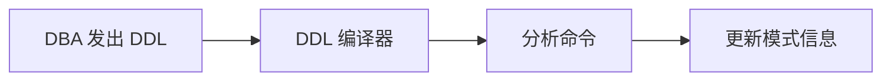
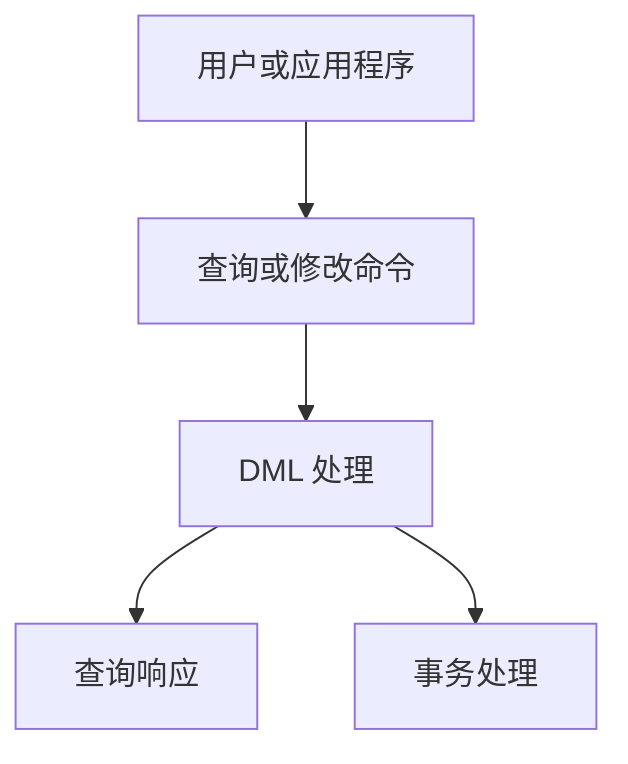

# DBMS接受的两类命令来源（DDL与DML/查询处理概述）

## 两类命令来源

DBMS 面对的命令可按“谁发出、做什么”分为两类：

| 来源 | 语言 | 作用对象 | 典型命令 |
|---|---|---|---|
| DBA 建立数据库模式 | DDL（Data Definition Language） | 模式、表结构、约束等元数据 | `CREATE`、`ALTER`、`DROP` |
| 普通用户和应用程序 | DML（Data Manipulation Language） | 数据本身 | 查询、插入、删除、修改 |

> [!IMPORTANT]
> ==DDL 定义“数据长什么样”，DML 处理“数据是什么、怎样变化”==。查询命令和修改命令都属于 DML，不要把“查询”单独划成与 DML 并列的第三类来源。

例如，DBA 执行 `CREATE TABLE Student(...)` 是在建立模式；应用程序执行 `SELECT * FROM Student` 或 `UPDATE Student SET ...` 是在查询或修改数据。

## DDL 怎样执行

DDL 命令先交给 **DDL 编译器**进行分析：识别命令、检查语法与相关定义，再把模式变更落实到系统维护的元数据中。可以用下面的主线理解：



这里最容易被流程图带偏：`CREATE`、`ALTER`、`DROP` 并不是先走普通查询优化，再像查询一样返回答案；它们首先改变的是数据库的结构定义。之后，针对这些表的 DML 才能依据新的模式被正确处理。

## DML 与查询处理概述

对 DML 中的查询部分，课件用两条主线概括：

- **查询响应**：DBMS 接收查询，经过查询处理，把结果返回给用户或应用程序。关注点是“怎样得到并返回正确结果”。
- **事务处理**：把查询、修改放在事务的执行与并发、故障背景中考虑，保证数据库状态正确。



> [!NOTE]
> “查询处理概述—事务处理”不是说只有修改命令才涉及事务。事务处理关注的是一组操作作为一个执行单位时的正确性；查询响应关注的是查询请求得到结果的过程，二者是不同观察角度。

## 相近概念与常见坑

| 易混点 | 正确区分 |
|---|---|
| DDL 与 DML | 前者定义、调整、删除模式对象；后者查询、修改数据 |
| DBA 与普通用户 | 是课件划分命令来源的语境，不等于任何系统都只能用一种固定账号权限模型 |
| `DROP` 与 `DELETE` | `DROP` 属于 DDL，删除表等结构对象；`DELETE` 属于 DML，删除表中的数据行 |
| 查询与修改 | 都可来自普通用户和应用程序，均归入 DML |
| DDL 编译器与查询处理 | DDL 先由 DDL 编译器分析；不要把 DDL 画成普通查询响应流程 |

> [!WARNING]
> 看到 `DROP TABLE S` 就答“DML 删除数据”是典型错误：它删除的是表结构，属于 DDL。相反，`DELETE FROM S` 删除的是行，表结构仍在。

## 一个做对的分类例

题目：判断下列命令的来源与类型。

```sql
CREATE TABLE S(id INT);
ALTER TABLE S ADD name CHAR(10);
SELECT * FROM S;
UPDATE S SET name = 'A' WHERE id = 1;
DROP TABLE S;
```

正确答案是：前两条由 DBA 建立、调整数据库模式，属于 DDL；`SELECT` 与 `UPDATE` 是普通用户或应用程序对数据的查询、修改，属于 DML；最后的 `DROP` 又回到 DDL。若 `SELECT` 没有返回结果，应先检查表是否已由 DDL 建立、数据是否已由 DML 写入，而不是把查询本身误判为 DDL。

> [!TIP]
> 记忆口诀：**建改删结构看 DDL，查改增删数据看 DML**。其中“删”要先问删的是结构还是行。
