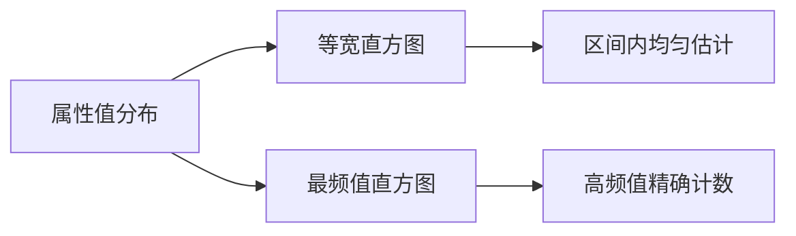

# 代价估计及常见参数获取方法

## 代价估计与常见参数获取方法

代价估计是查询优化器的核心任务：在多个等价执行计划中，估算每一个计划的 I/O 代价与 CPU 代价，选出总代价最小的那个。估计的准确性直接决定执行计划的好坏，而估计的基础是**统计参数**——关系大小、属性值分布等。

### 为什么需要直方图

假设属性 `grade` 取值 1～100，共有 1000 个元组。问：`grade = 30` 有多少条？

最简单的估计是用均匀分布假设：每个值出现的次数相同。那么 `V(grade, R) = 100`，每个值约 $T(R)/V = 1000/100 = 10$ 条。但真实数据往往**倾斜分布**——少数值出现极多，多数值零星分布。均匀假设会导致严重低估或高估，于是引入**直方图**来刻画分布。

### 两类常用直方图

**等宽直方图**把取值范围切成等宽区间，统计每个区间内元组数：

- 选定宽度 $w$ 和起点 $v_0$，区间为 $[v_0, v_0+w)$、$[v_0+w, v_0+2w)$……
- 对落在区间内的值，估计时假设**区间内均匀分布**。

**最频值直方图**单独列出出现次数最多的若干值及其精确频数，其余值再用等宽直方图估计。两者常配合使用，解决“重尾”问题。

### 估计选择结果大小

设关系 $R$ 有 $T(R)$ 个元组，属性 $A$ 的等宽直方图区间宽度为 $w$，某区间内有 $c$ 个元组。查询 `σ_{A=v}(R)` 的估计结果：

$$
\frac{c}{w}
$$

即**该区间内假设均匀分布**，每个值约占 $\dfrac{c}{w}$ 条。

> [!IMPORTANT]
> 等宽直方图的估计公式是 $\dfrac{c}{w}$，不是 $\dfrac{T(R)}{V}$；后者是全局均匀假设，只在无直方图时使用。

### 一个算对了的例子

关系 `Student` 有 $T = 10{,}000$ 个元组，属性 `age` 取值范围 18～38。等宽直方图以 $w=5$ 分段：

| 区间 | 元组数 |
|:---:|:---:|
| [18, 23) | 2000 |
| [23, 28) | 5000 |
| [28, 33) | 2500 |
| [33, 38] | 500 |

查询 `σ_{age=25}(Student)`：25 落在区间 [23, 28)，$c = 5000$，$w = 5$，估计结果：

$$
\frac{5000}{5} = 1000
$$

如果用全局均匀假设：$V(age) = 21$，估计 $\dfrac{10000}{21} \approx 476$，明显偏低——因为 23～28 这段恰是高频区。直方图捕捉到了这一点。

### 选择率的含义

估计结果大小与总元组数之比称为**选择率**：

$$
s = \frac{c/w}{T(R)}
$$

优化器用选择率决定连接顺序、是否使用索引等。选择率越小，越倾向于用索引。

### 参数获取方式

DBMS 通过**扫描整个关系**统计 $T(R)$、$V(A, R)$ 及直方图。这些统计信息存入系统目录，在数据大量更新后可能过期，需要周期性更新。

> [!WARNING]
> 直方图区间内“均匀分布”仍是**近似假设**，如果区间内分布也不均匀（如中间某个值集中出现），估计依然可能失真。此时更细的宽度 $w$ 或最频值直方图可以缓解。

> [!TIP]
> 考试计算时先定位值落在哪个区间，再取该区间的 $c$ 和 $w$，代入 $c/w$。若题目给的是最频值直方图，匹配到的高频值直接用精确频数，不除以 $w$。

### 和均匀分布假设的区别

| 方法 | 假设 | 适用场景 |
|:---:|:---:|:---:|
| 全局均匀 | 所有值频数相同 | 分布均匀、无统计信息 |
| 等宽直方图 | 区间内均匀 | 分布有波动但区间内较平 |
| 最频值直方图 | 高频值精确计数 | 明显重尾分布 |

代价估计的可靠性取决于统计信息的质量；直方图是连接查询优化理论与工程实践的关键桥梁。
