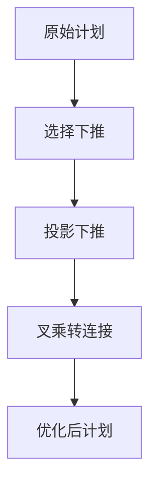

# 代数优化与关系代数表达式改进的经验原则（选择、投影、连接的转换与结合规则，早做投影）

## 什么是代数优化

在《数据库管理系统实现》中，查询优化器通常采用==代数优化==与代价优化相结合的策略。代数优化是指在不改变查询结果的前提下，利用关系代数的等价变换规则，将初始逻辑查询计划转换为更高效的等价表达式。它不依赖具体的统计信息，而是基于数学上的等价性进行“结构性”改进，是生成高效执行路径的第一步。

> [!IMPORTANT]
> 代数优化的核心目标是==减少中间结果规模==，而非直接计算I/O或CPU代价。

## 为什么需要代数优化

如果直接按照SQL语义生成“笛卡尔积→选择→投影”的原始方案，中间结果可能呈指数级膨胀。例如两个万级表做叉乘再过滤，会产生上亿条临时元组。代数优化通过下推选择和投影、合并操作等手段，在逻辑层面就消除冗余计算，为后续基于统计信息的代价优化提供更小的搜索空间。

## 怎么做：核心转换规则与经验原则

代数优化依赖一组等价变换规则，以下是南邮课程强调的关键规则：

- **选择下推**：$\sigma_{c_1 \land c_2}(R) \equiv \sigma_{c_1}(\sigma_{c_2}(R))$，且选择可下推到连接、投影之下。
- **投影下推**：$\pi_L(\sigma_c(R)) \equiv \pi_L(\sigma_c(\pi_{L'}(R)))$，其中 $L'$ 包含 $L$ 和 $c$ 中属性。
- **选择与连接结合**：$\sigma_{R.A=S.B}(R \times S) \equiv R \bowtie_{R.A=S.B} S$。
- **投影与连接结合**：若连接后只需部分属性，可提前对参与连接的表做投影。

> [!TIP]
> 经验原则口诀：==选择早下推，投影尽早做，叉乘变连接==。

## 与代价优化的区别

| 维度 | 代数优化 | 代价优化 |
| :--- | :--- | :--- |
| 依据 | 关系代数等价规则 | 元数据与统计数据 |
| 目标 | 缩小中间结果 | 最小化执行代价 |
| 依赖 | 无需统计信息 | 需基数、选择率等 |
| 阶段 | 逻辑计划生成时 | 物理计划选择时 |

## 常见误区与注意事项

> [!WARNING]
> 投影下推时==必须保留上层选择或连接所需的属性==，否则会导致结果错误。例如 $\pi_B(\sigma_{A=5}(R))$ 不能简化为 $\pi_B(R)$ 后再选择。

> [!CAUTION]
> 并非所有选择都能无限下推。若选择条件涉及聚合或外层关联属性，则不能下推到内层关系中。

## 正确优化示例

设查询：$\pi_{B,D}(\sigma_{R.A='c' \land R.C=S.C}(R \times S))$

**原始方案**：先算 $R \times S$，再选择，最后投影。  
**优化步骤**：

1. 将 $\sigma_{R.A='c'}$ 下推到 $R$ 上；
2. 将 $\sigma_{R.C=S.C}$ 与叉乘结合为等值连接 $R \bowtie_{R.C=S.C} S$；
3. 在连接前对 $R$ 做 $\pi_{A,C,B}$，对 $S$ 做 $\pi_{C,D}$（保留连接键与输出属性）；
4. 最终投影 $\pi_{B,D}$ 可在连接后立即执行。

优化后中间结果仅包含满足 $R.A='c'$ 且能连接的元组，避免了全量叉乘，显著降低内存与I/O开销。此过程完全符合课件所述“首先利用索引选择R中元组，再匹配S，最后连接并投影”的执行逻辑。
