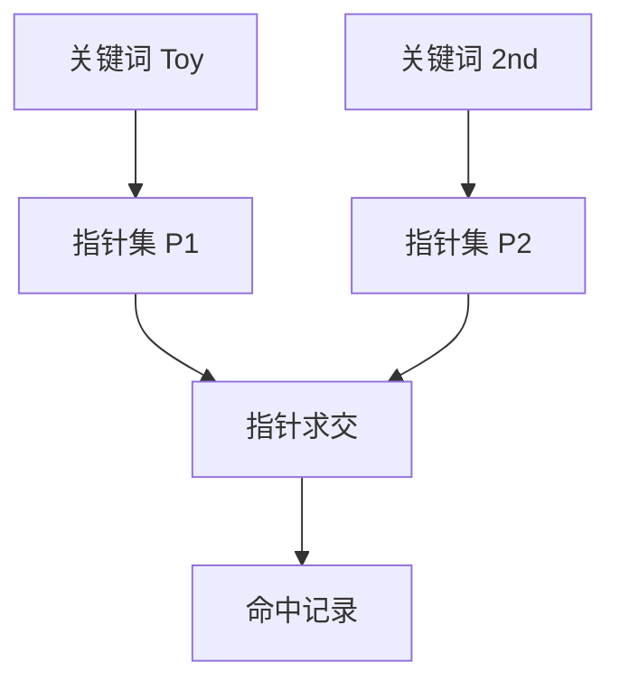

# 倒排索引与倒排文件（通过索引块交集求取记录）

## 它是什么，为什么需要

想一想：给定一组关键词 `Toy` 和 `2nd`，怎么找出同时含有这两个词的文档？最朴素的办法是**每遇到一条记录就把它所有属性值倒过来登记一遍**——每个**关键词（属性值）→ 指向含该值的记录指针**的映射，就叫==倒排索引（inverted index）==。把所有属性上的辅助索引合成一份、并把指针装进统一的桶里，就得到==倒排文件==。

它服务的典型问题是**多关键词交集查询**：单值辅助索引只能回答"含 `Toy` 的记录"，而倒排索引让我们把 `Toy` 与 `2nd` 两串指针**求交集**得到满足全部条件的记录，这正是信息检索的通用做法。

## 怎么做：通过索引块交集求取记录

具体到物理层，采用**分块 + 排序指针 + 归并求交**：

1. 每个关键词的指针按**记录号有序**排好，装入若干==索引块==；
2. 对两个关键词各取一个索引块，比较块内的最小/最大记录号区间；
3. 区间**无重叠**就跳过较小者对应的块（剪枝），区间**有重叠**才在交叠区内==两两比对==求交；
4. 交集结果并入输出，直到某一方的块全部用完。

> [!TIP]
> ==核心思想==：因为指针有序，==先按块区间剪枝，再在重叠区逐个比对==，无需两两扫描全表，复杂度从 $O(nm)$ 降到 $O(n+m)$ 量级。

**间接桶（indirect bucket）**用于提高空间利用率：不同关键词的指针串长度不一，若按最大长度预留会浪费，于是只在桶里存"指向指针串的间接指针"，指针串本身另行分配、按需增长。

> [!WARNING]
> 交集结果 ≠ "任一关键词命中"。`Toy` 与 `2nd` 求的是 ==AND== 语义；OR 语义要求**并集**，不要混用。

## 与相近概念的区别

| | 主索引（聚集） | 辅助索引（单值） | 倒排索引 |
|---|---|---|---|
| 索引项 | 一个搜索键值 | 一个搜索键值 | 一个关键词 → 指针串 |
| 适用 | 等值/范围单查 | 单属性查找 | **多关键词交集** |
| 指针指向 | 数据块/首记录 | 单条记录 | **多条记录** |
| 是否重复项 | 键值不重复 | 键值可重复 | 值→记录一对多 |

> [!NOTE]
> 主索引要求文件按搜索键**排序或聚集**；倒排索引不要求记录有序，只对指针串有序，因此插入代价更高（每插入一条记录要更新所有属性的指针串）。

## 常见坑与一个算对了的例子

> [!CAUTION]
> - 求交时忘记"指针有序"前提，退化成全扫描；
> - 把间接桶当成"省空间的指针"，其实它==省的是预留槽位，不是指针个数==；
> - 多关键词扩展时按 `(词1 AND 词2) OR 词3` 还是 `词1 AND (词2 OR 词3)` 的**运算符优先级**弄反。

设 `Toy` 的指针串为 $P_1 = \{3, 7, 12\}$，`2nd` 的指针串为 $P_2 = \{7, 12, 20\}$，分块大小 2：

- 块 $B_1 = \{3,7\}$，$B_2 = \{12\}$；$C_1 = \{7,12\}$，$C_2 = \{20\}$；
- $B_1$ 区间 $[3,7]$ 与 $C_1$ 区间 $[7,12]$ **重叠于 7**，逐个比对得 $\{7\}$；
- $B_2$ 区间 $[12,12]$ 与 $C_1$ 区间 $[7,12]$ **重叠于 12**，得 $\{12\}$；
- $C_2 = \{20\}$ 区间 $[20,20]$ 与剩余块无重叠，剪枝结束。

$$P_1 \cap P_2 = \{7, 12\}$$

故命中记录 7 与 12，恰为同时含 `Toy` 与 `2nd` 的记录。
