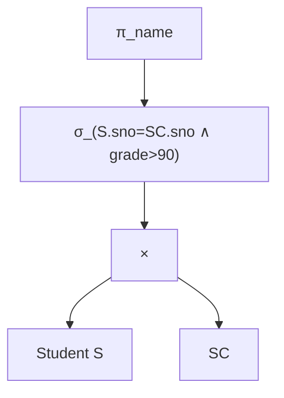

# 生成初始逻辑查询计划（关系代数描述与查询计划树）

## 它是什么

初始逻辑查询计划是查询优化第一阶段产出的**关系代数表达式树**。数据库收到 SQL 后，先经过语法解析得到语法树，再由 `construct_logical_tree()` 将其转换为由关系代数运算符组成的查询计划树。

此时生成的计划是**“初始”的**——它直接对应 SQL 的书写结构，没有经过等价变换优化，因此可能很低效，但它是后续代数优化的起点。

转换规则很简单：

| SQL 结构 | 关系代数节点 |
|---------|------------|
| `SELECT ... FROM ... WHERE ...` | $\sigma$（选择） |
| `FROM A, B` | $\times$（笛卡尔积） |
| `... JOIN ... ON ...` | $\bowtie$（连接） |
| `GROUP BY ...` | $\gamma$（分组聚合） |
| `SELECT DISTINCT` / `UNION` | $\delta$（去重）/ $\cup$ |

> [!IMPORTANT]
> 初始逻辑查询计划 = `construct_logical_tree()` 把 SQL 语法树直接翻译成关系代数树。==它按 SQL 书写顺序从下往上构造，WHERE 条件全挂在一个 $\sigma$ 里，多表连接还停留在笛卡尔积层面==。

## 为什么需要

直接按 SQL 字面意思执行往往极慢。例如 `FROM Student, SC, Course` 三个表直接做笛卡尔积，再筛掉不匹配的行，中间结果可能爆炸。查询优化必须有一个**可等价变换的数学对象**——关系代数表达式，才能应用代数规则（如把选择下推、把笛卡尔积变连接）逐步改进。

换句话说：==没有关系代数树，就没有代数优化的操作对象==。

## 怎么做：一棵树的诞生

假设有 SQL：

```sql
SELECT name
FROM Student S, SC
WHERE S.sno = SC.sno AND grade > 90;
```

语法树转初始逻辑计划树的步骤：

1. `FROM Student S, SC` → 两个叶子做 $\times$
2. `WHERE` 条件整个挂上去 → ${\sigma}_{\ S.sno = SC.sno \ \wedge\ grade > 90}$
3. `SELECT name` → 顶层投影 $\pi_{name}$



这棵树的执行逻辑是：先算出完整的笛卡尔积，再过滤，再投影。

> [!WARNING]
> 初始计划的典型问题：==选择条件和投影都被压在笛卡尔积之上==。笛卡尔积会先把所有组合都物化出来，数据量大时直接耗尽内存。代数优化的首要动作就是把 $\sigma$ 往下推。

## 和相近概念的区别

| 概念 | 是什么 | 关键区别 |
|------|--------|---------|
| 语法树 | 解析器产物，反映 SQL 语法结构 | 含 SQL 表层结构（关键字、子句） |
| 初始逻辑计划树 | 关系代数运算符树 | 纯关系代数，可做等价变换 |
| 优化后的逻辑计划 | 经过代数等价规则改写后的树 | 运算符顺序更优，但仍是逻辑层 |
| 物理计划 | 为每个逻辑算子选择了实现算法（如 hash join） | 带执行细节，可计算代价 |

**逻辑计划只说“做什么”（连接、选择），物理计划才说“怎么做”（用嵌套循环还是哈希）。**

## 一个算对的例子

上例的初始逻辑计划，执行时可估算代价。假设 `Student` 有 1000 行，`SC` 有 10000 行：

- 笛卡尔积中间结果：$1000 \times 10000 = 10^7$ 行
- 过滤后可能只剩几百行

代数优化把选择拆开并下推：

$${\pi_{name} \left( {\sigma_{grade>90}} \left( {\sigma_{S.sno=SC.sno}(Student \times SC)} \right) \right)}$$

进一步把 `S.sno = SC.sno` 变成等值连接，再用索引或哈希实现，中间结果大幅缩小。

> [!TIP]
> 记顺序：**语法树 → 初始逻辑计划 → 优化逻辑计划 → 物理计划 → 执行**。`construct_logical_tree()` 只做第二步。

常见的坑：把“初始逻辑计划”当成“优化后的计划”。初始计划只是一个**忠实的翻译**，不代表数据库真的会这样执行。
