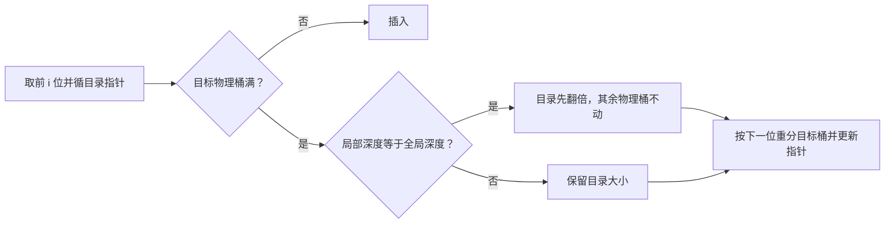

# 动态散列（可扩展散列表的三个要点与线性散列表的桶分裂过程）

静态散列表的主桶数固定。增长时若只接溢出块，热点桶的链会变长，等值搜索也要读更多页；一次性重组全文件又太贵。动态散列改变的是==定位规则能区分哪些桶==，使一次增长只重分一部分记录。

## 可扩展散列表的三个要点

设 $h(K)$ 产生 $b$ 位散列值。全局深度 $i$ 表示目录读取几位，局部深度 $j$ 表示某物理桶依赖几位。

1. **高位寻址**：取散列值前 $i$ 位作为目录下标，循该项指针定位物理桶。
2. **共享桶指针**：目录有 $2^i$ 项，一个依赖前 $j$ 位的桶可被 $2^{i-j}$ 项共同指向。
3. **按需扩目录**：目标桶满时，若 $j<i$，只按第 $j+1$ 位分裂该桶、调整相关指针；若 $j=i$，才先把每个目录前缀延伸为两项，两项初始指向同一旧桶，再分裂目标桶。目录翻倍不是把全部物理桶翻倍。

> [!IMPORTANT]
> 目录常驻内存、桶中只有一页时，读桶通常只需一次数据页 I/O。目录失去驻留性或发生溢出时不能这样估算。完整散列值相同的记录再加深也无从区分，需要溢出等保底机制。

## 线性散列表的桶分裂过程

以课件的负载触发版本为例，当前有 $n$ 个主桶、$r$ 条记录，用低 $i=\lceil\log_2 n\rceil$ 位算候选桶号 $m$。若 $m<n$，桶已存在；否则清掉候选号的最高位，回到尚未分裂的旧桶。插入后若平均条数 $r/n$ 超过阈值（如每桶 1.7 条），则新增一个桶。是否增加，与本次插入是否进入溢出页并不等价。

每次增长前，令 $M$ 为不大于当前 $n$ 的、最大的 2 的幂。新桶编号 $n$，对应的分裂对象是旧桶 $n-M$；按同一轮新生效的一位将这个旧桶的记录分回旧桶或迁到新桶。从 $n=M$ 开始，本轮依次分裂 0、1、2 等号的桶。达到 $n=2M$ 后本轮结束，下一次增长重新从 0 号桶开始。

## 对比与常见坑

| 特性 | 可扩展散列 | 线性散列 |
| :--- | :--- | :--- |
| **寻址** | 高位目录指针 | 低位候选号，未建立时回退 |
| **增长与分裂** | 目标桶满时拆目标桶，目录深度不足才翻倍 | 课件版本按全局负载加一桶，并按轮次拆指定桶 |
| **空间开销** | 目录波动大；前缀偏斜时可能分出空桶 | 局部溢出链可能暂时变长 |

> [!CAUTION]
> ==没有分裂不代表没有溢出==。例如每桶容 2 条、已有 3 桶共 4 条，其中一个桶已满。再往该桶插一条需要溢出空间，但 $5/3<1.7$，未到课件示例的分裂阈值。

## 算例演示

设散列值宽 $b=3$、目录深度 $i=2$，目标目录项是 `10`，桶容量为 2，且这个桶局部深度也是 2。已有 `100`、`100` 两条（原键可不同），现在插入 `101`。目录深度变成 3，`100` 与 `101` 最初共指旧桶；按第三位迁移后，前两条留在 `100` 物理桶，新记录去 `101` 物理桶。其他目录项扩成两项，但对应数据不必移动。

若同一个 `10` 项实际指向局部深度为 1 的 `1` 桶，则已经能用第二位区分 `10` 和 `11` 两个前缀。若桶内是 `100`、`111`、待插入 `101`，拆后 `100`、`101` 去 `10` 桶，`111` 去 `11` 桶；==$i=2$ 不变==。
