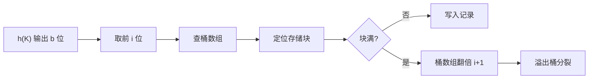

# 动态散列（可扩展散列表的三个要点与线性散列表的桶分裂过程）

静态散列表的桶数 $B$ 是固定的。当数据不断增长，存储块满了只能靠==溢出块链==解决，查找效率会急剧下降。如果直接重组（Rehash），代价又太大。怎么让桶的数量随数据量“弹性”变化？这就是**动态散列**要解决的问题。

## 可扩展散列表的三个要点

> [!IMPORTANT]
> 核心思想：桶数 $B$ 太小时，将其翻倍。

假设散列函数 $h(K)$ 产生 $b$ 位二进制输出，但当前只使用==前 $i$ 位==来寻址（初始 $i$ 满足 $2^i = B$）。它的运作依赖三个要点：

1. **位截取**：不直接用完整的 $h(K)$，而是取前 $i$ 位作为桶号。当目录翻倍时，$i$ 加 1，多区分出一位。
2. **桶数组翻倍**：增加一个指向块的指针数组（即目录）。每次空间不足时，将桶数组大小翻倍，$i \to i+1$。
3. **按需分裂**：只有发生溢出的那个桶才会真正分裂成两个物理块，并重新分配记录。

- **优点**：若桶数组小到可放入主存，只需一次磁盘 I/O 就能在存储块中找到键值为 $K$ 的记录，效率极高。
- **缺点**：桶数组翻倍后可能无法全部放入主存，导致 I/O 大幅增加；且某些块的分裂比逻辑上提前许多，会造成空间浪费。

## 线性散列表的桶分裂过程

> [!NOTE]
> 与可扩展散列不同，线性散列不采用“翻倍”策略，而是每次让桶数 ==$B$ 加一==。

为了避免一次性翻倍带来的性能抖动，线性散列引入一个指针 $n$（初始为 0）。其分裂过程如下：

1. 插入新记录时，若某桶发生溢出，并不立即翻倍目录，而是按顺序分裂第 $n$ 个桶。
2. 将第 $n$ 个桶中的记录根据新的散列函数重新分配到旧桶或新增的第 $B$ 个桶中。
3. 分裂完成后，$n \leftarrow n + 1$，$B \leftarrow B + 1$。
4. 当 $n$ 追上原来的 $B$ 时，说明所有旧桶都已轮询分裂过一轮，此时散列函数的有效位数加 1，$n$ 归零，开始下一轮。

这种机制将==分裂代价平摊==到了每一次插入操作中。

## 对比与常见坑

| 特性 | 可扩展散列 | 线性散列 |
| :--- | :--- | :--- |
| **增长方式** | 桶数组翻倍（$B \to 2B$） | 逐个增加（$B \to B+1$） |
| **分裂触发** | 溢出桶立即分裂 | 按指针 $n$ 顺序轮流分裂 |
| **空间开销** | 目录可能过大，浪费空间 | 溢出链可能暂时变长 |

> [!WARNING]
> 辅助存储器上的散列表区别于主存散列表：桶数组由==存储块==组成而非内存链表。必须设计机制保证给一个整数 $i$，对应的第一个存储块的位置就可以找到。

> [!CAUTION]
> 考试极易混淆点：不要把“溢出块链”当成动态散列！溢出链只是静态散列满了之后的补救措施，而动态散列是通过改变桶数量从根本上处理增长。

## 算例演示

设 $b=3$，当前使用 $i=2$ 位，桶数 $B=4$（编号 00, 01, 10, 11）。
现插入 $K_1$，$h(K_1) = 101$。

1. 取前 $i=2$ 位，即 `10`，映射到 2 号桶。
2. 若 2 号桶所在的存储块已满，触发分裂。
3. 桶数组翻倍，$i$ 变为 3，$B$ 变为 8。
4. 2 号桶分裂为 `010` 和 `110` 两个新桶。原记录与 $K_1$ 根据前 3 位重新落入对应的新存储块中。
