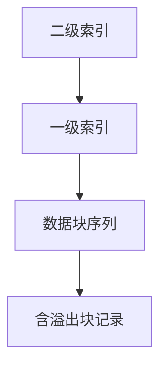
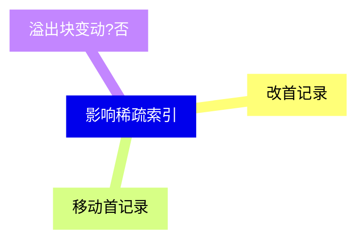

# 多级索引的实现原理

---
title: 多级索引的实现原理
requires: [数据库管理系统实现/稠密索引与稀疏索引]
---

## 为什么需要多级索引？

如果一级索引有 $10^6$ 个索引项，每个占 16 字节，索引本身有 16MB，无法一次性装入内存。查找时只能多次读盘定位索引项，性能很差。能不能在索引之上再建一层“索引的索引”？

答案是多级索引：把底层一级索引当作“数据文件”，在其上建立==二级稀疏索引==，必要时继续向上叠加。

用 mermaid 展示两层结构：

## 它是什么、怎么做

- 一级索引：可以是==稠密索引==（每个记录一个索引项），也可以是==稀疏索引==（每个基本块一个索引项）。
- 二级及以上索引：==必须是稀疏索引==，否则空间爆炸且无收益。

查找时先在二级稀疏索引里定位“一级索引所在块”，再在一级索引里定位“数据记录所在块”。

## 与相近概念的区别

| 索引类型 | 针对对象 | 是否含溢出块 | 二级以上能否使用 |
|---|---|---|---|
| 稠密索引 | 记录 | 是 | 否 |
| 稀疏索引 | 基本块 | 否 | 是 |

> [!IMPORTANT]
> 稠密索引针对**记录**，稀疏索引针对**基本块（不包含溢出块）**；二级以上必须稀疏。

## 增删改的影响原则

先想想：往某个数据块中间插入一条普通记录，稀疏索引会变吗？只有动到==块内第一个记录==时，稀疏索引的“块首键”才变化。

- 增加/删除记录：仅影响块内第一个记录时，稀疏索引才受影响。
- 移动记录：仅变更块内第一个记录时，稀疏索引才受影响。

> [!WARNING]
> 溢出块里的记录变动**不会**影响稀疏索引，因为稀疏索引只覆盖基本块。

## 一个算对了的例子

题目：判断“一级索引可稠密或稀疏；二级以上必须稀疏”是否正确。  
解答：正确。一级直接服务记录查找，可稠密；二级以上若稠密会重复存储下级全部项，浪费空间且无查询收益，故==必须稀疏==。这正是课件节 2 的核心结论。

> [!TIP]
> 口诀：一级随便密或疏，二级往上只能疏；稀疏只看基本块，首记录动才维护。
