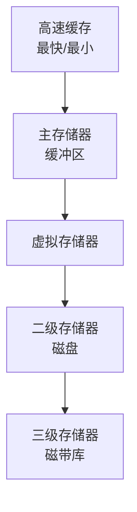

# 存储器层次结构（高速缓存、主存、虚拟存储器、二级存储器、三级存储器）

数据库系统处理的数据量通常远超物理内存容量。当数据无法全部装入主存时，我们该以什么代价去访问它？这直接决定了 DBMS 的算法设计方向。

## 存储器层次全景

DBMS 必须面对从快到慢、从小到大的多级存储体系：

> [!IMPORTANT]
> ==DBMS 中数据不能全装在主存，必须考虑二级甚至三级存储器==。因此，在二级、三级存储器中处理数据的最佳算法，完全不同于在内存中处理的算法。

**缓冲区管理器**负责将主存分割成缓冲区（Buffer），所有外存数据都要先读入缓冲区才能被 CPU 处理。

## I/O 计算模型与性能鸿沟

为什么课件反复强调“重点考虑降低磁盘访问次数”？来看一组数量级对比：

- 读一个 $4 \sim 64\text{KB}$ 的磁盘块大约需要 $10\text{ms}$。
- 处理器在这 $10\text{ms}$ 内可以执行**上百万条**指令。
- 一旦块在主存中，即使采用线性搜索查找键值 $K$，也仅执行**成千条**指令。

> [!TIP]
> 结论：==在主存中搜索的时间小于块访问时间的 $1\%$，可忽略不计==。I/O 才是性能瓶颈！

| 操作层级 | 典型耗时 | 对应指令数 | DBMS 优化策略 |
| :--- | :--- | :--- | :--- |
| 高速缓存 | $\sim \text{ns}$ | 极少 | 硬件管理 |
| 主存搜索 | $\sim \mu\text{s}$ | 成千条 | 尽量放入内存 |
| 磁盘 I/O | $\sim 10\text{ms}$ | 上百万条 | ==核心减少目标== |

## 利用主存缓冲减少 I/O

既然 I/O 极贵，如何利用有限的主存？以索引查找为例：

假设索引文件放在磁盘上，用二分查找找指定键值，需访问约 $\log_2(10000) \approx 13 \sim 14$ 个存储块，即 13～14 次 I/O。

如果改用**稀疏索引**，只需要 $1000$ 个索引块，大小约为 $4\text{MB}$。这个大小可以**完全放入主存**！此时只需 1 次 I/O 读取数据块即可。同理，**二级索引**也可以直接放在主存中，通过 1 个 I/O 取到一级索引对应的块，再取出数据块。

> [!NOTE]
> 如果索引文件足够小，可以在主存缓冲区中直接查找 $K$，完全不需要外存 I/O。把部分索引块放入内存，I/O 次数也会远低于 14。

## 主存与辅助存储器算法的区别

同样的数据结构，在不同存储层表现截然不同。以散列表为例：

记录如此多时必须放在辅助存储器。辅助存储器上的散列表区别于主存散列表：

> [!WARNING]
> 桶数组翻倍时，可能无法全部放入主存，会使 I/O 大幅增加；某些块的分裂比逻辑上提前许多，从而大幅度浪费空间。

## 块对齐规则

将一个块从磁盘读入主存时，块的第一个字节肯定放到主存的 ==$2$ 的高次幂的某个位置==。例如块大小为 $4096 = 2^{12}$，则起始地址必须是 $2^{12}$ 的倍数。

> [!CAUTION]
> 因此，要求某些字段放在 $2$ 的高次幂的主存位置，转化为：==字段在磁盘块内的偏移必须具有相同的因子==。

## 算例：查询索引的 I/O 分析

**题目**：关系 $R$ 有 $10000$ 个磁盘块。为快速响应键值 $K$ 的查询创建索引。若使用稀疏索引（$1000$ 个索引块，约 $4\text{MB}$），且主存缓冲区充足，求最坏情况下的磁盘 I/O 次数。

**解析**：
1. 若索引全在磁盘，二分查找需 $\lceil \log_2(10000) \rceil = 14$ 次 I/O。
2. 因稀疏索引仅 $4\text{MB}$，可完全放入主存缓冲区。
3. 索引查找在主存完成（耗时 $< 1\%$，忽略不计）。
4. 定位到目标块后，仅需 ==$1$ 次磁盘 I/O== 读入数据块。

这就是存储器层次结构指导 DBMS 设计的核心价值：通过将高频小体积元数据驻留上层，换取底层海量数据的极低 I/O 开销。
