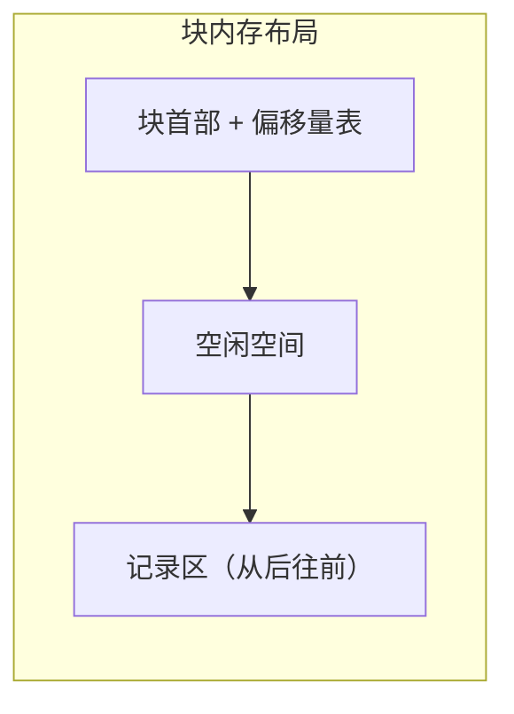

# 定长记录的构造、首部及块的格式

## 定长记录的构造、首部及块的格式

### 为什么定长记录也要“设计”？

一块磁盘块（如 4 KB）读入内存后，每一个字节都有固定地址。如果记录中所有字段都定长，我们当然可以简单地把字段一个接一个拼起来。但这里藏着两个问题：

- **内存对齐**：CPU 读取某些类型的数据时，要求数据地址是 2、4、8 的倍数。磁盘块读入内存后，块首地址天然是 $2$ 的高次幂倍数，所以==字段的块内偏移量也必须是对齐长度的倍数==，否则要么读得慢，要么直接出错。
- **变长字段混入**：`varchar(n)` 虽然内容变长，但我们常把它“定长化”——分配 `n+1` 或 `n+2` 字节的定长槽位，长度放前面，从而整个记录仍然是定长的。

所以，定长记录的构造规则不是“拼起来就行”，而是要亲自排每个字段的偏移量。

### 两条简化规则

南邮这门课的简化规则只有两条：

1. 每条记录从块内 **4 的倍数**字节处开始；
2. 记录中所有字段相对于记录起始位置的偏移量都是 **4 的倍数**。

这两条规则意味着：即使某个字段只需 1 字节（如 `char(1)`），它也可能因为对齐而“浪费”后面 3 个字节。

---

### 一个算对了的例子

```sql
CREATE TABLE moviestar(
  name char(30),
  address varchar(255),
  gender char(1),
  birthday date
);
```

先算各字段实际占用空间：

| 字段 | 类型 | 理论字节数 |
|------|------|-----------|
| `name` | `char(30)` | 30 |
| `address` | `varchar(255)` | 256（1 字节长度 + 255 内容） |
| `gender` | `char(1)` | 1 |
| `birthday` | `date` | 3 |

理论总和 $30 + 256 + 1 + 3 = 304$ 字节。

现在按“偏移量必须为 4 的倍数”修正：

- `name` 放最前面，偏移量 `0`，占 30 字节；
- `address` 不能从 30 开始，因为 30 不是 4 的倍数，取 $\lceil 30/4 \rceil \times 4 = 32$，所以偏移量 `32`；
- `address` 占 256 字节，结束于 $32 + 256 = 288$；
- `gender` 偏移量 `288`，占 1 字节；
- `birthday` 不能从 289 开始，取 292，偏移量 `292`。

所以最终记录长度是 $292 + 3 = 295$，但**下一条记录还必须从 4 的倍数开始**，所以实际每条记录占用 $296$ 字节。理论 304 字节反而比实际 296 小——这正是对齐“浪费”与 `varchar` 定长化叠加的结果。

> [!TIP]
> 算偏移量的口诀：**上一个字段结束位置若不是 4 的倍数，就向上取整到 4 的倍数**；最后记录总长度也要向上取整到 4 的倍数，否则下一条记录无法从 4 的倍数处开始。

---

### 记录首部与块的格式

记录中除了字段本身，往往还有额外的**首部**。首部常包含：

- 记录是否被删除的标志位；
- 指向记录中变长字段实际位置的指针；
- 记录长度或时间戳等元信息。

在定长记录的前提下，真正的结构复杂度出现在**块**这一层。

> [!IMPORTANT]
> 常用技巧是每个块维护一个**偏移量表**：它保存块内每条记录的起始偏移量。偏移量表从块头**往后**长，记录从块尾**往前**长，两者在中间相遇即块满。

这样一条记录的**结构地址** = **块地址** + **偏移量表项的偏移量**。即使记录在块内移动（如删除后压缩），对外暴露的结构地址不用变，只需要更新偏移量表项即可，这就是物理地址与逻辑地址分离的思想。



> [!WARNING]
> 偏移量表的增长方向与记录的增长方向相反。考试如果画图，方向画反是常见丢分点。

### 记录的修改：顺序存储的坑

如果记录不要求顺序（堆文件），删除、插入都很随意。但如果**记录要求按主键顺序存储**，麻烦就来了：

- 插入新记录可能要把后面的记录整体后移，代价高；
- 删除记录后留下空洞，如果不立即整理，顺序查找会扫过垃圾；
- 为了减少移动，常用**溢出块**或**指针链**来挂哪些插不进主块的记录。

这正是后续“索引与散列”要解决的问题：顺序文件 + 溢出块、B+ 树、散列桶，本质上都是在“维护顺序”和“减少记录移动”之间做权衡。

---

> [!NOTE]
> 定长记录 ≠ 简单拼接。它由**对齐规则、变长字段定长化、记录首部、块内偏移量表**共同决定。考试的核心就是：==先算字段实际大小，再按 4 的倍数修正偏移量，最后总长度向上取整到 4 的倍数==。
