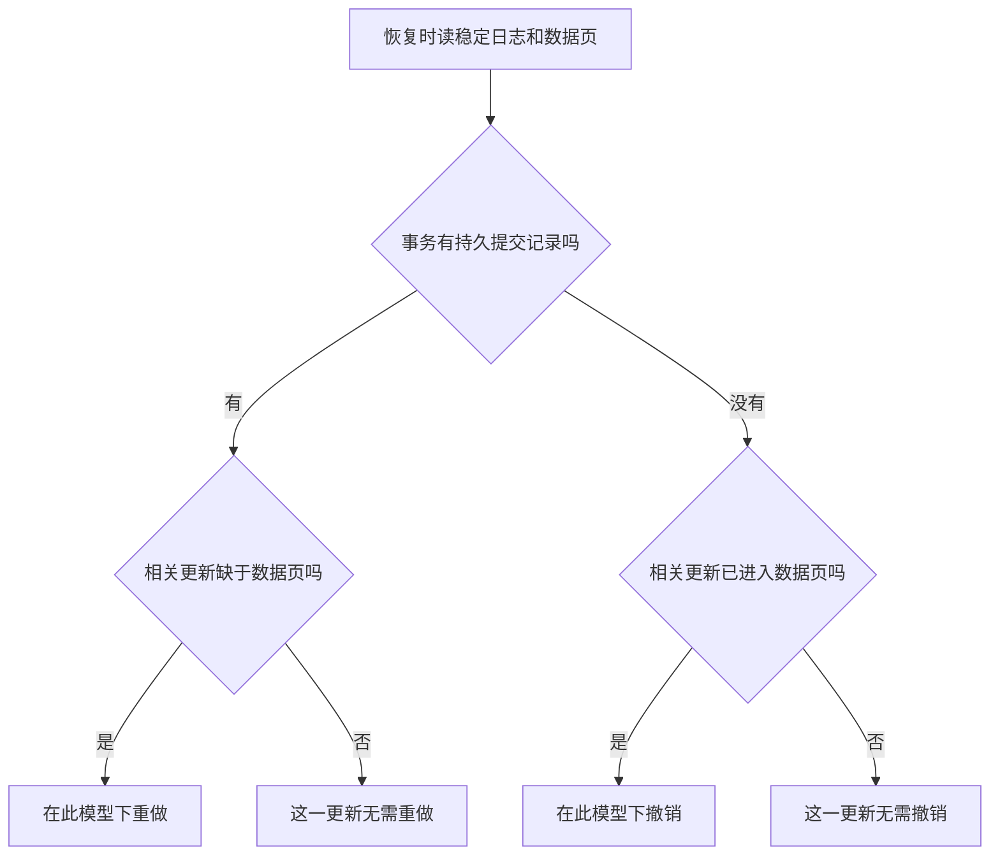

# 日志与事务恢复

一次提交为什么不能只把内存里的标记改成“已提交”？因为故障同时拿走了这枚标记和还没写盘的数据。反过来，如果脏页总是先落盘，故障时又可能留下未提交事务的一半更新。恢复的目标不是复现故障前的内存，而是让成功提交的效果没有遗失、未提交的效果没有残留。这里先讨论掉电后稳定存储仍完好的情形，再区分介质损坏。

## 数据库页与日志各负责什么

在教材的整块映像模型中，前像是一次更新前的块内容，便于撤销（Undo）；后像是更新后的块内容，便于重做（Redo）。不必把这一表示当作所有引擎的实现要求：日志也可以记录实现恢复所需的更新操作或局部变化。

- **提交规则**：确认成功之前，已提交的状态必须可从稳定存储恢复。教材的表述是让后像持久化于数据库页或日志；如果采用提交记录标明事务状态，还须使它可恢复。仅写入内存缓冲区不能算持久。
- **先记后写规则（WAL）**：未提交事务的更新若可能随脏页落到稳定存储，恢复所需的撤销信息必须先持久化。更一般地，含某次更新的数据页不能抢在保护该更新的日志之前落盘。==先==约束的是稳定存储上的先后，不是先改内存页还是先填内存日志缓冲区。

> [!IMPORTANT]
> 判断恢复动作要分开问：**未提交的数据有没有可能已经写盘？已提交的数据有没有可能尚未写盘？** 提交时间和数据页落盘时间不是同一条时间轴。

## 看到落盘策略，如何判定恢复动作

| 题干给出的安排 | 未提交状态可能在稳定页？ | 已提交状态可能缺于稳定页？ | 简化模型下所需动作 |
| --- | --- | --- | --- |
| 允许提交前写页，确认前强制刷齐该事务的更新 | 是 | 否 | 可能需 Undo |
| 提交前禁止写入该事务的更新，确认时可不刷齐页 | 否 | 是 | 可能需 Redo |
| 允许提交前写页，确认时也不强制刷齐 | 是 | 是 | 两者都可能需要 |
| 提交前禁止写页，且保证确认成功时数据页均安全到位（须有可靠的发布机制） | 否 | 否 | 就上述两类页差异而言，两者均不需要 |

表中“允许提前写页”是 STEAL 的关键后果，“确认时强制页已持久”对应 FORCE 的判定条件。第四行不能靠逐页非原子写入来兑现两项约束；恢复元数据与介质灾难也不在这张表里。

> [!TIP]
> 题给活动事务表（ATL）和已提交事务表（CTL）时，用它们分辨事务状态；仍须再看页是否已落盘。题只说“事务已执行完最后一条语句”不能推出提交已持久。

## 一次故障，两类缺口

$T_1$ 把页 $A$ 的值从 10 改为 15，后像与提交记录已经持久，但数据页仍是 10；$T_2$ 把另一页 $B$ 从 30 改为 37，前像已持久、数据页已写为 37，但没有持久的提交记录。掉电时稳定数据页是 $(10,37)$。

**参考解答**：对 $T_1$ 重做 $A$ 得 15；对 $T_2$ 撤销 $B$ 得 30，恢复成 $(15,30)$。破题信号是==提交记录已持久但页没写==与==没有提交但页已写==同时出现。两项更新在不同页，互不覆盖；若同一对象连续被改动，不能乱序套用映像。正确的恢复需要遵守日志顺序与相应算法的页状态判定，不能盲目拿旧前像覆盖后来应保留的更新。

## 超出一次掉电：如何应对介质损坏

| 技术 | 能恢复到哪里 | 主要限制 |
| --- | --- | --- |
| 仅用可用备份 | 最近可用、可恢复的备份点 | 两次备份之间的更新可能丢失，备份本身也有成本 |
| 备份加日志 | 从备份基线重放可用的日志，可达到更近的可恢复点 | 依赖备份与日志链完整，不能一到检查点就不顾保留要求地删旧日志 |
| 多个副本 | 从未损坏且符合恢复条件的副本重建 | 副本必须有足够独立的失效模式；误删或共同环境故障可能同时影响多个副本 |

“有副本”不等于“有可回拨的历史”。先判断是进程或机器故障、介质毁损，还是错误修改已经传播，再决定靠事务日志、历史备份还是可用副本。
