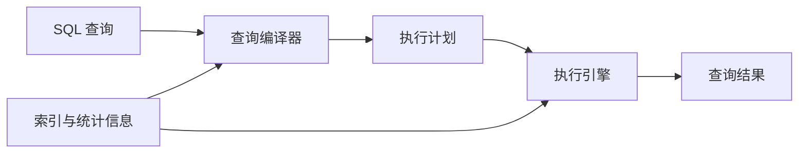

# 如何进行查询处理（查询响应与两个关键部件）

## 查询处理的目标

用户提交 SQL 查询后，DBMS 不能只保证“结果正确”，还要尽量缩短**查询响应时间**。例如，查询“选修数据库课程的学生姓名”，若直接把所有学生与所有选课记录做笛卡尔积，会产生大量无意义组合。因此，查询处理要解决的问题是：==把声明式查询转换成正确且高效的执行过程==。



## 两个关键部件

| 部件 | 主要任务 | 关注重点 |
|---|---|---|
| 查询编译器 | 解析、检查查询，进行逻辑优化与物理优化，生成执行计划 | 做什么、按什么顺序做、采用什么算法 |
| 执行引擎 | 按计划调用扫描、连接、选择、投影等操作，读写数据并返回结果 | 如何真正执行、如何减少 I/O 与中间结果 |

查询编译器类似“制定施工方案”，执行引擎类似“按方案施工”。==优化主要发生在查询编译阶段，实际数据访问由执行引擎完成==。

## 原始方案为什么低效

设学生关系为 $S$，选课关系为 $SC$，原始方案可以写成：

$$
\pi_{Sname}\bigl(\sigma_{S.Sno=SC.Sno\ \land\ Cname='数据库'}(S\times SC)\bigr)
$$

其执行顺序是：

1. **笛卡尔积**：生成 $S\times SC$；
2. **选择元组**：保留满足连接条件和课程条件的元组；
3. **进行投影**：只输出学生姓名。

若 $|S|=1000$、$|SC|=10000$，仅笛卡尔积就产生 $1000\times10000=10^7$ 个组合。即使最终只有 20 个结果，也已经构造了庞大的中间关系。

更合理的思路是：**先选择、尽早投影，再按连接条件组合关系**。若只有 100 名学生满足相关条件，就先缩小参与连接的数据，而不是先形成 $10^7$ 个组合。

> [!TIP]
> 解题时先找能否“下推”：选择下推可提前减少元组，投影下推可提前减少属性，二者都能减小后续操作的中间结果。

## 索引为什么能提高响应速度

索引是提高查询响应速度的“利剑”。没有索引时，查找指定学号可能需要扫描整张表；建立合适索引后，可以先定位少量数据页，再读取目标元组，从而减少磁盘 I/O。

但索引并非越多越好：它会占用存储空间，插入、删除和修改时还要维护索引。连接顺序、连接算法以及缓冲区使用同样影响响应速度，不能把查询优化简单等同于“建索引”。

> [!WARNING]
> 笛卡尔积本身不是错误，原始方案也能得到正确结果；问题是==执行代价过高==。另外，逻辑查询改写与物理执行计划不同：前者调整关系代数操作顺序，后者还要选择索引扫描、连接算法等具体实现。

## 一个算对了的例子

查询：

```sql
SELECT Sname
FROM S, SC
WHERE S.Sno = SC.Sno
  AND SC.Cno = 'C01';
```

原始方案先计算 $S\times SC$，再选择、投影。改进方案先执行 $\sigma_{Cno='C01'}(SC)$。假设 $SC$ 有 10000 条记录，其中只有 50 条选修 C01，则后续只需处理这 50 条选课记录，再与 $S$ 按学号连接并投影姓名。若 $SC.Sno$ 或 $S.Sno$ 上有合适索引，还能进一步减少扫描与连接开销。

最终姓名集合与原始方案完全相同，但中间结果显著缩小，查询响应通常更快。这正是查询处理与优化的核心价值：**结果不变，执行更省**。
